# IDE Architecture & Hot Reload System

This document outlines the design of the Mono GameMaker IDE, detailing how the editor separates authoring from execution, triggers background compilation, executes real-time script simulation via dynamic hot reloading, and uses reflection to build the inspector.

---

## 1. Architectural Separation: Authoring vs. Runtime

Mono GameMaker enforces a clean boundary between the IDE application and the user's game runtime.

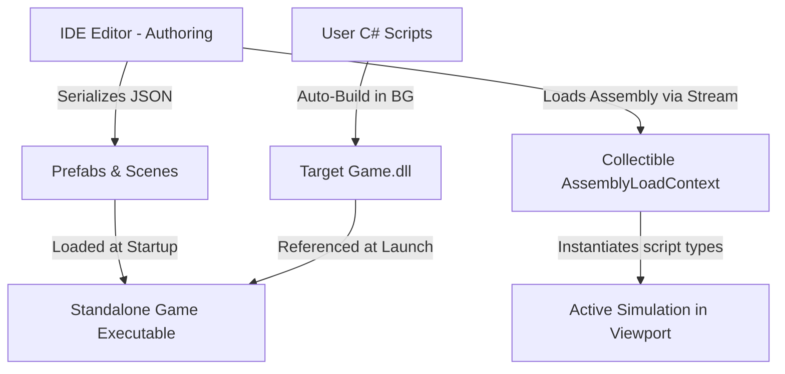

*   **Authoring (IDE)**: The editor is an ImGui-based visual editor (`IDE.csproj`). It reads, edits, and serializes scene configurations (`.json`) and prefab setups (`.prefab`). The IDE does not contain custom component scripts; it uses reflection to run user scripts inside the scene layout view.
*   **Runtime (Engine)**: The target game (`Game1.cs` scaffolded via `TemplateEngine.cs`) compiles into a standalone executable. It references the same shared contracts (`MonoGameMaker.Runtime`) inside `IDE.dll` to parse assets, build entities, and execute level loops without duplicate code.

---

## 2. Background Compilation & Hot Reload Flow

To make development fast and allow AI agents to test behavior changes in real time, the IDE implements a background compiler and dynamic assembly loader.

### Detailed Workflow

1.  **File Change Detection**:
    The IDE maintains a file watcher class `FileSystemCache.cs` monitoring the project directory. When a C# script file (`.cs`) inside the project is modified or created, it asynchronously fires:
    `Task.Run(() => AssemblyReloader.CompileAndLoad(...))`
2.  **Silent MSBuild Execution**:
    The service launches `dotnet build --configuration Debug` silently in the background using `ProcessStartInfo`. Output streams (Stdout/Stderr) are captured.
3.  **Log Redirection**:
    *   If compilation fails, the compiler output is captured and redirected to `GlobalState.Log(output)`.
    *   The `ConsoleLogsWindow` (ImGui logs panel) displays the compiler warning and error list instantly. This enables AI coding assistants or developers to identify syntax mistakes and recover without leaving the application.
4.  **Dynamic Assembly Load Context (ALC)**:
    *   To allow unloading previous assembly versions and prevent memory leaks, a collectible `CollectibleAssemblyLoadContext` (inheriting from `AssemblyLoadContext` with `isCollectible: true`) is instantiated.
    *   Before loading, the reload process triggers a strict deterministic cleanup:
        1. **`EntityManager.PurgeAllScripts()`** is invoked via reflection on the old assembly to dispose/teardown active scripts and clear static collections/reflection caches.
        2. A `WeakReference` is created pointing to the active `CollectibleAssemblyLoadContext`.
        3. The loaded assembly reference is cleared (`_loadedAssembly = null`), `Unload()` is called on the old context, and the load context reference itself is cleared (`_currentContext = null`).
        4. A forced collection loop runs up to 10 times executing `GC.Collect(GC.MaxGeneration, GCCollectionMode.Forced)` and `GC.WaitForPendingFinalizers()`, polling if the context is fully unloaded (`weakContext.IsAlive == false`).
        5. If the context is still alive, a warning is logged alerting about residual leaks.
5.  **Memory-Stream Assembly Loading (Zero-Lock)**:
    *   A typical assembly load locks the target `.dll` file, preventing subsequent compilation builds from overwriting the file.
    *   To bypass this, the file bytes are read into memory first:
        `byte[] dllBytes = File.ReadAllBytes(dllPath);`
    *   The assembly is loaded entirely from a memory stream:
        `loadContext.LoadFromStream(new MemoryStream(dllBytes))`
    *   This ensures the physical DLL file on disk remains unlocked at all times, allowing seamless continuous builds.

---

## 3. Reflection-Based Inspector

The IDE's property inspector (`InspectorWindow.cs`) dynamically adapts to the selected scene entity (`GlobalState.SelectedNode`) without hardcoded widget definitions.

### How it Works

1.  **Prefab Script Lookup**:
    When an entity is selected, the inspector looks up its prefab metadata to read the attached `ScriptName`.
2.  **Active Simulation Reflection**:
    If play mode simulation is active, the inspector searches the active simulated entity list inside the loaded assembly's `EntityManager.Entities`.
3.  **Reflection-Based Rendering**:
    The inspector obtains the type of the active script:
    `Type type = scriptInstance.GetType();`
    It loops through public fields and read-write properties using:
    *   `type.GetFields(BindingFlags.Public | BindingFlags.Instance)`
    *   `type.GetProperties(BindingFlags.Public | BindingFlags.Instance)`
4.  **ImGui Widget Mapping**:
    The inspector uses a switch-expression over the variable type to bind values to ImGui input widgets. Because ImGui edits variables using pointer references, local variables are modified and written back using reflection:
    ```csharp
    if (field.FieldType == typeof(float)) {
        float floatVal = (float)field.GetValue(obj);
        if (ImGui.DragFloat($"##F_{id}", ref floatVal))
            field.SetValue(obj, floatVal);
    }
    ```
5.  **Simulation Lockout**:
    When play mode is active, the scene data inputs are disabled using `ImGui.BeginDisabled()` to prevent coordinate corruption, while the inspector shows live script values.

---

## 4. Automatic Legacy Project Migration (ProjectMigrator)

To maintain backwards compatibility and simplify development workflows when legacy project folders are loaded into the editor, the IDE utilizes an automatic and idempotent migration pipeline (`ProjectMigrator.cs`).

### Core Mechanism

1.  **Trigger Points**:
    - **Open Project dialog**: Runs when a user opens an existing project through the IDE UI.
    - **Background compilation**: Triggers inside `AssemblyReloader.CompileAndLoad` to support command-line args or quick loads.
2.  **Upgrades Applied**:
    - **MSBuild Compliance**: Injects `<AllowUnsafeBlocks>true</AllowUnsafeBlocks>` and `<CopyLocalLockFileAssemblies>true</CopyLocalLockFileAssemblies>` to support the ImGui native vertex binding layout.
    - **Dependencies Synchronization**: Injects the appropriate `<PackageReference>` for `ImGui.NET` if it is missing.
    - **Script Signature Refactoring**: Scans all script classes under `Scripts/`. Converts inheritance syntax from the obsolete `: IEntityScript` interface to the abstract `EntityBehavior` class. Translates the legacy `Initialize(GameEntity, Dictionary<string, string>)` method signature into `public override void Awake()` while adjusting parameter name usages inside the method body.
3.  **Log Integration**:
    - Build diagnostic logs and migration output are routed directly to the `ConsoleLogsWindow` using `GlobalState.Log(...)`.

---

## 5. Simulation States & Focus-Based Input Isolation

To support proper play/pause simulation and protect user scripts from consuming inputs while the user interacts with the IDE, the framework implements a decoupled simulation lifecycle.

### State Transitions

- **Edit State**: Scripts do not run. Physics/animations are frozen. Camera is static.
- **Playing State**: Loop executes at a 60Hz fixed time step.
- **Paused State**: Script execution is halted. If `TriggerSingleFrame` is enabled, a single frame is updated (1/60th second step) and then paused state is restored.

### Focus-Based Interception Data Flow

1. **Focus Assessment**:
   The IDE determines if the game viewport has focus by querying ImGui:
   `GlobalState.IsViewportFocused = ImGui.IsWindowFocused(ImGuiFocusedFlags.ChildWindows)`
2. **Translation & Injection**:
   If focused, the real `KeyboardState` and viewport-translated `MouseState` are passed via reflection to the simulation assembly.
   If unfocused, empty instances (`new KeyboardState()`, `new MouseState()`) are sent, effectively isolating inputs.
3. **Global Shadowing**:
   User scripts use `global using Keyboard` and `global using Mouse` aliases pointing to shadow classes inside `MonoGameMaker.Runtime`. This abstracts the focus-based isolation layer from script code.

---

## 6. Selection Context & Command Pattern (Undo/Redo)

To support undo/redo capabilities and segregate monolithic state, the IDE isolates selections and property edits into distinct contexts and command objects.

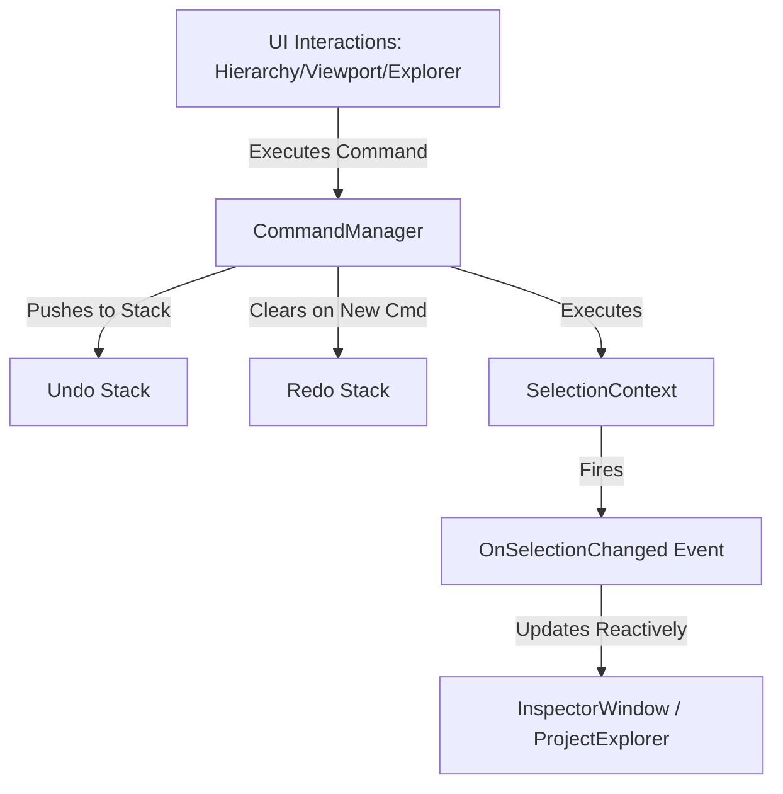

### Core Components

1.  **SelectionContext**:
    *   Manages active selected entity Guid (`SelectedEntityId`) and file paths (`SelectedResourcePath`).
    *   By storing only the entity's Guid, the SelectionContext decouples the IDE layer from direct object references of the dynamically loaded Runtime assembly, preventing memory leaks during assembly unloading.
    *   Dispatches `OnSelectionChanged` event whenever a selection changes, enabling reactive UI updates instead of periodic polling.
2.  **CommandManager**:
    *   Maintains an `IEditorCommand` history stack (`_undoStack` and `_redoStack`).
3.  **IEditorCommand**:
    *   Exposes `Execute()` and `Undo()` contracts.
    *   **`SelectNodeCommand` & `SelectResourceCommand`**: Wraps selection state changes.
    *   **`ChangePropertyCommand`**: Wraps mutations to entity properties (e.g. coordinates `x`, `y`, or values in `CustomProperties`).
4.  **Obsolete wrappers on GlobalState**:
    *   Redirects legacy code reads to `SelectionContext` (resolving the EntityInstance dynamically from the active scene by Guid) and writes to `CommandManager.ExecuteCommand`, maintaining backwards compatibility (Strangler Fig Pattern).
5.  **Keyboard Shortcuts**:
    *   Intercepts Ctrl+Z and Ctrl+Y key-press transitions via `InputManager` to invoke `CommandManager.Undo()` and `Redo()`.

---

## 7. Deterministic State Hydration & GUID Persistence

To prevent referential integrity loss during scene loads and runtime hot reloading, the ecosystem implements deterministic GUID synchronization between disk representations and live engine memory.

### Serialization Data Flow

1. **Persistent State Storage**:
   Scene configurations serialize entity layouts, including their unique identifiers (`Id` of type `Guid`), to `scene_init.json`.
2. **JSON Loading (IDE & standalone)**:
   The `SceneSerializer.cs` reads the file. If an `"Id"` property exists, it parses it to preserve the exact same GUID. If it does not exist (backward compatibility), a new GUID is generated.
3. **Reflective Viewport Hydration**:
   During simulation start in the editor, the IDE resolves the loaded assembly's `MonoGameMaker.Runtime.GameEntity` type via reflection, instantiates it, and sets its `Id` property to the parsed disk ID.
4. **Runtime Scene Instantiation**:
   The scaffolded `SceneLoader.cs` initializes entities by mapping their `EntityInstance.Id` directly to the `GameEntity.Id` via the parameterized constructors/hydration methods, rather than generating a fresh random Guid in the default constructor.

---

## 8. Rendering & Post-Processing Pipeline

The Mono GameMaker engine incorporates a physically-based shading model and multi-pass post-processing pipeline for 2.5D and 3D scenes.

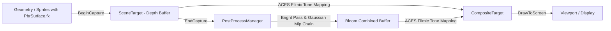

### Key Subsystems:
1. **PBR Surface Shading (`PbrSurface.fx`)**:
   - Implements Blinn-Phong/Schlick-Fresnel specular models, metallic/roughness parameters, alpha cutout discard, and tangent-space normal mapping.
   - Computes combined directional lighting and distance-attenuated point lights with unclamped HDR emissive contributions.
2. **Materials & Texture Processing Pipeline (`PbrMaterial.cs` & `TextureProcessor.cs`)**:
   - **`PbrMaterial`**: Unifies Albedo, Tangent Normal, and Emissive maps with optical properties (`Roughness`, `Metallic`, `EmissiveIntensity`, `AlphaCutoff`) and automatically maps uniforms onto HLSL effects.
   - **`TextureProcessor`**: Runtime procedural processing providing background keying with smooth anti-aliased Hermite falloff, 3x3 Sobel luminance-to-tangent normal map generation, HSV neon emissive mask extraction, and one-liner PBR material instantiation from raw images.
3. **Post-Processing Pipeline (`PostProcessManager.cs` & `BloomEffect.fx`)**:
   - Manages offscreen HDR render targets (`SceneTarget`, `CompositeTarget`) and multi-tier downsampled mip chains (1/2, 1/4, 1/8).
   - Extracts bright spots via smooth-knee thresholding and applies separable 9-tap Gaussian blurs across mip levels.
   - Applies ACES Filmic Tone Mapping during composite pass to map high dynamic range colors gracefully to LDR backbuffers.
   - Provides an automatic zero-crash SpriteBatch software fallback when running without compiled shader binaries.

---

## 9. 3D/2.5D Camera System & Screen-Space Raycasting

The `Camera3D` system manages 3D perspective projection, trauma-based screen shake, and unprojection raycasting for 2.5D and 3D gameplay:

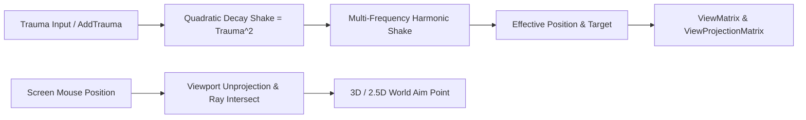

### Key Subsystems:
1. **Trauma Screen Shake**: Non-linear quadratic displacement ($Trauma^2$) with multi-frequency harmonic sinusoidal oscillations across camera translation (Right, Up, Forward) and rotation (Pitch, Yaw, Roll).
2. **Raycasting & Unprojection**: Exact mathematical intersection of mouse screen rays with arbitrary 3D planes ($Z = \text{planeZ}$ or custom `Plane`), providing precise cursor aiming in 2.5D top-down and 3D scenes.
3. **Projection Helpers**: Fast screen-space projections (`WorldToScreen2D`) for rendering HUD overlays, health bars, and indicators above world entities.

---

## 10. Volumetric 3D/2.5D Particle System

The `ParticleSystem3D` engine delivers high-density, zero-allocation visual effects tailored for high-action gameplay:

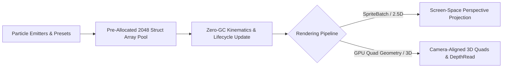

### Key Subsystems:
1. **Zero GC Memory Guarantee**: Fixed pre-allocated `Particle3D[2048]` struct array with $O(1)$ recycling of inactive slots, pre-allocated vertex/index buffers, and GPU-cached fallback glow textures.
2. **Out-of-the-Box Presets**: Ready-to-use parameterized generators for multi-stage explosive blasts, directional spark cones, radial shockwave rings, and spacecraft engine thrusters.
3. **Dual Pipeline Rendering**: Fast 2D projected billboards via `SpriteBatch` and hardware-accelerated 3D camera-facing billboard quads via `DrawUserIndexedPrimitives` with depth-buffer compliance and additive/alpha blending modes.

---

## 11. The Space Combat Pipeline & CombatContext Lifecycle

The Phase 3 runtime extensions introduce an allocation-free combat architecture designed to support dense bullet-hell dogfights without GC frame drops:

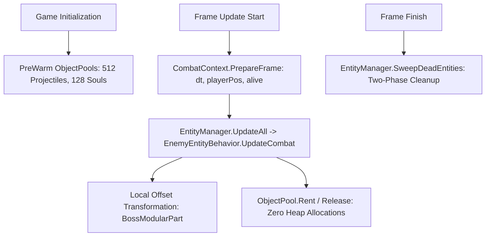

### Key Subsystems:
1. **`CombatContext` Parameter Consolidation**: Replaces 10+ chained parameters across behaviors with a single pre-allocated context object, refreshed every frame via `PrepareFrame` with zero heap allocation.
2. **`ObjectPool<T>` Zero-GC Memory Guarantee**: Replaces `new` and garbage-collected allocations in gameplay with pre-warmed $O(1)$ LIFO object recycling implementing `IPoolable` (`OnSpawn`, `OnDespawn`, `Reset`).
3. **`GameFlowController`**: Decouples application life cycle, scene transitions (Title, Hub, Combat, Intermission, Game Over), and view routing from the persistence authority `GameState`.

---

## 12. Multiplatform Native Engine Services (Zero-PInvoke & Managed Audio)

To achieve 100% cross-platform parity across Linux (DesktopGL/SDL2), macOS, and Windows without Win32 dependency locks:

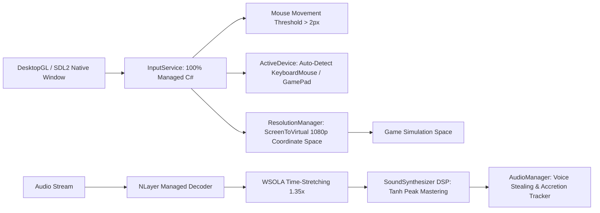

### Key Subsystems:
1. **Expurged P/Invoke & Managed Input**: Completely eliminates `user32.dll` and `kernel32.dll` calls (`GetAsyncKeyState`, `GetCursorPos`, `ScreenToClient`). Input is read strictly through MonoGame/SDL2 window abstractions with auto-detection of active controller device.
2. **`ResolutionManager` Virtual 1080p Space**: Projects mouse client pixels into virtual $1920 \times 1080$ design space via `ScreenToVirtual`, handling dynamic pillarbox and letterbox compensation matrices uniformly.
3. **Pure Managed Audio Pipeline (`NLayer` + DSP Synthesis)**:
   - **`SoundSynthesizer`**: Mathematical procedural synthesis of 16-bit 44.1kHz mono PCM buffers with hyperbolic tangent ($\tanh$) soft analog saturation mastering and strict 5% tail zeroing.
   - **`AudioManager`**: Semantic category voice limiter (voice stealing), timestamp throttling, and 120ms explosion accretion stacking.
   - **`Mp3AudioLoader`**: Cross-platform MP3 decoding with WSOLA speech time-stretching without pitch shift and cockpit Schroeder reverb.
4. **Resilient Typography (`BitmapFontRenderer` & `TextRenderer`)**: Built-in 5x7 matrix font in pure C# with full Latin-1 Portuguese support, acting as an uncrashable fallback when compiled `.xnb` fonts are absent.

---

## 13. Procedural 3D Mesh & Hybrid Shading Architecture

Enables 3D and 2.5D visual depth through procedural geometry generators and specialized HLSL shaders:

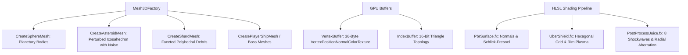

### Key Subsystems:
1. **`Mesh3D` & `Mesh3DFactory`**: Encapsulates GPU vertex buffers with 36-byte sequential vertices (`Position`, `Normal`, `Color`, `TextureCoordinate`) and index buffers. Features in-memory procedural generation of UV spheres, organically perturbed noise asteroids with recalculation of smooth surface normals, and faceted wedge shards.
2. **Procedural Starship Carapaces**: Generates complex multi-part fighter hulls, alien interceptors, solar raiders, and colossal multi-tiered titan boss meshes in pure code without loading external model assets.
3. **Complete HLSL Shader Suite**: Encapsulates `BloomEffect.fx`, `PbrSurface.fx`, `PostProcessJuice.fx`, `UberShield.fx`, `Hologram.fx`, `Vortex.fx`, and `ColorQuantization.fx`.

---

## 14. Headless Automated Testing & Zero-GC Verification Suite (Fase 3)

Garante a blindagem contínua de regressão técnica e determinismo físico através de execução 100% headless em terminais Linux/CI:

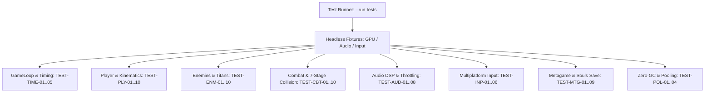

### Arquitetura de Testes:
1. **Desacoplamento Headless**: Utiliza `HeadlessGraphicsDeviceFixture` (viewports 1080p sem GPU nativa), `HeadlessAudioContext` (relógio temporal virtual sem OpenAL físico) e `InputSimulationFixture` (injeção programática de teclado, mouse e joysticks).
2. **Protocolo Zero-GC em Combate Ativo**: Medição cirúrgica com `GC.GetAllocatedBytesForCurrentThread()` antes e após 10.000 iterações de combate pré-aquecido (`TEST-POL-04`), exigindo rigidamente 0 bytes alocados no Heap.
3. **Expurgo de P/Invoke por Reflection**: Varredura estática de assemblies via Reflection (`TEST-INP-04`) garantindo 0 atributos `[DllImport]` de bibliotecas Win32 (`user32.dll`, `kernel32.dll`).
4. **Execução Padronizada**: Acionada nativamente via `dotnet run --project src/TestConsole/TestConsole.csproj -- --run-tests` com exit code 0 em 100% de aprovação.

---

## 15. Mass RTS Simulation Architecture (Spatial Grid, Flow Field, Fog & GPU Instancing)

Incorpora capacidades de simulação e controle militar em larga escala (500 a 1.000 unidades a 60+ FPS) sem comprometer o ciclo de atualização nem a responsividade do editor:

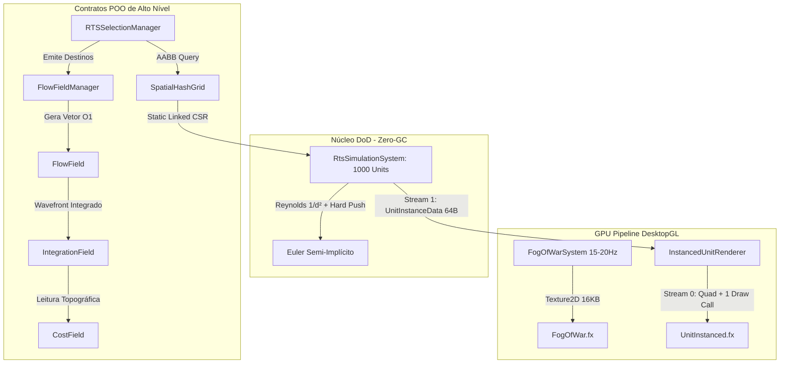

### Pilares da Arquitetura RTS:
1. **Desacoplamento do Monólito `EntityManager`:**
   As 1.000 unidades militares operam em buffers contíguos de memória sob o `RtsSimulationSystem`. Elas não existem como instâncias individuais de `GameEntity` na lista global de atualização da engine, impedindo a sobrecarga do Inspector e a degradação do Garbage Collector.
2. **Particionamento Espacial CSR (`SpatialHashGrid`):**
   Utiliza três arrays lineares contíguos (`cellHead`, `nextEntity`, `entityCell`), mantendo toda a indexação espacial em apenas $24\text{ KB}$ de memória (100% contido no Cache L1 da CPU). Fornece consultas em $O(1)$ para separação mútua e seleção por caixa.
3. **Navegação Vetorial de Três Camadas (`CostField` $\to$ `IntegrationField` $\to$ `FlowField`):**
   Inverte a complexidade clássica de $N$ buscas A\* para uma única expansão Wavefront/Dijkstra Zero-GC por destino. Tropas navegam por amostragem vetorial contínua com interpolação bilinear em $O(1)$.
4. **Névoa de Guerra Desacoplada (`FogOfWarSystem`):**
   Ciclo de linha de visão a 15-20 Hz gerando máscara dinâmica `SurfaceFormat.Alpha8` (64 KB para mapas de 256x256). O shader HLSL `FogOfWar.fx` interpola suavemente as fronteiras com curvas Hermite `smoothstep` e desaturação na penumbra.
5. **GPU Hardware Instancing (`InstancedUnitRenderer`):**
   Desenha 1.000 unidades militares com animação de atlas UV e coloração personalizada de facção (*Team Color*) em uma única Draw Call via `DrawInstancedPrimitives` no MonoGame DesktopGL.

---

## 16. Autonomous Scaffolding & Zero-Friction Multiplatform Distribution (`TemplateEngine`)

O subsistema `TemplateEngine` (`MonoGameMaker.IDE.Core.TemplateEngine`) governa a criação e sincronização de novos projetos de jogos dentro do ecossistema MonoGameMaker, garantindo paridade total de recursos, documentação atômica embutida e compilação instantânea sem dependências de sistema operacional:

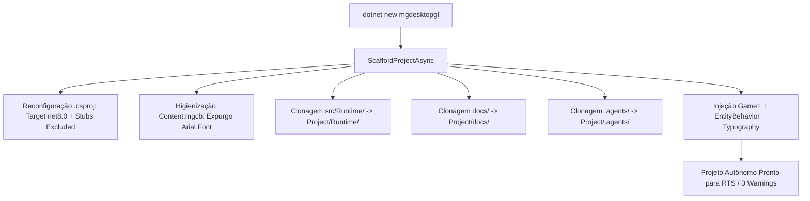

### Pilares da Arquitetura de Scaffolding:
1. **Distribuição Completa de Subsistemas de Runtime:**
   Todo projeto recém-criado recebe a árvore completa de runtime do MonoGameMaker (`Spatial`, `Pathfinding`, `Simulation`, `Vision`, `Selection`, `Graphics3D`, `Audio`, `Pooling`, `Resolution`, `Typography`, `Combat`, `Shaders`). O desenvolvedor ou agente de IA pode invocar simulações RTS massivas ou combate estilo Space sem necessidade de portar bibliotecas externas.
2. **Documentação e Regras Embutidas (Doc-as-Code & Agent Governance):**
   A árvore `docs/` (com todos os manuais atômicos e `RUNTIME_API_REFERENCE.md`) e as regras `.agents/rules/monogamerules.md` são replicadas diretamente no projeto scaffolded. Isso garante que qualquer agente de IA ou desenvolvedor operando no diretório do jogo tenha acesso imediato a todas as assinaturas, contratos e guias de uso sem consultar o repositório da engine.
3. **Resiliência Multiplataforma no Linux (Zero-Dependency Font Build):**
   O template original do MonoGame DesktopGL cadastra `Fonts/default.spritefont` associado à fonte proprietária Arial no `Content.mgcb`, causando falhas fatais de compilação em distribuições Linux sem fontes Microsoft. O `TemplateEngine` higieniza o `Content.mgcb` expurgando essa referência e conectando o pipeline nativo ao `BitmapFontRenderer` procedural (Zero-GC, 100% C# gerenciado).
4. **Isolamento de Stubs no Compilador:**
   O `.csproj` do projeto scaffolded injeta automaticamente diretivas `<Compile Remove="Runtime\Docs\**" />` e `<None Include="Runtime\Docs\**" />`. Isso preserva o arquivo `RUNTIME_SUMMARY.cs` para consulta estática de IAs sem provocar erros de duplicação de tipos no MSBuild.
5. **Sincronização Contínua (`SyncRuntimeFiles`):**
   Permite atualizar projetos existentes com as últimas inovações da engine com uma única chamada, higienizando arquivos obsoletos e sincronizando documentação atômica.


