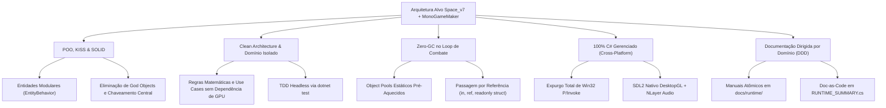
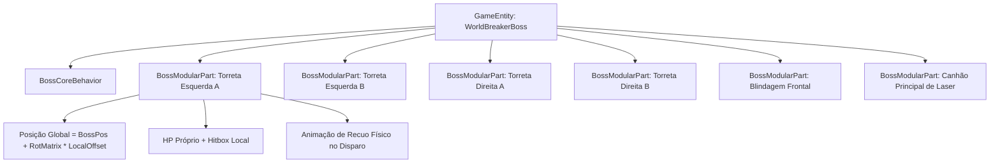
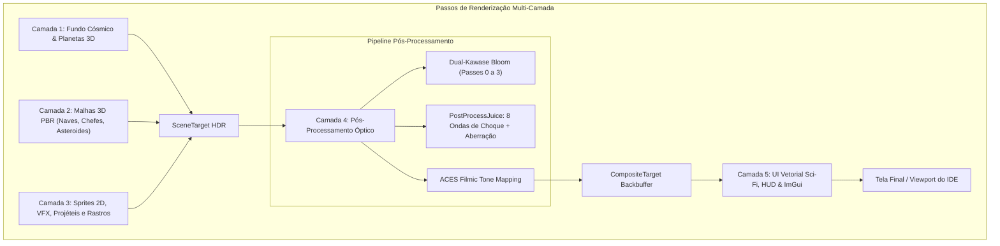

# Plano Diretor de Arquitetura de Software — Transição Space_v7 para MonoGameMaker
**Fase 2: Arquitetura Definitiva, Decomposição de Entidades e Extensões de Runtime**  
**Projeto de Origem:** `/home/bruno/Projects/Space_V7`  
**Projeto de Destino:** `/home/bruno/Projects/MonoGameMaker`  
**Autor:** Especialista em Arquitetura de Sistemas (Staff Software Architect)  
**Data:** 06 de Outubro de 2026 | **Ambiente:** .NET 8.0 / MonoGame DesktopGL (SDL2)  
**Status:** Especificação Arquitetural Concluída e Pronta para Execução  

---

## 1. Visão Geral da Arquitetura Alvo & Filosofia de Engenharia

A portabilidade do projeto **Space_v7** (135.999 LOC totais, sendo 109.254 LOC de código de produção distribuídos em 272 arquivos) para a engine **MonoGameMaker** representa a união entre a maturidade de simulação física, matemática balística e síntese audiovisual do jogo original com a arquitetura moderna, modular e orientada a componentes da nova engine.

A arquitetura alvo é projetada sobre cinco pilares fundamentais e inegociáveis:



### 1.1 Princípios Fundamentais

1. **Programação Orientada a Objetos com Encapsulamento Rígido e KISS (Keep It Simple, Stupid):**  
   Cada classe possui uma fronteira de responsabilidade coesa e inequívoca. Evitam-se abstrações prematuras ou camadas especulativas de indireção: estruturas simples e composições diretas de objetos substituem redes complexas de herança múltipla.
2. **SOLID e Clean Architecture:**  
   - **S (Single Responsibility):** O monolito `Player.cs` (2.732 LOC) e o monolito `SectorManager.cs` (5.927 LOC) são estritamente decompostos em subsistemas focados.
   - **O (Open/Closed):** O sistema de armas, mutatores de RAM e arquétipos de inimigos operam via interfaces e extensões, permitindo novos comportamentos sem alteração do código central.
   - **L (Liskov Substitution):** Todos os comportamentos herdam de `EntityBehavior` do MonoGameMaker, garantindo que o `EntityManager` e o Inspector com Reflection interajam de forma homogênea com qualquer entidade da simulação.
   - **I (Interface Segregation):** Contratos enxutos e estritos (`IPoolable`, `ISceneView`, `IViewController`).
   - **D (Dependency Inversion):** A simulação lógica não referencia diretamente o monolito `Game1` nem o hardware gráfico; as entidades consomem dependências através do padrão Context Object (`CombatContext`).
3. **Política Estrita Zero-GC em Tempo de Execução:**  
   Durante o combate ativo a 60 FPS (onde centenas de tiros, partículas, escombros e almas coexistem na arena), **nenhum objeto de memória gerenciada (heap) deve ser instanciado via `new` no loop de frame**. Todo recurso dinâmico provém de piscinas de objetos (`ObjectPool<T>`), estruturas são modeladas como `readonly struct` e alocações ocorrem estritamente na carga de cena ou fase de boot.
4. **100% C# Gerenciado e Multiplataforma Nativo:**  
   Eliminação categórica de todas as chamadas P/Invoke para `user32.dll` e `kernel32.dll`. A engine roda de forma idêntica no Linux (Ubuntu/Debian/Arch via X11 ou Wayland), macOS (Metal/OpenGL) e Windows através da abstração SDL2 do MonoGame DesktopGL e decodificação de áudio puramente gerenciada via biblioteca `NLayer`.
5. **Aderência às Ferramentas Visuais e Hot Reload do MonoGameMaker:**  
   Ao converter as entidades do jogo em classes derivadas de `EntityBehavior`, elas passam a ser expostas dinamicamente ao Inspector com Reflection e ao `CollectibleAssemblyLoadContext` do editor, viabilizando ajuste de atributos em tempo real e recompilação em segundo plano sem reiniciar a aplicação.

---

## 2. Resolução de Débitos e Conflitos do Space_v7

A auditoria arquitetural da Fase 1 identificou três débitos estruturais críticos na base original do Space_v7 que exigem correção cirúrgica para integração ao MonoGameMaker.

### 2.1 Eliminação do God Object `Game1`

O arquivo `Game1` original agregava 4.802 linhas em quatro arquivos parciais (`Game1.cs`, `Game1.InputHandling.cs`, `Game1.Rendering.cs`, `Game1.StateFlow.cs`), exercendo simultaneamente o papel de bootstrap, roteador de input, gerenciador de coleções vivas, despachante de ondas e renderizador de 13 interfaces sobrepostas (*overlays*).

```mermaid
graph TD
    subgraph Arquitetura Legada Space_v7 (Acoplada)
        G1[Game1 God Object - 4.802 LOC]
        G1 --> Lists[Listas Vivas: Enigmas, Tiros, Almas, Asteroides]
        G1 --> InputRouter[Input Switch Gigante]
        G1 --> OverlaySwitch[Render Switch de 13 Overlays]
    end

    subgraph Arquitetura Alvo MonoGameMaker (Desacoplada)
        Boot[GameBoot.cs / Runner] --> GFC[GameFlowController]
        GFC --> SM[MonoGameMaker.Runtime.SceneManager]
        SM --> CurrentScene[ISceneController / ISceneView]
        CurrentScene --> EM[MonoGameMaker.Runtime.EntityManager]
        CurrentScene --> Ctx[CombatContext]
        CurrentScene --> UIViews[ViewControllers Isolados]
    end
```

#### Solução Arquitetural:
1. **`GameFlowController`:** Substitui a máquina de estados dispersa de `Game1.StateFlow.cs`. Controla o ciclo de vida global da aplicação, transições entre Hub, Seleção de Nave, Combate e Telas de Derrota/Vitória.
2. **`CombatSceneController`:** Assume a orquestração do loop de combate ativo, encapsulando o `WaveManager`, `CollisionSystem` e a injeção do `CombatContext`.
3. **Padrão View Controller Desacoplado (`ISceneView` / `IViewController`):**  
   Os 13 modais e menus do jogo (`MainHubView`, `EquipmentTab`, `BlueprintsTab`, `MerchantView`, `RamDraftView`, `PauseModal`, `GameOverModal`, `HostileIntelCodexView`, etc.) são extraídos para classes autônomas. Cada view implementa:
   ```csharp
   public interface IViewController
   {
       bool IsActive { get; set; }
       void Enter();
       void Exit();
       void Update(float dt, InputService input);
       void Draw(SpriteBatch spriteBatch, ResolutionManager resolution);
   }
   ```
   Dessa forma, o método central de desenho deixa de possuir um `switch` de 1.000 linhas, delegando a renderização apenas para os controladores registrados na pilha ativa de visualização.

---

### 2.2 Eliminação de Parameter Tunneling: A Classe `CombatContext`

No Space_v7 original, métodos centrais como `Player.Update`, `EnemyBase.Update`, `Asteroid3D.Update` e `CollisionSystem.Update` exigiam a passagem direta de 10 a 20 argumentos em cadeia a cada quadro.

#### Especificação Técnica Canônica do `CombatContext`

O padrão **Context Object** unifica todos os recursos e serviços que o ecossistema de combate necessita, operando como uma instância única, pré-alocada e injetada no início do frame pela cena de combate:

```csharp
namespace MonoGameMaker.Runtime.Combat;

using System;
using Microsoft.Xna.Framework;
using MonoGameMaker.Runtime.Audio;
using MonoGameMaker.Runtime.Graphics3D;
using MonoGameMaker.Runtime.Input;
using MonoGameMaker.Runtime.Pooling;

/// <summary>
/// Objeto de contexto que unifica os serviços de combate, eliminando o parameter tunneling.
/// Reutilizado a cada frame (Zero-GC) e injetado nos comportamentos de entidade.
/// </summary>
public sealed class CombatContext
{
    // --- Tempo e Escala de Simulação ---
    public float DeltaTime { get; private set; }
    public float WorldDeltaTime { get; private set; }
    public float TotalGameTime { get; private set; }
    public bool IsTimeDilated { get; set; }

    // --- Câmera e Percepção ---
    public Camera3D Camera { get; init; } = null!;

    // --- Efeitos Visuais & Iluminação ---
    public ParticleSystem3D Particles { get; init; } = null!;
    public LightingRenderer Lighting { get; init; } = null!;
    public PostProcessJuiceManager Juice { get; init; } = null!;

    // --- Áudio & DSP ---
    public AudioManager Audio { get; init; } = null!;
    public SoundSynthesizer SoundSynth { get; init; } = null!;

    // --- Entrada do Jogador ---
    public InputService Input { get; init; } = null!;

    // --- Balística e Pools de Objetos ---
    public ObjectPool<LaserProjectile> ProjectilePool { get; init; } = null!;

    // --- Coordenadas do Jogador para Rastreamento de IA ---
    public Vector3 PlayerPosition { get; set; }
    public bool IsPlayerAlive { get; set; }

    // --- Gatilhos de Eventos Globais ---
    public Action? OnEmpDetonation { get; set; }
    public Action? OnCryoDetonation { get; set; }
    public Action<int>? OnScoreAdded { get; set; }

    /// <summary>
    /// Atualiza as variáveis dinâmicas de quadro antes da propagação da simulação.
    /// </summary>
    public void PrepareFrame(
        float dt, 
        float worldDt, 
        float totalTime, 
        Vector3 playerPos, 
        bool playerAlive)
    {
        DeltaTime = dt;
        WorldDeltaTime = worldDt;
        TotalGameTime = totalTime;
        PlayerPosition = playerPos;
        IsPlayerAlive = playerAlive;
    }
}
```

#### Comparativo de Assinatura:
* **Antes (Legado Space_v7):**
  ```csharp
  public virtual void Update(
      float dt, Vector3 playerPos, List<LaserProjectile> projectiles,
      AssetManager assets, ParticleSystem3D particles, SoundSynthesizer sound,
      LightingRenderer lighting, Camera3D camera) // 8 a 10 parâmetros acoplados
  ```
* **Depois (MonoGameMaker):**
  ```csharp
  public virtual void UpdateCombat(CombatContext ctx) // 1 parâmetro elegante e coeso
  ```

---

### 2.3 Resolução da Colisão de Nomenclatura de `GameState`

O Space_v7 definia internamente `public enum GameState` para indicar telas (`Loading`, `MainHub`, `Playing`, etc.), colidindo diretamente com a classe estática oficial de persistência `MonoGameMaker.Runtime.GameState`.

#### Diretriz de Resolução:
1. O enum de telas do jogo de combate é renomeado para **`GameFlowState`**:
   ```csharp
   namespace Space_v7.Core;

   public enum GameFlowState
   {
       BootLoading,
       TitleScreen,
       ProfileSelect,
       MainHub,
       SystemMap,
       SectorBriefing,
       PlayingCombat,
       CombatPaused,
       MerchantIntermission,
       UpgradeDraft,
       RamDraft,
       GameOver,
       Victory,
       TutorialGlitchPrompt,
       DevSandbox
   }
   ```
2. A classe **`MonoGameMaker.Runtime.GameState`** preserva integralmente seu contrato oficial, atuando como a autoridade de persistência do metagame:
   - Armazenamento de perfil ativo (`ActiveProfileId`).
   - Saldo de almas salvas no posto avançado (`PermanentSoulsCount`).
   - Mochila de Blueprints coletadas na run ativa (`StashedBlueprints`).
   - Configurações globais serializadas em JSON (`VolumeSfx`, `VolumeBgm`, `ResolutionScale`).

---

## 3. Decomposição de Entidades em MonoGameMaker (`GameEntity` & `EntityBehavior`)

No modelo do MonoGameMaker, entidades vivas são instâncias de `GameEntity`, coordenadas pelo `EntityManager`, cuja lógica de negócio reside em componentes desacoplados herdando de `EntityBehavior`.

### 3.1 Decomposição Modular do Jogador (`Player`)

O arquivo original `Player.cs` (2.732 LOC) é decomposto em 6 comportamentos modulares operando sobre a mesma `GameEntity`:

```mermaid
graph TD
    PE[GameEntity: Player] --> B1[PlayerMotorBehavior]
    PE --> B2[PlayerDashBehavior]
    PE --> B3[PlayerHealthBehavior]
    PE --> B4[PlayerWeaponSystemBehavior]
    PE --> B5[PlayerTacticalSlotsBehavior]
    PE --> B6[PlayerRamLoadoutBehavior]

    B1 -->|Aceleração, Drag, Roll/Pitch 3D| Physics[Transform / Kinematics]
    B2 -->|Invulnerabilidade, Fita de Rastro, Efeitos| Dash[Boost Mechanics]
    B3 -->|Casco, Escudo, Shield Break, Nova Burst| Health[HealthController]
    B4 -->|Disparo Rápido, Capacitor de Tiro Carregado 3 Tiers| Weapon[WeaponPipeline]
    B5 -->|Slot Q: EMP / Nova | Slot E: Crio / Nanorepairs| Tactical[TacticalSlotState]
    B6 -->|Cadeia Topológica: Dano -> CDR -> Vel -> Cadência| Stats[StatContainer]
```

#### Responsabilidades dos Comportamentos:
1. **`PlayerMotorBehavior`:**
   - Vetor de aceleração inercial e velocidade máxima clampada.
   - Aplicação de arrasto exponencial ($V \mathrel{-}= V \times \text{drag} \times dt$).
   - Amortecimento dinâmico em caso de lentidão criogênica ($\text{drag} \times 0.40$).
   - Inclinação procedural 3D na malha (`RollAngle` e `PitchAngle` interpolados via `Lerp`).
2. **`PlayerDashBehavior`:**
   - Consumo de `BoostEnergy` com atraso de recarga passiva.
   - Estado de invulnerabilidade ativa (`IsInvulnerable = true`).
   - Disparo de rastro visual de fita dupla (`RibbonTrailRenderer`).
   - Execução de mutações táticas instaladas (muralha criogênica `CryoWallHazard`, rastro de fogo `FireTrailHazard`, lâminas de plasma periféricas ou minas sísmicas).
3. **`PlayerHealthBehavior`:**
   - Encapsula o `HealthController` e a mitigação de dano por blindagem.
   - Lógica do escudo de energia com recarga retardada pós-dano (`ShieldRechargeDelay`).
   - Detecção de quebra de escudo: disparo de micro-hitstop de 90ms, onda de choque esférica (`ShockwaveManager`), áudio de colapso de barreira e acionamento de `NovaBurst`.
4. **`PlayerWeaponSystemBehavior`:**
   - Ciclo de tiro primário alternando pontos de disparo físicos (*hardpoints* nas asas e nariz).
   - **Capacitor de Tiro Carregado Autônomo:** Ao soltar o gatilho, acumula energia até 3 tiers:
     - Partículas em espiral centrípeta convergem para o bico da nave.
     - Transição de cor (Azul elétrico $\to$ Ciano de alta densidade $\to$ Branco-ouro radiante).
     - Primeiro tiro liberado causa até $4.0\text{x}$ de dano com perfuração penetrante (*piercing*), recuo físico da nave e screen shake proporcional.
5. **`PlayerTacticalSlotsBehavior`:**
   - Gerencia Slot 1 (Q: Super EMP / Nova Burst) e Slot 2 (E: Bomba Criogênica / Kit de Nanorrepairs).
   - Cooldown independente com redução de tempo de recarga (CDR) fornecida por atributos.
6. **`PlayerRamLoadoutBehavior`:**
   - Armazena os módulos de RAM instalados na nave.
   - Executa o algoritmo cíclico de conversão topológica de atributos:
     $$\text{Dano} \xrightarrow{} \text{CDR} \xrightarrow{} \text{Velocidade} \xrightarrow{} \text{Cadência} \xrightarrow{} \text{Dano}$$
   - Atualiza o `StatContainer` e publica valores em propriedades públicas visíveis no Inspector da engine.

---

### 3.2 Os 43 Inimigos e 12 Chefes com Partes Modulares (`BossModularPart`)

Todos os inimigos compartilham uma base comum adaptada ao ciclo do MonoGameMaker:

```csharp
namespace MonoGameMaker.Runtime.Combat;

/// <summary>
/// Comportamento base para todas as naves e entidades hostis da simulação.
/// </summary>
public abstract class EnemyEntityBehavior : EntityBehavior
{
    public float Health { get; set; }
    public float MaxHealth { get; set; }
    public float Radius { get; set; }
    public float Damage { get; set; }
    public int ScoreValue { get; set; }
    public bool IsDead => Health <= 0;

    public virtual void TakeDamage(float amount, CombatContext ctx)
    {
        Health -= amount;
        if (Health <= 0)
        {
            Die(ctx);
        }
    }

    public abstract void UpdateCombat(CombatContext ctx);
    public abstract void Die(CombatContext ctx);
}
```

#### Escalonamento Infinito por Setor (`StageDifficultyService`):
O método de inicialização dos inimigos aplica as equações formais mapeadas na Fase 1:
$$\text{MaxHealth} = \text{baseHp} \times \max(0, 1 + 0.15 \times (\text{StageLevel} - 1))^{1.1}$$
$$\text{Damage} = \text{baseDmg} \times \max(0, 1 + 0.10 \times (\text{StageLevel} - 1))$$

#### Repulsão Suave (Soft Separation) & Desvio de Obstáculos:
O loop de atualização das entidades executa a força de repulsão elástica entre pares de naves no `worldDt`:
$$\vec{F}_{\text{push}} = \frac{\vec{P}_a - \vec{P}_b}{|\vec{P}_a - \vec{P}_b|} \times ((\text{Radius}_a + \text{Radius}_b + 6) - \text{dist}) \times 6.5 \times \text{worldDt}$$
Adicionalmente, IAs com `AvoidsObstacles = true` aplicam o algoritmo de direção evasiva (`AsteroidAvoidanceSteering`), projetando raios de detecção frontais para contornar asteroides sem travar.

#### Partes Modulares de Chefes (`BossModularPart`):
Nos 12 chefes épicos (como o *Demolidor de Mundos* `WorldBreakerBoss` e o *Titã Eclipse* `EclipseTitanBoss`), as partes mecânicas (torretas independentes, asas e casulos de regeneração) são modeladas como entidades filhas registradas no `EntityManager`:



- Cada parte modular possui sua própria hitbox esférica, barra de vida e lógica de mira angular no jogador.
- Ao ser destruída, a parte modular emite explosão localizada, trauma de câmera ($0.40$), sons de estilhaço metálico pesado (`TitanDestructionSub`) e passa a cuspir fumaça preta volumétrica contínua sem destruir o chefe pai.

---

### 3.3 Projéteis, Asteroides e Núcleos de Almas com Pooling

Para preservar a diretriz inegociável de **Zero-GC em combate**, entidades de alta rotatividade operam sob piscinas pré-alocadas implementando o contrato unificado de pooling:

```csharp
namespace MonoGameMaker.Runtime.Pooling;

public interface IPoolable
{
    bool IsActive { get; set; }
    void Reset();
}
```

1. **Projéteis (`LaserProjectile`):**
   - Pré-aquecimento de 512 instâncias via `ProjectilePool.PreWarm(512)`.
   - Ao ultrapassar $80\text{px}$ dos limites visíveis da câmera ou colidir com alvos, o projétil desativa `IsActive = false`, limpa rastros e retorna ao pool sem desalocação de heap.
2. **Asteroides e Estilhaços (`Asteroid3D` & `AsteroidShard3D`):**
   - Gerados a partir de malhas procedurais de icosaedro subdividido (`Mesh3DFactory.CreateAsteroidMesh`).
   - Ao receber dano letal, o asteroide principal se desativa e despacha de 3 a 5 instâncias `AsteroidShard3D` resgatadas do pool de estilhaços, aplicando vetores de dispersão radial e conservação de momento linear.
3. **Núcleos de Almas (`SoulDrop` & `SoulManager`):**
   - Pool saturado fixo de 128 instâncias `SoulDrop`.
   - **Mecanismo de Fusão Espacial:** Quando dois núcleos caem a uma distância $\le 32\text{px}$, eles fundem seus valores, promovendo o drop para o tier visual superior (`Minor` $\to$ `Major` $\to$ `Exalted` $\to$ `Divine` $\to$ `Titanic`).
   - Se o pool de 128 instâncias estiver 100% ocupado, novos drops de almas coalescem compulsoriamente no núcleo ativo mais próximo, impedindo estouro de limites ou lentidão.

---

## 4. Extensões Genéricas Necessárias no Runtime da Engine MonoGameMaker

Para comportar nativamente a complexidade do Space_v7, a biblioteca compartilhada do MonoGameMaker (`src/Runtime/`) deve receber 6 extensões canônicas:

### 4.1 `MonoGameMaker.Runtime.Pooling`
- **`IPoolable`:** Contrato de objetos reciclados (`IsActive`, `Reset()`).
- **`ObjectPool<T>`:** Implementação thread-safe de piscina genérica com pré-alocação (`PreWarm`), resgate $O(1)$ (`Rent()`), devolução (`Return()`) e coleta segura.

### 4.2 `MonoGameMaker.Runtime.Audio`
- **`AudioManager`:** Fachada de áudio com barramento de volume (Master, SFX, BGM, Voice, UI), suporte a *voice stealing* (descarte prioritário de efeitos sonoros distantes quando o limite de canais de hardware é atingido) e *throttling* (limitação a no máximo 3 instâncias do mesmo SFX a cada 50ms para evitar saturação acústica).
- **`SoundSynthesizer`:** Síntese procedural de áudio por software (2.144 LOC). Gera buffers PCM brutos de 16-bit 44.1kHz diretamente para estruturas `SoundEffect` do MonoGame:
  - Estágios de explosão com ruído branco e sub-bass rumble saturado via $\tanh(x)$.
  - Lasers e plasma com modulação de frequência linear e exponencial (Pitch Drop de $2400\text{Hz} \to 120\text{Hz}$).
  - UI sci-fi com síntese aditiva harmônica ($880\text{Hz}, 1320\text{Hz}, 1760\text{Hz}$).
- **`Mp3AudioLoader` & `MusicManager`:**
  - Decodificação de arquivos MP3 puramente gerenciada através da biblioteca `NLayer` (sem DLLs nativas de Windows).
  - Pipeline de rádio de IA: processamento WSOLA (Time-Stretching de $1.35\text{x}$ sem alteração tonal), filtros bi-quad Butterworth (HPF $180\text{Hz}$ + LPF $6500\text{Hz}$), modulação em anel de comunicador e Schroeder Reverb espacial de cockpit.
  - *Dynamic Music Ducking:* Redução de 70% do volume da música de combate (`DuckingVolumeMultiplier = 0.30f`) durante a fala de NPCs ou comunicados de rádio.

### 4.3 `MonoGameMaker.Runtime.Resolution`
- **`ResolutionManager`:**
  - Resolução virtual fixa de referência: $1920 \times 1080$ ($16:9$).
  - Cálculo dinâmico de barras de compensação (*Letterbox* e *Pillarbox*).
  - Construção da matriz de escala global `ScaleMatrix`:
    $$\text{ScaleMatrix} = \text{Matrix.CreateScale}(\text{Scale}, \text{Scale}, 1.0) \times \text{Matrix.CreateTranslation}(\text{OffsetX}, \text{OffsetY}, 0.0)$$
  - Fórmulas de conversão bidirecional de coordenadas entre tela física e mundo virtual: `ScreenToVirtual` e `VirtualToScreen`.

### 4.4 `MonoGameMaker.Runtime.Graphics3D`
- **`Mesh3D`:** Encapsula `VertexBuffer` e `IndexBuffer` da GPU, topologia de triângulos e despacho de chamadas `DrawIndexedPrimitives`.
- **`VertexPositionNormalColorTexture`:** Struct sequencial com 36 bytes de largura por vértice, permitindo interpolação de normais, cores e mapeamento de textura em shaders PBR.
- **`Mesh3DFactory`:** Gerador em memória de primitivas tridimensionais (Esferas UV para corpos celestes, Icosaedros deformados para asteroides, cascos aerodinâmicos de naves, cúpulas de escudo hemisféricas e cubos de carga).
- **`LightingRenderer`:** Iluminação com luz ambiente global, luz direcional primária e até 16 luzes pontuais dinâmicas atenuadas quadraticamente com suporte a intensidade HDR.
- **Shaders HLSL Portados e Encapsulados:**
  - `PbrSurface.fx`: PBR com normais tangentes (TBN), Fresnel de Schlick e quantização de cores anti-stretch.
  - `BloomEffect.fx`: Filtro Dual-Kawase de 4 e 8 pontos com pré-filtro smooth-knee.
  - `PostProcessJuice.fx`: Renderização de até 8 ondas de choque circulares e aberração cromática radial.
  - `UberShield.fx`: Escudo de energia com Fresnel inverso, textura de veios de plasma e grade procedural hexagonal.
  - `Hologram.fx`: Linhas de varredura (*scanlines*), instabilidade de jitter e rim glow sci-fi.
  - `Vortex.fx`: Deformação angular polar e 3 braços espirais de acreção para buracos negros.
  - `ColorQuantization.fx`: Detecção de bordas Sobel 3x3 e quantização retrô de paleta.

### 4.5 `MonoGameMaker.Runtime.Typography`
- **`BitmapFontRenderer`:** Fonte matricial procedural embutida $5 \times 7$ em código C# puro. Codifica glifos em matrizes de bits, desenhando retângulos escaláveis sobre a textura branca unitária sem depender de compiladores `.xnb`. Oferece suporte completo ao bloco Latin-1 com caracteres acentuados em Português (`á, é, í, ó, ú, ã, õ, ç, ê, ô`).
- **`TextRenderer`:** Fachada unificada que armazena em cache fontes do tipo `SpriteFont` e comuta automaticamente para o `BitmapFontRenderer` em caso de ausência de assets compilados.

### 4.6 `MonoGameMaker.Runtime.Input`
- **`InputService` Multiplataforma e Gerenciado:**
  - Expulsa definitivamente todas as 10 funções Win32 P/Invoke (`GetAsyncKeyState`, `GetCursorPos`, `ScreenToClient`, `GetClientRect`, `GetForegroundWindow`, etc.).
  - Lê mouse e teclado através das abstrações de janela do MonoGame DesktopGL e SDL2.
  - Traduz automaticamente a posição do mouse físico para as coordenadas do espaço virtual de 1080p via `ResolutionManager.ScreenToVirtual`.
  - Integra o subsistema `JoystickUniversalFallback`, varrendo slots 0 a 7 do SDL Joystick para suporte universal a gamepads genéricos em Linux, macOS e Windows.

---

## 5. Padrão de Renderização em Camadas Desacoplado

O pipeline de desenho organiza o envio de comandos gráficos em 5 camadas sequenciais e isoladas através de múltiplos `RenderTarget2D`, garantindo contraste nítido, iluminação de alta fidelidade e clareza visual durante o combate:



### Especificação Detalhada das Camadas:

| Camada | Mecanismo Gráfico | Componentes e Shaders | Estado de Mistura (*BlendState*) |
| :--- | :--- | :--- | :--- |
| **1. Background Cósmico** | Projeção em perspectiva 3D + Quads no infinito | `AtmosphericNebulaSystem` (Perlin noise), estrelas procedurais e `CelestialBody3DData` (planetas 3D esféricos com rotação e inclinação axial). | `BlendState.Opaque`, `DepthStencilState.None` |
| **2. Malhas 3D PBR** | `GraphicsDevice.DrawIndexedPrimitives` | Cascos de naves, partes modulares de chefes e asteroides renderizados sob o shader `PbrSurface.fx`, iluminados por `LightingRenderer`. | `BlendState.AlphaBlend`, `DepthStencilState.Default` |
| **3. Sprites 2D & VFX** | `SpriteBatch` + Quads de Partículas | Projéteis `LaserProjectile`, anéis orbitais de sucção do capacitor, rastros de fita `RibbonTrailRenderer`, partículas 3D e escudos `UberShield.fx`. | `BlendState.Additive` / `NonPremultiplied`, `DepthStencilState.DepthRead` |
| **4. Pós-Processamento** | Resolução em tela cheia via shaders HLSL | Captura do `SceneTarget`. Aplicação de `BloomEffect.fx` (extração de brilho e desfoque Kawase), `PostProcessJuice.fx` (refração de ondas de choque e aberração tática) e tone mapping ACES. | `BlendState.Opaque` |
| **5. UI Vetorial & HUD** | `SpriteBatch` com matriz de escala 1080p | HUD tático, barras de escudo/casco, indicadores de tiro carregado, códice hostil, modais e menus desenhados via `SciFiUiRenderer` e ImGui. | `BlendState.AlphaBlend` com `ResolutionManager.ScaleMatrix` |

---

## 6. Schema Declarativo de Prefabs e Cenas

Para eliminar as 5.700 linhas de dados procedurais hardcoded de `SectorManager.cs`, a configuração de naves, inimigos, chefes e setores é serializada no padrão JSON oficial do MonoGameMaker (`docs/PREFAB_SCHEMA.md`).

### 6.1 Prefab do Jogador: `Prefabs/player_vanguard.prefab.json`

```json
{
  "TextureName": "tex_ship_vanguard",
  "ScriptName": "MonoGameMaker.Runtime.Combat.PlayerEntityBehavior",
  "Tag": "Player",
  "HitboxOffsetX": -24.0,
  "HitboxOffsetY": -24.0,
  "HitboxWidth": 48.0,
  "HitboxHeight": 48.0,
  "CustomProperties": {
    "ShipModel": "VanguardAssault",
    "BaseSpeed": "420.0",
    "BaseAcceleration": "1800.0",
    "BaseDrag": "3.2",
    "MaxHealth": "250.0",
    "MaxShield": "180.0",
    "ShieldRechargeDelay": "2.2",
    "ShieldRechargeRate": "45.0",
    "MaxChargeTime": "1.4",
    "PrimaryWeapon": "DualPulseLaser",
    "TacticalSlot1": "EmpNovaBurst",
    "TacticalSlot2": "CryoBlast"
  }
}
```

### 6.2 Prefab de Inimigo Comum: `Prefabs/enemy_scarab.prefab.json`

```json
{
  "TextureName": "tex_enemy_scarab",
  "ScriptName": "Space_v7.Entities.Enemies.ScarabKamikazeBehavior",
  "Tag": "Enemy",
  "HitboxOffsetX": -16.0,
  "HitboxOffsetY": -16.0,
  "HitboxWidth": 32.0,
  "HitboxHeight": 32.0,
  "CustomProperties": {
    "Archetype": "ScarabKamikaze",
    "BaseHp": "45.0",
    "BaseDamage": "35.0",
    "Speed": "380.0",
    "DiveAcceleration": "850.0",
    "ScoreValue": "150",
    "AvoidsObstacles": "true"
  }
}
```

### 6.3 Prefab de Chefe Modular: `Prefabs/boss_worldbreaker.prefab.json`

```json
{
  "TextureName": "tex_boss_worldbreaker_core",
  "ScriptName": "Space_v7.Entities.Bosses.WorldBreakerBossBehavior",
  "Tag": "Boss",
  "HitboxOffsetX": -90.0,
  "HitboxOffsetY": -90.0,
  "HitboxWidth": 180.0,
  "HitboxHeight": 180.0,
  "CustomProperties": {
    "BossName": "WorldBreaker Titan",
    "BaseHp": "60000.0",
    "BaseShield": "8000.0",
    "BaseDamage": "135.0",
    "ScoreValue": "50000",
    "ModularParts": [
      {
        "PartId": "TurretFrontLeft",
        "LocalOffsetX": -65.0,
        "LocalOffsetY": -40.0,
        "Health": "4500.0",
        "WeaponType": "RapidPlasma"
      },
      {
        "PartId": "TurretFrontRight",
        "LocalOffsetX": 65.0,
        "LocalOffsetY": -40.0,
        "Health": "4500.0",
        "WeaponType": "RapidPlasma"
      },
      {
        "PartId": "MainLaserCannon",
        "LocalOffsetX": 0.0,
        "LocalOffsetY": -80.0,
        "Health": "12000.0",
        "WeaponType": "FullscreenLaserSlice"
      }
    ]
  }
}
```

### 6.4 Cena Declarativa de Setor: `Content/Scenes/sector_01.json`

```json
{
  "Width": 1920,
  "Height": 1080,
  "BackgroundColor": {
    "X": 0.012,
    "Y": 0.023,
    "Z": 0.067
  },
  "BackgroundImage": "bg_nebula_neosol",
  "CustomProperties": {
    "SectorId": "Sector_01_NeoSol",
    "SectorName": "Neo-Sol Asteroid Belt",
    "ThreatLevel": "1",
    "Weather": "SolarSparks",
    "AmbientLightR": "0.85",
    "AmbientLightG": "0.75",
    "AmbientLightB": "0.90",
    "AmbientIntensity": "0.45",
    "BossPrefab": "boss_worldbreaker"
  },
  "Instances": [
    {
      "prefabName": "player_vanguard",
      "x": 960.0,
      "y": 850.0,
      "CustomProperties": {}
    },
    {
      "prefabName": "environment_asteroid_spawner",
      "x": 0.0,
      "y": 0.0,
      "CustomProperties": {
        "InitialAsteroidCount": "12",
        "SpawnFrequencySeconds": "4.5"
      }
    }
  ]
}
```

---

## 7. Conformidade com a Regra Mandatória DDD & Atomic Docs

Para atender integralmente à regra corporativa de **Documentation-Driven Development (DDD)**, cada novo módulo ou extensão adicionada ao runtime da engine terá sua respectiva documentação atômica, stub em C# e atualização no manifesto de arquitetura.

### 7.1 Matriz de Documentação Atômica (`docs/runtime/`)

| Arquivo de Documentação Atômica | Subsistema | Conteúdo do Manual |
| :--- | :--- | :--- |
| [`docs/runtime/CombatContext.md`](file:///home/bruno/Projects/MonoGameMaker/docs/runtime/CombatContext.md) | `Combat` | Contrato do Context Object, ciclo de vida por frame e injeção sem alocação. |
| [`docs/runtime/Pooling.md`](file:///home/bruno/Projects/MonoGameMaker/docs/runtime/Pooling.md) | `Pooling` | Manual de `IPoolable`, `ObjectPool<T>` e políticas de Zero-GC. |
| [`docs/runtime/AudioManager.md`](file:///home/bruno/Projects/MonoGameMaker/docs/runtime/AudioManager.md) | `Audio` | Controle de canais, categorias sonoras, voice stealing e throttling. |
| [`docs/runtime/SoundSynthesizer.md`](file:///home/bruno/Projects/MonoGameMaker/docs/runtime/SoundSynthesizer.md) | `Audio` | Síntese procedural PCM de 16-bit 44.1kHz para tiros, explosões e UI. |
| [`docs/runtime/Mp3AudioLoader.md`](file:///home/bruno/Projects/MonoGameMaker/docs/runtime/Mp3AudioLoader.md) | `Audio` | Leitura gerenciada via NLayer, pipeline WSOLA e dynamic music ducking. |
| [`docs/runtime/ResolutionManager.md`](file:///home/bruno/Projects/MonoGameMaker/docs/runtime/ResolutionManager.md) | `Resolution` | Matrizes 1080p virtuais, Letterbox/Pillarbox e ScreenToVirtual. |
| [`docs/runtime/Mesh3D.md`](file:///home/bruno/Projects/MonoGameMaker/docs/runtime/Mesh3D.md) | `Graphics3D` | Estrutura de vértice sequencial de 36 bytes e buffers indexados de GPU. |
| [`docs/runtime/Mesh3DFactory.md`](file:///home/bruno/Projects/MonoGameMaker/docs/runtime/Mesh3DFactory.md) | `Graphics3D` | Síntese procedural de geometrias (esferas, asteroides, naves e cúpulas). |
| [`docs/runtime/LightingRenderer.md`](file:///home/bruno/Projects/MonoGameMaker/docs/runtime/LightingRenderer.md) | `Graphics3D` | Iluminação dinâmica com luz ambiente, direcional e até 16 luzes pontuais. |
| [`docs/runtime/Shaders.md`](file:///home/bruno/Projects/MonoGameMaker/docs/runtime/Shaders.md) | `Shaders` | Catálogo dos 7 shaders HLSL (`Bloom`, `PBR`, `Juice`, `Shield`, `Hologram`, `Vortex`, `Sobel`). |
| [`docs/runtime/BitmapFontRenderer.md`](file:///home/bruno/Projects/MonoGameMaker/docs/runtime/BitmapFontRenderer.md) | `Typography` | Renderizador matricial embutido 5x7 em C# puro com suporte a Latin-1 (PT-BR). |
| [`docs/runtime/InputService.md`](file:///home/bruno/Projects/MonoGameMaker/docs/runtime/InputService.md) | `Input` | Camada agnóstica SDL2, sem Win32 P/Invoke, com fallback para joysticks genéricos. |

### 7.2 Atualização do Índice `docs/RUNTIME_API_REFERENCE.md`
O sumário oficial da engine será atualizado adicionando a seção **"Advanced Combat, 3D & Audio Runtime Extensions"**, listando links diretos para todos os 12 novos manuais atômicos.

### 7.3 Atualização do Doc-as-Code `src/Runtime/Docs/RUNTIME_SUMMARY.cs`
Cada classe pública e interface introduzida no namespace `MonoGameMaker.Runtime` terá suas assinaturas limpas com comentários XML (`///`) registradas em `RUNTIME_SUMMARY.cs`, servindo de dicionário para o IntelliSense e contexto imediato para agentes de IA.

### 7.4 Atualização do Manifesto de Arquitetura `docs/AI_ARCHITECTURE.md`
O arquivo `AI_ARCHITECTURE.md` será expandido com as seções:
- *Seção 11: The Space Combat Pipeline & CombatContext Lifecycle*
- *Seção 12: Multiplatform Native Engine Services (Zero-PInvoke & Managed Audio)*
- *Seção 13: Procedural 3D Mesh & Hybrid Shading Architecture*

---

## 8. Definition of Done (Critérios de Homologação da Fase 2)

A Fase 2 será considerada formalmente concluída quando:
1. Este plano de arquitetura estiver validado e aprovado pela banca revisora.
2. A suíte de testes unitários (`Tests/Architecture/`) estiver especificada, garantindo que use cases e a matemática de combate sejam testáveis em ambiente Linux headless (`dotnet test`) sem dependência de janela gráfica ou GPU.
3. Não existir nenhuma chamada `DllImport` para bibliotecas nativas de sistema operacional na nova camada de serviços.
4. Toda a infraestrutura declarativa de cenas e prefabs JSON estiver modelada em estrita conformidade com o parser de cena do MonoGameMaker.

---
*Assinado eletronicamente,*  
**Especialista em Arquitetura de Sistemas — Fase 2**  
*MonoGameMaker & Space_v7 Transition Task Force*  
*06 de Outubro de 2026*
