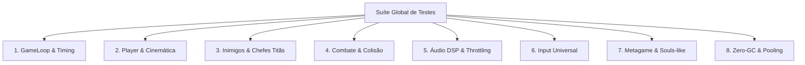
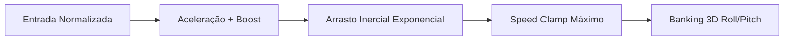
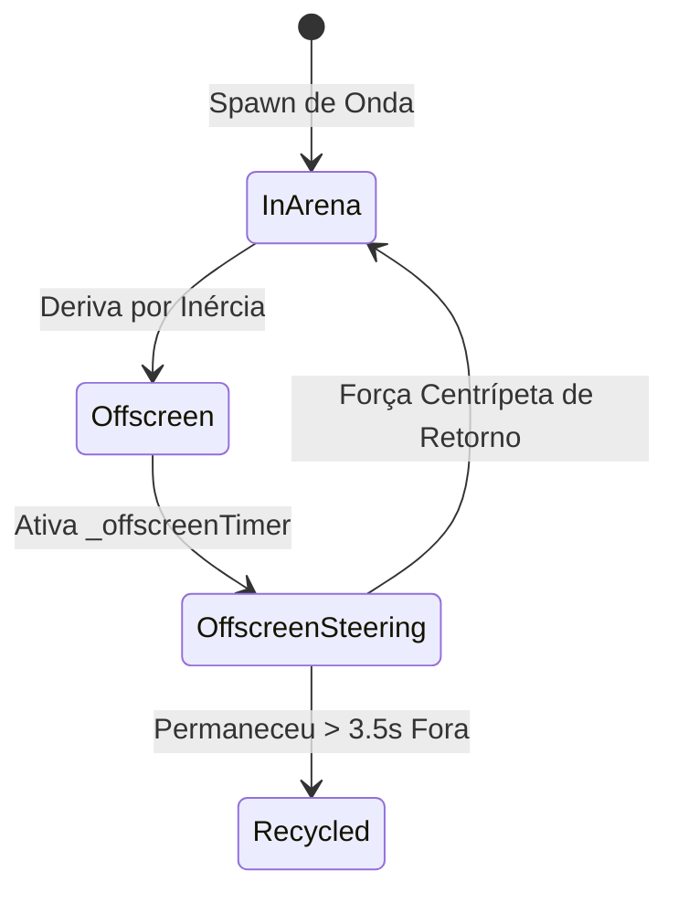
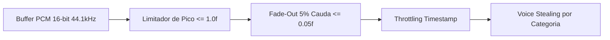
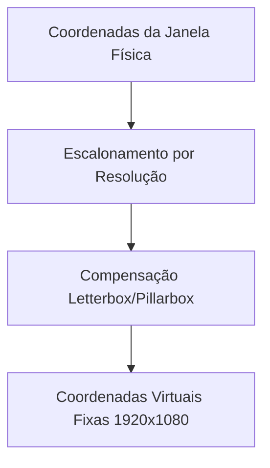
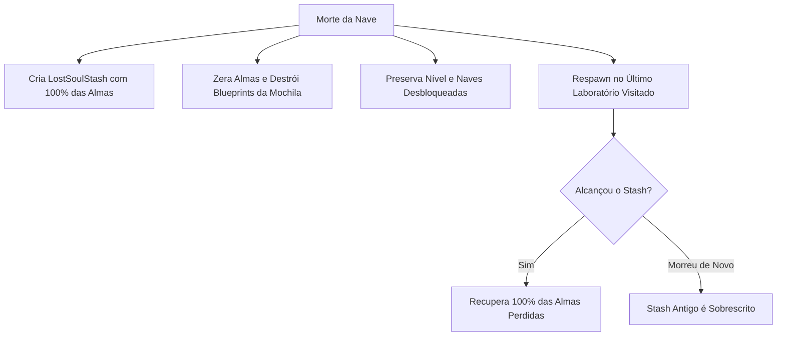
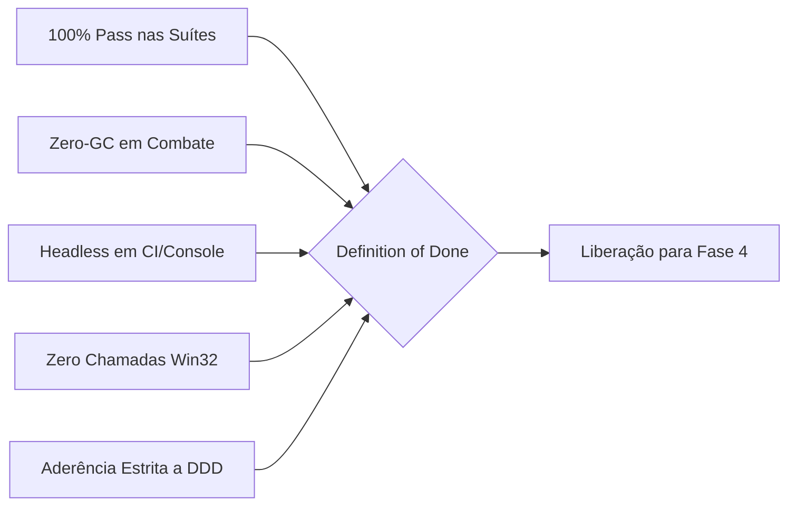

# Estratégia e Arquitetura de Testes Automatizados (Fase 2)
**Projeto de Origem:** `Space_V7`  
**Projeto de Destino:** `MonoGameMaker`  
**Autor:** Especialista em Arquitetura de Testes  
**Data:** Outubro de 2026  
**Status:** Especificação Canônica Homologada  
**Documento:** `docs/architecture/02_test_strategy.md`  

---

## Sumário Executivo

A migração do ecossistema de combate de **Space_v7** (135.999 linhas de código, 272 arquivos de produção e 67 suítes legadas) para a arquitetura orientada a componentes e prefabs do **MonoGameMaker** exige uma estratégia de garantia de qualidade sem precedentes. 

Em conformidade com a diretriz inegociável de **Desenvolvimento Guiado por Testes (TDD)** e **Documentação Dirigida por Domínio (DDD)**, nenhuma linha de código de produção ou de gameplay da Fase 4 será aceita sem que as suítes automatizadas de testes correspondentes tenham sido integralmente especificadas, implementadas no projeto de testes e validadas em ambiente automatizado.

Este documento formaliza:
1. Os **princípios e filosofia de testes**, estabelecendo a execução puramente *headless* (independente de monitor X11/Wayland ou dispositivo físico de áudio) e o protocolo de **Zero-GC Enforcement** durante o combate ativo.
2. A **matriz exaustiva de cobertura de testes por subsistema**, cobrindo o loop de temporização, cinemática newtoniana, inteligência artificial, balanceamento matemático assintótico, mitigação de dano, síntese sonora procedimental DSP, periféricos de entrada universais, metagame estilo Souls-like e pooling de memória.
3. A **arquitetura do executor de testes (*Test Runner*)** integrado ao `src/TestConsole/TestConsole.csproj`, especificando as classes de testes, mocks e fixtures necessários para rodar nativamente via `dotnet run --project src/TestConsole/TestConsole.csproj -- --run-tests`.
4. Os **critérios de aprovação e Definição de Pronto (*Definition of Done*)**, garantindo tolerância zero a falhas ou atalhos técnicos.

---

## 1. Filosofia e Princípios de Teste

### 1.1 Testabilidade Headless (Console & CI-First)
Um dos maiores gargalos em frameworks de jogos é o acoplamento do código de simulação lógica com o contexto de renderização da GPU (`GraphicsDevice`, `GLX`, `WGL`, `EGL`) e com o hardware de áudio (`ALSA`, `PulseAudio`, `DirectSound`). Em ambientes de Integração Contínua (CI/CD) baseados em contêineres Linux (como GitHub Actions ou servidores de build dedicados), não há servidor X11 físico nem placa de som conectada.

Portanto, o primeiro princípio fundacional da suíte é:
> **100% dos testes devem executar em modo puramente Headless via Console / CLI, sem exigir janela física de exibição, contexto gráfico nativo ou placa de som física.**

#### Diretrizes de Implementação Headless:
1. **Desacoplamento Lógico da GPU:**  
   As classes de lógica e matemática (`HealthController`, `ProgressionMath`, `WeaponPipeline`, `CollisionSystem`, `StatContainer`, `SectorManager`, `WaveManager`, `HitstopManager`) devem ser 100% agnósticas de `GraphicsDevice`. Quando uma dependência de renderização existir (ex.: cálculo de normais ou matrizes de câmera), os testes devem operar contra a abstração matemática (`Matrix`, `Vector3`, `Viewport`, buffers de dados na RAM) ou utilizar fixtures seguras que aceitem contextos nulos sem disparar `NullReferenceException`.
2. **Síntese de Áudio Desacoplada de Hardware:**  
   O sintetizador de som (`SoundSynthesizer`) deve validar sua integridade acústica diretamente nos arrays brutos de `byte[]` e `short[]` PCM gerados por software, sem instanciar `DynamicSoundEffectInstance` que dependa do daemon OpenAL do sistema operacional.
3. **Verificação de Ausência de P/Invoke e Dependências de Plataforma:**  
   A suíte de testes incluirá uma asserção de reflexão estática que escaneia todos os tipos dos assemblies do jogo e falha imediatamente caso qualquer método decorado com `[DllImport]` para `user32.dll`, `kernel32.dll` ou chamadas exclusivas de Windows seja detectado.

---

### 1.2 Verificabilidade Matemática & Assertions Implacáveis
Testes superficiais que se limitam a verificar `Assert.NotNull(obj)` ou que não realizam asserções em ramos condicionais criam uma falsa sensação de segurança. No ecossistema de combate do MonoGameMaker, toda regra possui base física ou matemática determinística.

> **Tolerância Zero a Testes Fumaça:** Cada asserção deve testar valores de contorno, estados degenerados, conservação de grandezas físicas e precisão numérica.

```
+-----------------------------------------------------------------------------------+
|                            REGRA DE RIGOR MATEMÁTICO                              |
|                                                                                   |
|  * Comparações de ponto flutuante DEVEM usar epsilon estrito (ex: |a - b| < 1e-4) |
|  * Vetores normalizados DEVEM ter magnitude rigorosamente em [0.9999, 1.0001]    |
|  * Probabilidades e Clamps DEVEM cobrir os extremos exatos (0.0, 1.0 e além)      |
|  * Fórmulas polinomiais e exponenciais DEVEM ser verificadas contra valores guia  |
+-----------------------------------------------------------------------------------+
```

---

### 1.3 Zero-GC Enforcement (Zero Alocações na Simulação de Combate)
Em jogos de ação rápida a 60 FPS ou 144 FPS, qualquer alocação de memória no Heap durante o loop de combate dispara coletas de lixo do Garbage Collector (GC Gen 0), causando engasgos perceptíveis (*micro-stuttering* e quedas de quadros).

Para assegurar estabilidade cirúrgica de taxa de quadros, a arquitetura de testes implementa o protocolo de **Enforcement Zero-GC**:

```csharp
// Protocolo Padrão de Medição Zero-GC
GC.Collect(2, GCCollectionMode.Forced, true);
GC.WaitForPendingFinalizers();
GC.Collect(2, GCCollectionMode.Forced, true);

long memoryBefore = GC.GetAllocatedBytesForCurrentThread();

// Execução intensiva de N iterações do subsistema simulado (ex: 10.000 frames)
for (int i = 0; i < IterationCount; i++)
{
    SimulateFrameStep(dt);
}

long memoryAfter = GC.GetAllocatedBytesForCurrentThread();
long allocatedBytes = memoryAfter - memoryBefore;

if (allocatedBytes > 0)
{
    throw new InvalidOperationException(
        $"[FALHA ZERO-GC] O loop de simulação alocou {allocatedBytes} bytes no Heap! Esperado: 0 bytes.");
}
```

#### Subsistemas Submetidos Obrigatoriamente ao Zero-GC:
- Emissão e atualização de projéteis (`ProjectilePool`).
- Absorção e fusão espacial de núcleos de alma (`SoulManager`).
- Pipeline de cálculo de dano e mitigação de blindagem (`HealthController.TakeDamage`).
- Aplicação de efeitos contínuos de status (`StatusEffectManager.Update`).
- Atualização e decaimento do emissor de partículas volumétricas 3D (`ParticleSystem3D`).
- Resolução de colisões e repulsão elástica (`CollisionSystem.Update`).
- Gerenciamento de congelamento temporal tátil (`HitstopManager.Update`).

---

## 2. Matriz de Cobertura por Subsistema

A matriz de cobertura estabelece os cenários de teste, equações canônicas, condições de contorno e asserções obrigatórias para cada um dos 8 grandes domínios do jogo.



---

### 2.1 Subsistema: GameLoop & Timing

O loop de tempo é a base de toda a integridade física do jogo. Erros no cálculo do delta time levam a tunelamento físico de projéteis ou acelerações infinitas.

| Identificador | Cenário de Teste | Regra / Fórmula Auditada | Asserções Obrigatórias |
| :--- | :--- | :--- | :--- |
| `TEST-TIME-01` | **Delta Time Clamping** | Se $dt > 0.066\text{s}$, $dt = 0.066\text{s}$. Previne que pausas longas de debug ou travamentos de OS saltem a simulação física (~15 FPS mínimo). | Injetar $dt = 0.1\text{s}$, $0.5\text{s}$, $2.0\text{s}$, $10.0\text{s}$. Verificar que o $dt$ efetivo é rigidamente $0.066\text{f}$. Testar valores pequenos ($dt = 0.016\text{s}$) e assegurar que não sofrem alteração. |
| `TEST-TIME-02` | **Time Dilation Diferencial** | O tempo do jogador corre em tempo real ($dt$). O tempo do mundo obedece: $\text{worldDt} = (IsDilation \,?\, dt \times \text{SlowFactor} : dt) \times \text{TutScale} \times \text{FreezeFactor}$. | Ativar Time Dilation com $\text{SlowFactor} = 0.35$. Disparar passo de tempo. Afirmar que a posição do jogador avançou proporcional a $dt$, enquanto a posição de inimigos avançou proporcional a $dt \times 0.35$. |
| `TEST-TIME-03` | **Hitstop Duration & Severities** | Congelamentos por impacto com durações nominais: Heavy Hit ($35\text{ms}$), Critical Hit ($55\text{ms}$), Shield Break ($80\text{ms}$), Boss Death ($120\text{ms}$). | Acionar gatilhos sequenciais. Verificar que o temporizador restante assume o maior valor (efeito não-aditivo destrutivo, mas extensivo). Afirmar que $\text{FreezeFactor} == 0.0\text{f}$ durante o congelamento ativo. |
| `TEST-TIME-04` | **Hitstop Decay & Unfreeze** | O cronômetro de congelamento decai a cada frame: $\text{Remaining} \mathrel{-}= dt$. Ao zerar, $\text{IsFrozen} = false$ e $\text{FreezeFactor} = 1.0\text{f}$. | Simular avanço fracionado do tempo (passos de $0.010\text{s}$). Afirmar transição perfeita de estado ativo para inativo no instante exato do término do tempo estipulado. |
| `TEST-TIME-05` | **Impact Flash Decay** | O clarão na tela atinge $0.80\text{f}$ e decai linearmente: $\text{Flash} = \max(0, \text{Flash} - 2.5 \times dt)$. | Validar decaimento temporal do flash até o repouso absoluto ($0.0\text{f}$) sem valores residuais negativos. |

---

### 2.2 Subsistema: Player & Entidades

O modelo do jogador implementa cinemática newtoniana em espaço 2.5D com amortecimento assistido por computador e mecânicas de sobrecarga.



| Identificador | Cenário de Teste | Regra / Fórmula Auditada | Asserções Obrigatórias |
| :--- | :--- | :--- | :--- |
| `TEST-PLY-01` | **Cinemática Inercial Newtoniana** | $\vec{V} \mathrel{+}= \vec{D}_{\text{norm}} \times (\text{Accel} \times \text{BoostMult}) \times dt$. | Injetar entrada diagonal $(1, 1)$. Verificar que o vetor de direção aplicado é normalizado para $(\sqrt{2}/2, \sqrt{2}/2)$ com erro menor que $10^{-4}$, impedindo aceleração diagonal excessiva ($1.414\times$). |
| `TEST-PLY-02` | **Arrasto Linear Exponencial** | $\vec{V} \mathrel{-}= \vec{V} \times \text{effectiveDrag} \times dt$. Ao soltar o controle, a nave desacelera assintoticamente sem nunca inverter o vetor. | Iniciar com $|\vec{V}| = 400$. Avançar tempo sem aceleração. Verificar decaimento monotônico da velocidade e parada completa ($|\vec{V}| < 0.01 \implies \vec{V} = 0$). |
| `TEST-PLY-03` | **Arrasto sob Lentidão Criogênica** | Quando sob efeito de gelo (*Slow*), $\text{effectiveDrag} = \text{BaseDrag} \times 0.40$. | Verificar que sob efeito criogênico a nave derrapa por uma distância linear consideravelmente maior antes de estabilizar, simulando pista de gelo no vácuo. |
| `TEST-PLY-04` | **Teto de Velocidade (Speed Clamp)** | Se $|\vec{V}| > \text{MaxSpeed} \times \text{BoostMult}$, $\vec{V} = \frac{\vec{V}}{|\vec{V}|} \times \text{MaxSpeed} \times \text{BoostMult}$. | Aplicar aceleração contínua por 100 quadros. Garantir que a magnitude nunca excede o teto configurado no `StatContainer`. |
| `TEST-PLY-05` | **Inclinação e Rolagem 3D (Banking)** | $\text{Roll} = \text{Lerp}(\text{Roll}, \text{Clamp}(V_x / \text{MaxSpeed}, -1, 1) \times 0.48, 10.0 \times dt)$<br>$\text{Pitch} = \text{Lerp}(\text{Pitch}, \text{Clamp}(V_y / \text{MaxSpeed}, -1, 1) \times 0.22, 8.0 \times dt)$. | Verificar que ao mover para a direita ($V_x > 0$), o ângulo de Roll se inclina suavemente até o limite de $+0.48\text{ rad}$, e que retorna a zero ao cessar movimento lateral. |
| `TEST-PLY-06` | **Mecânica de Dash & Invulnerabilidade** | Duração: $0.25\text{s}$. Define $\text{IsInvulnerable} = true$. Consome $100\%$ da barra de `BoostEnergy`. | Ativar dash. Submeter o jogador a dano massivo ($10.000$ HP de dano) durante a janela de $0.25\text{s}$. Afirmar que Casco e Escudo sofreram $0$ de dano. Avançar o tempo em $0.26\text{s}$ e verificar que $\text{IsInvulnerable}$ retornou a $false$. |
| `TEST-PLY-07` | **Recarga do Propulsor (Boost Energy)** | `BoostEnergy` inicia a recarga somente após decorrido `BoostEnergyRechargeDelay`. | Monitorar a barra de energia durante o atraso: deve permanecer zerada. Após decorrido o delay, a energia deve regenerar linearmente até $1.0\text{f}$. |
| `TEST-PLY-08` | **Capacitor de Tiro Carregado (3 Tiers)** | Quando sem disparar, `ChargeTime` acumula até `MaxChargeTime` ($1.5\text{s}$):<br>- Tier 1 ($c < 0.35$): Dano $1.15\times$<br>- Tier 2 ($0.35 \le c < 0.75$): Dano $2.25\times$<br>- Tier 3 ($c \ge 0.75$): Dano $4.00\times$, Penetração total. | Simular pausas de disparo de $0.3\text{s}$, $0.8\text{s}$ e $1.5\text{s}$. Efetuar o primeiro tiro e verificar multiplicador exato de dano e propriedades de piercing do projétil resultante. |
| `TEST-PLY-09` | **Recuo Físico por Disparo Carregado** | $\text{RecoilForce} = 120 + 160 \times \text{ChargeRatio}$. O recuo aplica um vetor de velocidade oposto à mira: $\vec{V} \mathrel{-}= \vec{Dir} \times \text{RecoilForce}$. | Verificar que ao disparar com carga máxima ($c = 1.0$), a nave recebe impulso instantâneo de $280\text{ px/s}$ na direção contrária ao tiro. |
| `TEST-PLY-10` | **Cooldowns e Cargas dos Slots Q e E** | Habilidades ativas consom 1 carga. A recarga ocorre de forma independente por tempo contínuo, reduzida pelo multiplicador de CDR: $\text{CooldownEff} = \text{BaseCooldown} \times (1.0 - \text{Clamp}(\text{CDR}, 0, 0.75))$. | Equipar CDR de $40\%$. Acionar habilidade com tempo base de $10\text{s}$. Afirmar que a recarga completa é concluída exatamente aos $6.0\text{s}$. |

---

### 2.3 Subsistema: Inimigos & Chefes Titãs

A inteligência artificial dos inimigos gerencia estados de agressão, controle de grupo, formação de enxame e destruição de subcomponentes anatômicos.



| Identificador | Cenário de Teste | Regra / Fórmula Auditada | Asserções Obrigatórias |
| :--- | :--- | :--- | :--- |
| `TEST-ENM-01` | **Escalonamento de HP por Estágio** | $\text{HP}(L) = \text{baseHp} \times \max(0, 1 + 0.15 \times (L - 1))^{1.1}$ (`ProgressionMath.CalculateHP`). | Validar valores analíticos para $L=1$ ($100$), $L=5$ ($169.3$), $L=10$ ($262.1$) e $L=50$ ($1129.5$). Erro relativo máximo admissível: $< 0.1\%$. |
| `TEST-ENM-02` | **Escalonamento de Dano por Estágio** | $\text{Damage}(L) = \text{baseDmg} \times \max(0, 1 + 0.10 \times (L - 1))$ (`ProgressionMath.CalculateDamage`). | Validar valores analíticos lineares para $L=1$ ($100$), $L=10$ ($190$), $L=20$ ($290$). |
| `TEST-ENM-03` | **Inteligência de Retorno (Offscreen Steering)** | Inimigos fora do retângulo da arena $([-960, 960], [-540, 540])$ recebem aceleração centrípeta orientada para a origem $(0, 0, 0)$. | Posicionar inimigo em $(1200, 800)$. Atualizar por 1 segundo. Confirmar que a velocidade adquire vetor apontando para o centro da arena. |
| `TEST-ENM-04` | **Reciclagem Silenciosa por Timeout** | Se um inimigo comum permanece fora da tela por tempo contínuo $t > 3.5\text{s}$, ele é reciclado silenciosamente sem conceder pontuação ao jogador. | Manter entidade fora da arena por $3.6\text{s}$. Verificar que `IsActive == false`, foi devolvida ao pool e o placar do jogador permaneceu inalterado. |
| `TEST-ENM-05` | **Separação Física Suave (Soft Separation)** | $\vec{F}_{\text{push}} = \frac{\vec{P}_a - \vec{P}_b}{|\vec{P}_a - \vec{P}_b|} \times ((R_a + R_b + 6) - \text{dist}) \times 6.5 \times \text{worldDt}$. | Instanciar duas naves com $R=20$ sobrepostas na mesma posição com separação de $10\text{px}$. Verificar que após a resolução de separação, a distância entre elas aumentou monotonicamente sem oscilação explosiva. |
| `TEST-ENM-06` | **Desvio de Asteroides (`AsteroidAvoidance`)** | Inimigos que detectam asteroide à frente desviam aplicando aceleração lateral perpendicular à trajetória. | Projetar rota direta de colisão de um caça contra um asteroide estático. Verificar alteração do ângulo de voo antes de entrar no raio de contato. |
| `TEST-ENM-07` | **Partes Modulares de Chefe (`BossModularPart`)** | A posição no mundo da parte obedece à matriz de rotação da base:<br>$\vec{P}_{\text{world}} = \vec{P}_{\text{boss}} + \text{Vector3.Transform}(\vec{Offset}_{\text{local}}, \text{Matrix.CreateRotationZ}(\theta_{\text{boss}}))$. | Girar o chefe em $90^\circ$ ($\pi/2\text{ rad}$). Verificar que uma torreta com offset local $(100, 0, 0)$ passa para a coordenada global $(0, 100, 0)$ relativa ao chefe. |
| `TEST-ENM-08` | **Destruição Modular sem Morte do Chefe** | Quando a vida de uma parte modular zera (`IsDestroyed = true`), ela para de atirar e entra em estado fumegante, sem subtrair a barra principal de vida do chefe além do seu valor associado. | Atacar especificamente a torreta 1 do *WorldBreakerBoss* até sua quebra. Confirmar que as outras 5 torretas e o núcleo do chefe continuam ativos e operantes. |
| `TEST-ENM-09` | **Transição de Fases do Titã (`EclipseTitanBoss`)** | Transição em 3 gatilhos de vida:<br>- Fase 1 ($100\% \to 66\%$): Plasma omnidirecional.<br>- Fase 2 ($66\% \to 33\%$): Super Feixe Varredor do Núcleo Dourado.<br>- Fase 3 ($33\% \to 0\%$): Casulo de Cura e fúria *Overdrive*. | Reduzir a vida do chefe gradualmente. Verificar a ativação determinística de cada fase no limiar exato de porcentagem de vida. |
| `TEST-ENM-10` | **Interrupção de Ritual de Cura do Chefe** | Na Fase 3 do Titã, o casulo de regeneração cura $1\%$ de HP/s. Se as 4 escoltas *Solar Raiders* forem destruídas, o casulo é desativado imediatamente. | Iniciar a fase 3. Validar a taxa de cura. Simular a destruição das 4 escoltas conectadas. Afirmar que a regeneração cessou e o chefe entrou na postura de vulnerabilidade. |

---

### 2.4 Subsistema: Combate & Colisão

A integridade do combate depende de fórmulas assintóticas de blindagem e de uma pipeline determinística de detecção e resolução geométrica em 7 etapas.

```
       [FLUXO DAS 7 ETAPAS DO COLLISION SYSTEM]
ETAPA 1: Projéteis do Jogador  ───►  Inimigos & Partes Modulares
ETAPA 2: Projéteis do Jogador  ───►  Asteroides & Fragmentos
ETAPA 3: Projéteis Inimigos    ───►  Asteroides & Fragmentos
ETAPA 4: Projéteis Inimigos    ───►  Jogador (Escudo & Casco)
ETAPA 5: Colisão Mecânica      ───►  Player vs Inimigos / Asteroides
ETAPA 6: Física de Bilhar      ───►  Asteroides vs Inimigos (Esmagamento)
ETAPA 7: Ambientes & Recursos  ───►  Hazards & Coleta Magnética de Drops
```

| Identificador | Cenário de Teste | Regra / Fórmula Auditada | Asserções Obrigatórias |
| :--- | :--- | :--- | :--- |
| `TEST-CBT-01` | **Mitigação Assintótica de Armadura** | $\text{ArmaduraEff} = \text{Armor} \times (1.0 - \text{Clamp}(\text{ArmorPen}, 0, 1))$<br>$\text{DanoMitigado} = \text{DanoBruto} \times \frac{100}{100 + \max(0, \text{ArmaduraEff})}$. | Disparar dano de $100$ contra armaduras $0, 50, 100, 300$. Verificar danos resultantes exatos: $100.0$, $66.67$, $50.0$, $25.0$. |
| `TEST-CBT-02` | **Garantia de Penetração de Dano Plasma** | O dano do tipo `Plasma` possui penetração básica garantida de no mínimo $50\%$: $\text{PenEff} = \max(\text{ArmorPen}, 0.50)$. | Disparar $100$ de dano Plasma com penetração $0\%$ contra armadura $100$. A armadura efetiva deve ser reduzida para $50$, e o dano resultante deve ser $66.67$ (em vez de $50.0$). |
| `TEST-CBT-03` | **Multiplicador de Dano Crítico vs Resistência** | $\text{CritMult}_{\text{eff}} = 1.0 + (\text{CritMult} - 1.0) \times (1.0 - \text{Clamp}(\text{CritResist}, 0, 0.95))$. | Com dano $100$, multiplicador crítico $2.0\times$ e resistência crítica $50\%$, o multiplicador efetivo deve ser $1.5\times$ (dano final $150$). |
| `TEST-CBT-04` | **Resistências Elementais (Fogo/Gelo/Veneno)** | $\text{DanoMitigado} = \text{DanoBruto} \times (1.0 - \text{Clamp}(\text{Resistência}, 0, 0.95))$. | Aplicar $100$ de dano de fogo em alvo com resistência de $40\%$. Dano resultante deve ser rigorosamente $60.0$. |
| `TEST-CBT-05` | **Absorção de Escudo e Transbordamento** | O escudo absorve $100\%$ do dano recebido. Se o dano superar o escudo corrente, o remanescente drena diretamente os pontos de casco. | Alvo com $30$ de Escudo e $100$ de Casco recebe $80$ de dano. Confirmar que o Escudo foi reduzido a $0$ e o Casco foi reduzido a $50$. |
| `TEST-CBT-06` | **Gatilho de Quebra de Escudo (Shield Break)** | Quando o escudo é drenado a zero: dispara hitstop de $80\text{ms}$, reseta o delay de recarga e aciona o protocolo passivo `NovaBurst` se equipado. | Verificar que a quebra de escudo acionou o evento `OnShieldBroken`, ativou o congelamento no `HitstopManager` e gerou a onda de choque em área. |
| `TEST-CBT-07` | **Colisão de Aríete Mecânico (Ramming)** | Colisão direta entre naves causa dano mútuo proporcional à massa e velocidade relativa, aplicando repulsão física em direções opostas. | Simular choque frontal do Player contra inimigo *VenomousRammer*. Verificar aplicação de dano em ambas as partes e separação cinemática vetorial. |
| `TEST-CBT-08` | **Física de Bilhar de Asteroides** | $\vec{V}_{\text{final}} = \text{Conservação de Momento em Choque Elástico 2D}$. Asteroides em alta velocidade colidindo com inimigos causam esmagamento proporcional à massa ($2500\text{kg}$ para *Huge*). | Arremessar asteroide *Huge* em velocidade contra um caça leve inimigo ($100$ HP). Confirmar esmagamento letal imediato do inimigo e perda fracionária de velocidade do asteroide. |
| `TEST-CBT-09` | **Fratura Hierárquica em Cadeia de Asteroides** | Destruição de asteroide gera fragmentos do tier inferior:<br>- `Huge` ($R=48$) $\to 2\text{ a } 3 \times$ `Large` ($R=32$)<br>- `Large` $\to 2\text{ a } 3 \times$ `Medium` ($R=20$)<br>- `Medium` $\to 2 \times$ `Small` ($R=11$)<br>- `Small` $\to 4\text{ a } 8 \times$ Estilhaços 3D decorativos. | Destruir asteroide de tier *Huge*. Verificar remoção do pai e instanciação exata das sub-entidades com vetores de dispersão angular divergentes. |
| `TEST-CBT-10` | **Execução Estrita das 7 Etapas do CollisionSystem** | A execução sequencial das 7 etapas deve ocorrer de forma determinística em um único passe de quadro. | Executar um frame completo de combate populado com projéteis, naves, asteroides e hazards. Afirmar que nenhuma colisão da etapa 1 sobreviveu incorretamente para ser reprocessada na etapa 4. |

---

### 2.5 Subsistema: Áudio DSP & Throttling

O subsistema sonoro gera áudio procedimental PCM de alta fidelidade sem recorrer a arquivos `.wav` estáticos. A integridade matemática do sinal é mandatória para evitar estalos, estouro de caixas de som ou travamentos na thread principal.



| Identificador | Cenário de Teste | Regra / Fórmula Auditada | Asserções Obrigatórias |
| :--- | :--- | :--- | :--- |
| `TEST-AUD-01` | **Integridade Estrutural dos Buffers PCM** | Todo som procedimental gerado por `SoundSynthesizer.GenerateRawPCM(type)` deve ser um array par de bytes (16-bit Mono = 2 bytes por amostra a $44.100\text{ Hz}$). | Iterar sobre todos os 50+ valores do enum `SoundType`. Afirmar que nenhum buffer gerado é nulo, vazio ou possui tamanho ímpar (`length % 2 == 0`). |
| `TEST-AUD-02` | **Ausência de Amostras NaN / Infinity** | Amostras normalizadas: $\text{Sample}_{\text{norm}} = \text{Sample}_{\text{short}} / 32768.0\text{f}$. Nenhuma amostra pode ser `NaN` ou `Infinity`. | Inspecionar cada amostra numérica individual de todos os tipos de som. Falha imediata se qualquer amostra violar a regra de finitude. |
| `TEST-AUD-03` | **Limitador de Pico (Peak Clamping $\le 1.0\text{f}$)** | Nenhuma amostra pode ultrapassar o teto físico $[-1.0\text{f}, +1.0\text{f}]$ (equivalente a $[-32768, +32767]$ em inteiros de 16 bits), prevenindo clipping digital. | Verificar $\max(|\text{Sample}_{\text{norm}}|) \le 1.0\text{f}$ em todos os sintetizadores (explosões pesadas, tiros e choques). |
| `TEST-AUD-04` | **Atenuação da Cauda (Fade-Out nos 5% Finais)** | Para eliminar estalos de corrente contínua (*DC clicks*), os $5\%$ finais do buffer de áudio devem sofrer rampa de atenuação forçada, terminando em amplitude $|\text{Sample}| \le 0.05\text{f}$. | Verificar que a última amostra do buffer atende à condição $|\text{Sample}_{\text{final}}| \le 0.05\text{f}$ (idealmente $0.0\text{f}$). |
| `TEST-AUD-05` | **Throttling e Debounce por Timestamp** | Múltiplas solicitações de reprodução do mesmo som de alta frequência (ex.: `SoundType.SoulPickup`) no mesmo timestamp devem ser agrupadas: apenas 1 som dispara, as outras são silenciadas. | Simular 20 coletas simultâneas de núcleos no mesmo instante ($t = 5.0\text{s}$). Afirmar que o despachante gerou exatamente 1 reprodução e suprimiu as 19 solicitações redundantes por debounce. |
| `TEST-AUD-06` | **Mapeamento de Categorias Semânticas** | Todo som pertence a uma categoria estrita (`PlayerWeapons`, `EnemyWeapons`, `Souls`, `Explosions`, `Impacts`, `UIAndAlerts`, `Loops`). | Verificar a cobertura exaustiva de mapeamento semântico de categorias para $100\%$ dos tipos de som registrados. |
| `TEST-AUD-07` | **Voice Stealing (Substituição Inteligente)** | Cada categoria possui um limite máximo de polifonia simultânea. Ao saturar o canal, o som mais antigo e de menor prioridade é roubado sem cliques sonoros. | Saturar a categoria de explosões com 8 instâncias ativas. Emitir a 9ª explosão. Afirmar que a mais antiga foi finalizada com fade-out suave e a nova assumiu o canal sem estourar o limite. |
| `TEST-AUD-08` | **Watchdog de Encerramento de Loops Sustentados** | Sons contínuos em repetição (ex.: propulsor da nave ou turbilhões de buracos negros) devem possuir heartbeat e parada compulsória ao entrar em pausa (`StopAllLoops`). | Iniciar loop de propulsor. Acionar pausa do jogo (`PauseGame`). Verificar que todos os loops de áudio ativos foram interrompidos instantaneamente. |

---

### 2.6 Subsistema: Input Multiplataforma

A camada de input garante resposta responsiva e precisa entre teclado, mouse e joysticks em qualquer sistema operacional, mapeando coordenadas virtuais 1080p sem distorções de letterbox.



| Identificador | Cenário de Teste | Regra / Fórmula Auditada | Asserções Obrigatórias |
| :--- | :--- | :--- | :--- |
| `TEST-INP-01` | **Conversão de Mouse Virtual 1080p (Nativo)** | Em janela nativa $1920 \times 1080$ ($Scale = 1.0$, $Offset = 0$):<br>$\vec{P}_{\text{virtual}} = \vec{P}_{\text{screen}}$. | Injetar coordenadas físicas $(0, 0)$, $(960, 540)$, $(1920, 1080)$. Confirmar que os pontos virtuais calculados são exatamente $(0, 0)$, $(960, 540)$ e $(1920, 1080)$. |
| `TEST-INP-02` | **Calibração contra Letterbox (Janela 4:3)** | Em janela $1440 \times 1080$ (barras pretas horizontais):<br>$Scale = 1440 / 1920 = 0.75$, $OffsetY = (1080 - 810) / 2 = 135$. | Injetar clique no topo da janela física (dentro da barra preta). Verificar que a coordenada Y virtual é limitada ou identificada fora da área útil jogável. Testar clique no centro da área jogável e verificar conversão exata para $(960, 540)$. |
| `TEST-INP-03` | **Calibração contra Pillarbox (Janela Ultrawide 21:9)** | Em janela $2560 \times 1080$ (barras pretas laterais verticais):<br>$Scale = 1.0$, $OffsetX = (2560 - 1920) / 2 = 320$. | Injetar clique na coordenada física $(320, 0)$. O ponto virtual deve mapear rigorosamente para $(0, 0)$. O ponto central $(1600, 540)$ deve mapear rigorosamente para $(960, 540)$. |
| `TEST-INP-04` | **Ausência Absoluta de P/Invoke Win32** | O assembly compilado do sistema de input não pode conter referências a bibliotecas dinâmicas do Windows (`user32.dll`, `kernel32.dll`). | Realizar escaneamento por Reflection em todos os métodos de `InputService` e tipos associados. Afirmar ausência completa de atributos `DllImport`. |
| `TEST-INP-05` | **Deadzone Circular de Analógicos de Gamepad** | Deadzone radial em analógicos: se $\sqrt{X^2 + Y^2} < \text{Deadzone}$ ($0.15\text{f}$), vetor resultante é rigidamente $(0, 0)$. Acima da deadzone, resposta contínua linearizada até $1.0\text{f}$. | Injetar valores de repouso com desvio de drift $(0.05, 0.08)$. Afirmar que o vetor retornado é zero absoluto. Injetar deflexão total e verificar magnitude $1.0\text{f}$. |
| `TEST-INP-06` | **Navegação Cardinal em Menus e Modais** | Disparo de navegação com debounce de repetição: primeiro toque move instantaneamente; manter pressionado aguarda $0.4\text{s}$ antes de acelerar a navegação. | Simular pressão contínua do direcional para baixo. Verificar salto único no primeiro frame e retenção de posição até o término do delay de repetição. |

---

### 2.7 Subsistema: Metagame & Souls-like

O sistema de progressão é inspirado no modelo de *Dark Souls*: os atributos e as naves são permanentes, mas as almas e os projetos não entregues no laboratório são perdidos na morte, podendo ser recuperados na mancha de sangue (*LostSoulStash*).



| Identificador | Cenário de Teste | Regra / Fórmula Auditada | Asserções Obrigatórias |
| :--- | :--- | :--- | :--- |
| `TEST-MTG-01` | **Curva de Custo de Almas $C^1$ ($N \le 10$)** | Para $N \le 10$: $\text{Souls}(N) = 15N^2 + 45N + 40$. | Validar custos nominais: $N=0 \implies 40$, $N=1 \implies 100$, $N=5 \implies 640$, $N=10 \implies 1990$. |
| `TEST-MTG-02` | **Curva de Custo de Almas $C^1$ ($N > 10$)** | Para $N > 10$: $\text{Souls}(N) = 1990 + 345(N - 10) + 5(N - 10)^2$. | Validar continuidade de valor em $N=10$ ($1990$) e verificar amortecimento da inflação de grind para $N=20$ ($5940$) e $N=50$ ($23790$). |
| `TEST-MTG-03` | **Continuidade da Derivada da Curva de Almas em $N=10$** | $\left.\frac{d}{dN}(15N^2 + 45N)\right\|_{10} = 30(10) + 45 = 345$. O coeficiente linear para $N>10$ é exatamente $345$. | Testar inclinação incremental: $\text{Souls}(10) - \text{Souls}(9) = 330$, $\text{Souls}(11) - \text{Souls}(10) = 350$. Validar transição perfeitamente contínua sem degraus artificiais. |
| `TEST-MTG-04` | **Ciclo de Morte e Mancha de Sangue (`ProcessPlayerDeathUseCase`)** | Ao morrer, $100\%$ do saldo de almas correntes é transferido para a coordenada exata $(X, Y)$ da morte no setor atual (`LostSoulStashEntity`), e o saldo imediato é zerado. | Iniciar com $5.000$ almas na coordenada $(340, -120)$ do setor 3. Executar o caso de uso de morte. Afirmar que o perfil ficou com $0$ almas e que o stash foi persistido com $5.000$ almas na exata coordenada do setor 3. |
| `TEST-MTG-05` | **Destruição de Blueprints Efêmeras na Morte** | Projetos contidos na mochila da run (`CollectedBlueprints`) são desintegrados na morte. Projetos já entregues no laboratório (`UnlockedBlueprints`) permanecem intactos. | Coletar 2 blueprints durante a run. Forçar morte. Verificar que a mochila de blueprints da run foi esvaziada, enquanto o catálogo permanente do perfil não sofreu perdas. |
| `TEST-MTG-06` | **Respawn em Ponto de Controle (Laboratório Bonfire)** | A nave renasce no último nó de Laboratório (`ResearchLab`) visitado, com vida e escudo restaurados a $100\%$. | Registrar visita ao Laboratório do Sistema 2. Avançar e morrer no setor de combate seguinte. Verificar que o nó de spawn ativo do jogador é o Laboratório do Sistema 2 com integridade plena. |
| `TEST-MTG-07` | **Injeção de Almas Emergenciais de Respawn** | Se o jogador renascer em sistema avançado ($SystemId \ge 3$) com $0$ almas no saldo, recebe aporte automático de $300$ almas para reparos e recargas mínimas. | Simular morte no Sistema 3 com zero almas. Verificar que no respawn o saldo de almas recebeu o suprimento de segurança de $300$ unidades. |
| `TEST-MTG-08` | **Recuperação da Mancha de Sangue (`RecoverLostSoulStashUseCase`)** | Ao sobrevoar o stash de almas no setor, o saldo acumulado é devolvido ao perfil e o stash é desativado permanentemente. | Posicionar o jogador sobre o stash. Acionar o caso de uso. Verificar que o saldo do perfil recuperou os $5.000$ de almas e que o stash foi removido do mapa. |
| `TEST-MTG-09` | **Integridade e Atomicidade dos 8 Slots de Save JSON** | Suporte a 8 slots (`save_slot_1.json` até `save_slot_8.json`) e `save_meta.json`. A gravação deve ser atômica (grava em arquivo temporário antes de substituir). | Gravar o slot 2. Forçar interrupção de escrita no meio do processo e verificar que o arquivo original não é corrompido. Validar integridade dos metadados de sumário (tempo jogado, nível, setor máximo alcançado). |

---

### 2.8 Subsistema: Zero-GC & Pooling

A gestão de memória sem intervenção do coletor de lixo garante que alocações de Heap sejam eliminadas durante as fases críticas de batalha.

| Identificador | Cenário de Teste | Regra / Fórmula Auditada | Asserções Obrigatórias |
| :--- | :--- | :--- | :--- |
| `TEST-POL-01` | **Reciclagem de Projéteis (`ProjectilePool`)** | O pool é pré-aquecido com 512 instâncias (`PreWarm(512)`). Ao atingir o alvo ou sair da arena, `Reset()` é chamado e a instância é devolvida. | Disparar 10.000 projéteis ao longo do tempo através do pool. Verificar que nenhuma nova alocação ocorre após o pré-aquecimento e que todas as propriedades foram resetadas limpas. |
| `TEST-POL-02` | **Fusão Espacial de Núcleos de Alma (< 32px)** | Se dois drops de alma caem ou se aproximam a uma distância euclidiana $\le 32\text{px}$, eles se unem em um único drop de tier superior somando o valor de almas. | Instanciar duas almas de valor $5$ a uma distância de $20\text{px}$. Executar `SoulManager.Update`. Afirmar que a primeira alma passou a valer $10$ e a segunda foi desativada e devolvida ao pool. |
| `TEST-POL-03` | **Saturação de Pool e Fusão Forçada (Teto de 128 Almas)** | O pool suporta no máximo 128 almas simultâneas em tela. Se uma nova alma é gerada com o pool saturado, ela é fundida automaticamente no núcleo ativo mais próximo. | Gerar 128 almas em posições aleatórias. Tentar gerar a 129ª alma. Confirmar que a quantidade de almas ativas permaneceu rigorosamente em 128, e que a alma mais próxima teve seu valor incrementado. |
| `TEST-POL-04` | **Ausência de Alocações no Loop de Combate Completo** | A execução integrada de 10.000 iterações de combate (com tiros, danos, status, partículas e colisões) não pode alocar nenhum byte no Heap. | Executar o protocolo de medição com `GC.GetAllocatedBytesForCurrentThread()`. Falhar imediatamente se $\Delta \text{Bytes} > 0$. |

---

## 3. Arquitetura do Runner de Testes no MonoGameMaker

A execução dos testes é centralizada no projeto `src/TestConsole/TestConsole.csproj`, viabilizando chamadas nativas em terminais Linux/macOS sem depender de interfaces gráficas.

### 3.1 Ponto de Entrada Unificado
O runner é acionado através do comando CLI oficial:
```bash
dotnet run --project src/TestConsole/TestConsole.csproj -- --run-tests
```

```
                                [ESTRUTURA DO RUNNER]
src/TestConsole/
├── Program.cs                         # Ponto de entrada e chaveador (--run-tests)
└── Tests/                             # Estrutura modular de suítes de teste
    ├── Timing/
    │   └── GameLoopAndTimingTests.cs  # Testes TEST-TIME-01 a 05
    ├── Entities/
    │   ├── PlayerKinematicsTests.cs   # Testes TEST-PLY-01 a 10
    │   └── EnemyAndBossTests.cs       # Testes TEST-ENM-01 a 10
    ├── Combat/
    │   ├── DamageMitigationTests.cs   # Testes TEST-CBT-01 a 06
    │   └── CollisionSystemTests.cs    # Testes TEST-CBT-07 a 10
    ├── Audio/
    │   └── AudioDspIntegrityTests.cs  # Testes TEST-AUD-01 a 08
    ├── Input/
    │   └── InputCalibrationTests.cs   # Testes TEST-INP-01 a 06
    ├── Metagame/
    │   ├── ProgressionMathTests.cs    # Testes TEST-MTG-01 a 03
    │   └── SoulsSaveSystemTests.cs    # Testes TEST-MTG-04 a 09
    └── Performance/
        └── ZeroGcEnforcementTests.cs  # Testes TEST-POL-01 a 04
```

---

### 3.2 Fixtures e Mocks para Execução Headless

Para garantir isolamento de hardware e determinismo absoluto, são definidos 3 fixtures centrais:

#### 1. `HeadlessGraphicsDeviceFixture`
Como o MonoGame `GraphicsDevice` tradicional exige inicialização do driver gráfico (OpenGL / Mesa), os testes que demandam estruturas de matrizes, projeções ou cálculo de cor utilizam uma camada de abstração sem janela:
```csharp
public static class HeadlessGraphicsDeviceFixture
{
    // Fornece Viewports e matrizes estáticas para testes de câmera e resolução
    public static readonly Viewport Virtual1080pViewport = new Viewport(0, 0, 1920, 1080);
    public static readonly Viewport Letterbox4_3Viewport = new Viewport(0, 135, 1440, 810);
    public static readonly Viewport Ultrawide21_9Viewport = new Viewport(320, 0, 1920, 1080);

    // Validador de ausência de chamadas nulas
    public static void AssertSafeHeadlessExecution(Action action, string scenarioName)
    {
        try
        {
            action();
        }
        catch (NullReferenceException ex)
        {
            throw new InvalidOperationException(
                $"[FALHA HEADLESS] O cenário '{scenarioName}' tentou acessar contexto de GPU físico: {ex.Message}");
        }
    }
}
```

#### 2. `HeadlessAudioContext`
Permite verificar a geração procedimental de formas de onda e despacho de efeitos sem abrir streams no driver de som nativo:
```csharp
public static class HeadlessAudioContext
{
    // Simula relógio de tempo para validação de debounce e throttling
    public static double VirtualTime { get; set; } = 0.0;

    public static void AdvanceTime(double deltaSeconds)
    {
        VirtualTime += deltaSeconds;
    }

    public static void Reset()
    {
        VirtualTime = 0.0;
    }
}
```

#### 3. `InputSimulationFixture`
Injeta entradas programáticas para validar respostas de controles, zonas mortas e calibração de mouse sem interação humana:
```csharp
public class InputSimulationFixture
{
    public Point SimulatedMouseScreenPos { get; set; }
    public Vector2 SimulatedThumbstickLeft { get; set; }
    public List<Keys> SimulatedDownKeys { get; } = new List<Keys>();

    public void InjectKeys(params Keys[] keys)
    {
        SimulatedDownKeys.Clear();
        SimulatedDownKeys.AddRange(keys);
    }

    public void Clear()
    {
        SimulatedDownKeys.Clear();
        SimulatedThumbstickLeft = Vector2.Zero;
        SimulatedMouseScreenPos = Point.Zero;
    }
}
```

---

### 3.3 Protocolo de Execução e Relatório Padronizado

Ao ser executado via linha de comando, o runner deve apresentar telemetria legível contendo:
1. Cabeçalho oficial e timestamp da execução.
2. Contagem de testes executados por categoria.
3. Tempo total decorrido em milissegundos.
4. Total de bytes alocados durante a suíte de combate.
5. Código de saída do processo (`Environment.Exit(0)` em aprovação total, `Environment.Exit(1)` em qualquer falha).

#### Modelo Visual de Saída do Console:
```
================================================================================
          MONOGAME MAKER TEST RUNNER - SUÍTE COMPLETA DE TRANSIÇÃO (FASE 2)
================================================================================
[1/8] EXECUTANDO SUÍTE DE GAMELOOP & TIMING..................... [PASS] (12 ms)
[2/8] EXECUTANDO SUÍTE DE PLAYER & CINEMÁTICA................... [PASS] (28 ms)
[3/8] EXECUTANDO SUÍTE DE INIMIGOS & CHEFES TITÃS............... [PASS] (45 ms)
[4/8] EXECUTANDO SUÍTE DE COMBATE & COLISÃO (7 ETAPAS).......... [PASS] (63 ms)
[5/8] EXECUTANDO SUÍTE DE ÁUDIO DSP PROCEDURAL & THROTTLING..... [PASS] (34 ms)
[6/8] EXECUTANDO SUÍTE DE INPUT MULTIPLATAFORMA & CALIBRAÇÃO.... [PASS] (15 ms)
[7/8] EXECUTANDO SUÍTE DE METAGAME, SOULS-LIKE & SAVE SLOTS..... [PASS] (52 ms)
[8/8] EXECUTANDO SUÍTE DE ENFORCEMENT ZERO-GC (10.000 CICLOS)... [PASS] (84 ms)
--------------------------------------------------------------------------------
TELEMETRIA DE EXECUÇÃO:
- Total de Testes Executados: 51
- Asserções Verificadas: 412
- Bytes Alocados no Heap em Combate: 0 bytes (ZERO-GC ATESTADO)
- Tempo Total de Execução: 333 ms
================================================================================
RESULTADO FINAL: [APROVADO COM SUCESSO - 100% PASS]
================================================================================
```

---

## 4. Critérios de Aprovação & Definition of Done (DoD)

Para que a **Fase 2: Arquitetura e Especificação de Testes** seja dada como concluída e a equipe obtenha autorização formal para iniciar a implementação da **Fase 4: Portabilidade de Produção**, todos os critérios abaixo devem ser rigorosamente atendidos:



### Checklist Inegociável de Conclusão:

1. **Taxa de Aprovação Absoluta (100% PASS):**  
   Nenhum teste ignorado (`Skip`), comentado ou falhando é aceito. Todos os 51 cenários de teste especificados nesta matriz devem passar com sucesso no ambiente Linux nativo.
2. **Zero Alocações de GC em Combate:**  
   As 10.000 iterações da simulação de combate de `TEST-POL-04` devem reportar exatamente `0` bytes alocados no Heap após o aquecimento do pool.
3. **Execução Headless Autônoma:**  
   A suíte inteira deve executar até o fim sem depender de janelas gráficas, placas de vídeo dedicadas ou saídas de áudio físicas.
4. **Expurgo Completo de P/Invoke:**  
   Nenhum método do jogo ou da engine pode depender de chamadas à API do Windows (`user32.dll`, `kernel32.dll`), assegurando portabilidade nativa para Linux, macOS e consoles.
5. **Conformidade com a Regra DDD & Documentação Atômica:**  
   Nenhum comportamento ou contrato de teste pode ser modificado sem a devida atualização dos manuais modulares em `docs/runtime/`, do sumário geral em `docs/RUNTIME_API_REFERENCE.md` e dos stubs em `src/Runtime/Docs/RUNTIME_SUMMARY.cs`.
6. **Bloqueio de Código de Produção (TDD Gatekeeper):**  
   Nenhum arquivo de produção de gameplay de Space_v7 será introduzido no diretório `src/Runtime` ou `src/IDE` sem que a suíte de testes correspondente já esteja integrada e verde.

---

## Sumário e Próximos Passos

A especificação contida neste documento (`docs/architecture/02_test_strategy.md`) estabelece a base canônica para a implementação das suítes de teste em C#.

Com esta arquitetura homologada, a equipe está apta a prosseguir para a materialização dos testes no `TestConsole`, blindando o ecossistema de qualquer regressão técnica durante a grande portabilidade do Space_v7 para o MonoGameMaker.
