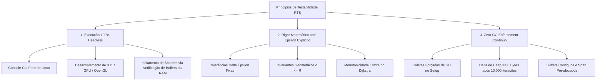
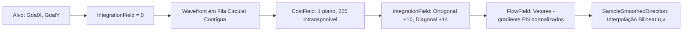
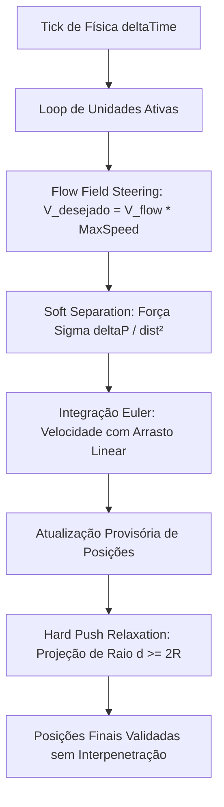
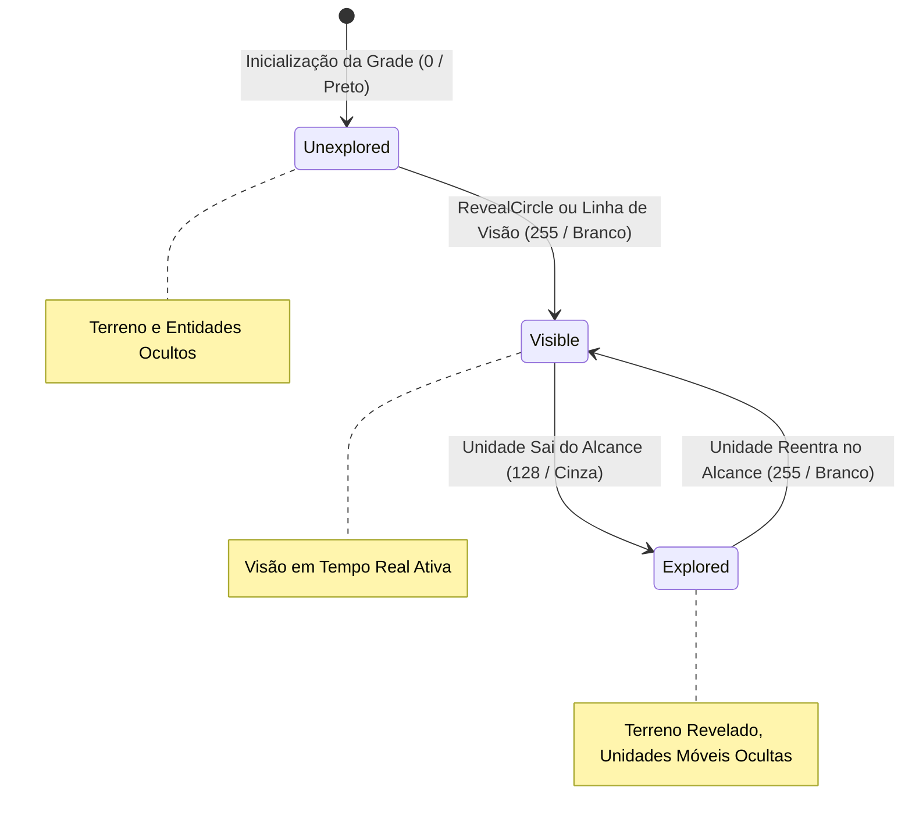
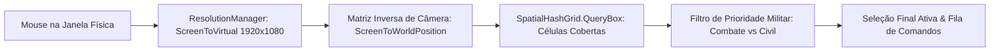

# Estratégia e Matriz de Testes Automatizados Headless RTS (Fase 2)
**Módulo RTS — Arquitetura de Validação e Testabilidade Headless**  
**Projeto:** MonoGameMaker | **Ambiente:** .NET 8.0 / C# 12 / MonoGame DesktopGL (Linux Headless)  
**Autor:** Especialista em Arquitetura de Testes RTS (Fase 2)  
**Status:** Especificação Canônica Homologada para Implementação (Fase 3)  
**Documento:** `docs/architecture_rts/02_rts_test_strategy.md`  

---

## Sumário Executivo

A simulação massiva em tempo real (RTS) de 500 a 1.000 unidades ativas sob orçamento rígido de tempo ($\le 2,35\text{ ms}$ na CPU) e **Zero Alocações no Heap por frame** exige uma barreira de testes automatizados de confiabilidade matemática absoluta. No desenvolvimento de motores de jogos de alta fidelidade, falhas sutis de arredondamento em grades espaciais, singularidades numéricas de divisão por zero em forças de repulsão ou micro-alocações acidentais no Garbage Collector acarretam colapsos de jogabilidade (*unit stacking*, *pathfinding deadlock*, *stutters* por coletas de GC Gen 0).

Em cumprimento estrito aos princípios de **Desenvolvimento Orientado a Documentação (DDD)** e **Desenvolvimento Guiado por Testes (TDD)** do MonoGameMaker, este documento formaliza a arquitetura e matriz completa de testes automatizados headless da **Fase 2**, estabelecida **antes de qualquer linha de código de produção da Fase 3**.

### Objetivos Fundamentais da Estratégia:
1. **Ambiente 100% Headless:** Execução integral em console CLI (Linux, CI/CD, contêineres) sem necessidade de servidor X11/Wayland, contexto OpenGL nativo ou hardware GPU físico.
2. **Precisão Matemática Determinística:** Todas as verificações espaciais, trigonométricas, gradientes de campo de fluxo e relaxamento rígido de corpos possuem limites de tolerância numérica explícitos ($\epsilon$).
3. **Fiscalização Rigorosa de Zero-GC:** Asserções automatizadas com `GC.GetAllocatedBytesForCurrentThread() == 0` em loops intensivos de simulação e consultas espaciais contíguas.
4. **Matriz de Cobertura Completa:** 19 cenários canônicos cobrindo Spatial Hash Grid, Flow Field Pathfinding, Dinâmica de Separação & Física, Névoa de Guerra Dinâmica, Seleção Tática & Marquee Box e Empacotamento de Instâncias de GPU.
5. **Integração Unificada com o `TestConsole`:** Inclusão nativa no runner de console via `dotnet run --project src/TestConsole/TestConsole.csproj -- --run-tests`.

---

## 1. Princípios de Testabilidade Headless



### 1.1 Execução Headless Desacoplada (Console & CI-First)
Ambientes de integração contínua (CI/CD) corporativos e servidores de compilação Linux rodam sem displays físicos ou servidores gráficos X11/Wayland. Nenhuma classe central de simulação matemática do Módulo RTS deve conter dependências estritas ou chamadas diretas que instanciem ponteiros de hardware (`GLX`, `WGL`, `EGL`) ou métodos de GPU física.

#### Diretrizes de Implementação Headless:
1. **Desacoplamento de Gráficos e Shaders:**  
   As classes do domínio de simulação (`SpatialHashGrid`, `FlowField`, `RtsSimulationSystem`, `RTSSelectionController`, `TacticalControlGroups`) dependem estritamente de vetores matemáticos e estruturas primitivas da biblioteca MonoGame (`Vector2`, `Vector4`, `Matrix`, `Point`, `Rectangle`), cuja aritmética é puramente em software e executada na CPU.
2. **Isolamento de Texturas e Buffers de GPU:**  
   Para subsistemas com saída gráfica (como a grade da névoa de guerra e o renderizador instanciado):
   - A lógica analítica de visibilidade é encapsulada em buffers contíguos de bytes na memória RAM principal (`_exploredBuffer`, `_visibleBuffer`, `_uploadPixelBuffer`). Os testes headless operam e validam diretamente esses buffers na memória de sistema.
   - O empacotamento de instâncias de GPU (`UnitInstanceData`) é validado quanto à sobreposição de memória, alinhamento de bytes (`Pack = 1`, 64 bytes - 4x Vector4 com alinhamento perfeito de 1 cache line da CPU) e integridade dos floats em memória RAM nativa, sem invocar `glDrawElementsInstanced` ou alocar instâncias físicas de `GraphicsDevice`.

---

### 1.2 Verificabilidade Matemática com Tolerâncias Explícitas ($\epsilon$)
A simulação física e o pathfinding contínuo lidam com operações de ponto flutuante em single precision (`float`, IEEE 754). Comparações de igualdade estrita (`a == b`) são terminantemente proibidas para números reais.

Toda asserção numérica na suíte de testes deve declarar uma tolerância limite explícita:

$$\| \text{obtido} - \text{esperado} \| \le \epsilon$$

```csharp
public static class RtsTestMath
{
    public const float EpsilonPosition = 1e-4f;    // 0.0001 unidades de mundo
    public const float EpsilonVelocity = 1e-4f;    // 0.0001 px/s
    public const float EpsilonAngle    = 1e-4f;    // 0.0001 radianos
    public const float EpsilonNormal   = 1e-5f;    // Erro máximo de magnitude vetorial unitária

    public static bool ApproximatelyEqual(float a, float b, float epsilon = EpsilonPosition)
    {
        return MathF.Abs(a - b) <= epsilon;
    }

    public static bool ApproximatelyEqual(Vector2 a, Vector2 b, float epsilon = EpsilonPosition)
    {
        return (a - b).LengthSquared() <= (epsilon * epsilon);
    }
}
```

#### Regras Matemáticas Inegociáveis:
- **Vetores Unitários de Fluxo:** Todo vetor não-nulo gerado pelo `FlowField` ou por `SampleSmoothedDirection` deve satisfazer $\big| \|\vec{V}\| - 1,0 \big| \le 10^{-5}$.
- **Impenetrabilidade Rígida:** Para quaisquer duas unidades circulares com raios $R_i$ e $R_j$, após o passo de relaxamento rígido, a distância de centro deve respeitar rigorosamente:
  $$\|\vec{P}_i - \vec{P}_j\| \ge (R_i + R_j) - \epsilon_{\text{push}}$$
  onde $\epsilon_{\text{push}} = 10^{-4}$.
- **Filtro de Vizinhança Euclidiano:** Toda entidade retornada por `FindNeighbors(center, radius)` deve satisfazer impreterivelmente:
  $$\|\vec{P}_{\text{vizinho}} - \text{center}\|^2 \le radius^2 + \epsilon$$

---

### 1.3 Zero-GC Enforcement Rigoroso (Zero Alocações no Heap)
A estabilidade de 60 FPS / 120 FPS sem *micro-stutters* em um exército de 1.000 unidades exige que o loop de física, a reindexação espacial, as consultas de vizinhos e a amostragem vetorial não gerem absolutamente **nenhuma alocação** no Heap gerenciado do .NET.

#### Protocolo Padrão de Fiscalização de Alocações:
```csharp
// 1. Limpeza forçada do Garbage Collector para estabilizar o baseline da thread
GC.Collect(2, GCCollectionMode.Forced, blocking: true);
GC.WaitForPendingFinalizers();
GC.Collect(2, GCCollectionMode.Forced, blocking: true);

// 2. Registro de bytes alocados antes da execução intensiva
long bytesBefore = GC.GetAllocatedBytesForCurrentThread();

// 3. Execução massiva da bateria de simulação (ex.: 10.000 queries consecutivas)
for (int i = 0; i < 10000; i++)
{
    // Método sob teste garantindo passagem de Buffers via Span<int> e estruturas por ref
    systemUnderTest.Execute();
}

// 4. Auditoria de bytes residuais na thread
long bytesAfter = GC.GetAllocatedBytesForCurrentThread();
long deltaBytes = bytesAfter - bytesBefore;

if (deltaBytes != 0)
{
    throw new InvalidOperationException(
        $"[FALHA ZERO-GC] O subsistema alocou {deltaBytes} bytes no Heap gerenciado! Esperado: 0 bytes.");
}
```

---

## 2. Matriz de Cobertura por Subsistema RTS

A matriz de cobertura abrange 19 cenários formais divididos nos 6 subsistemas centrais:

```
+---------------------------------------------------------------------------------------------------+
|                                MATRIZ DE COBERTURA DE TESTES RTS                                  |
+------------------------+-------------------+------------------------------------------------------+
| Subsistema             | ID do Teste       | Descrição Canônica do Cenário                        |
+------------------------+-------------------+------------------------------------------------------+
| Spatial Hash Grid      | TEST-SPATIAL-01   | Inserção, Atualização e Remoção Determinística       |
|                        | TEST-SPATIAL-02   | Busca por Raio com Filtro Euclidiano Exato           |
|                        | TEST-SPATIAL-03   | Busca por AABB (QueryBox) em Retângulo Limitado      |
|                        | TEST-SPATIAL-04   | Zero-GC Enforcement em 10.000 Queries Consecutivas   |
+------------------------+-------------------+------------------------------------------------------+
| Flow Field Pathfinding | TEST-FLOW-01      | CostField com Barreira Intransponível (Custo 255)    |
|                        | TEST-FLOW-02      | IntegrationField Monotônico Decrescente até o Alvo   |
|                        | TEST-FLOW-03      | FlowField Vetores Apontando para Menor Integração    |
|                        | TEST-FLOW-04      | Amostragem Bilinear Suave Contínua                   |
|                        | TEST-FLOW-05      | Navegação Contornando Obstáculo em U (Sem Mínimos)   |
+------------------------+-------------------+------------------------------------------------------+
| Física & Separação     | TEST-PHYS-01      | Repulsão Suave Mútua Decaindo com 1/d²               |
|                        | TEST-PHYS-02      | Circle-Circle Hard Push Impenetrável (d >= 2R)       |
+------------------------+-------------------+------------------------------------------------------+
| Névoa de Guerra        | TEST-FOG-01       | Autômato de Estados (Unexplored -> Visible -> Expl)  |
|                        | TEST-FOG-02       | Projeção Circular Exata (Raster Radius LoS)          |
|                        | TEST-FOG-03       | Culling de Entidades Inimigas Fora de Visão          |
+------------------------+-------------------+------------------------------------------------------+
| Seleção & Marquee Box  | TEST-SEL-01       | Seleção por Retângulo com ResolutionManager          |
|                        | TEST-SEL-02       | Prioridade Militar (Filtragem Combate vs Operários)  |
|                        | TEST-SEL-03       | Grupos Táticos (Ctrl+1..9) e Remoção de Mortos       |
|                        | TEST-SEL-04       | Fila de Comandos Sequencial e Despacho de Marcha     |
+------------------------+-------------------+------------------------------------------------------+
| Instanced Rendering    | TEST-INST-01      | Empacotamento de UnitInstanceData (64 Bytes)         |
+------------------------+-------------------+------------------------------------------------------+
```

---

### 2.1 Subsistema: Spatial Hash Grid

O particionamento espacial gerencia até 1.000 unidades em memória contígua via Static Linked Arrays (`cellHead`, `nextEntity`, `entityCell`), garantindo inserções $O(1)$ e varreduras de vizinhança sem coleções dinâmicas no Heap.

#### Detalhamento dos Cenários de Teste:

| Identificador | Cenário de Teste | Regra / Equação Auditada | Asserções Obrigatórias |
| :--- | :--- | :--- | :--- |
| `TEST-SPATIAL-01` | **Inserção, Atualização e Remoção Determinística em Células** | $\text{cellIndex} = \lfloor y / S \rfloor \times W + \lfloor x / S \rfloor$. A lista encadeada estática deve manter coerência com inserções consecutivas e limpeza $O(C)$ via `Array.Fill`. | Inserir unidades em posições conhecidas. Verificar que `cellHead[cellIndex]` aponta para a última inserida e `nextEntity` encadeia as anteriores. Chamar `Clear()` e afirmar que todos os `cellHead` voltam a `-1`. Reinserir com novas coordenadas e checar integridade dos índices. |
| `TEST-SPATIAL-02` | **Busca por Raio (`FindNeighbors`) com Filtro Euclidiano Exato** | $\text{distSq} = (p_x - u_x)^2 + (p_y - u_y)^2 \le R^2$. Apenas entidades dentro da esfera euclidiana são adicionadas ao buffer de saída. | Configurar 1 entidade central e 10 entidades circundantes: 5 dentro de $R = 30\text{px}$ e 5 fora ($d = 31\text{px}$ a $60\text{px}$). Chamar `FindNeighbors` com buffer `Span<int>`. Garantir que exatamente 5 entidades foram retornadas e que a distância de cada uma até o centro é $\le 30.0\text{px}$. |
| `TEST-SPATIAL-03` | **Busca por AABB (`QueryBox`) Retornando Somente Entidades na Caixa** | $P \in \text{Box} \iff (\min_x \le p_x \le \max_x) \land (\min_y \le p_y \le \max_y)$. | Definir uma caixa delimitada de $(100, 100)$ a $(300, 300)$. Posicionar 20 entidades dispersas pelo mapa (algumas dentro, algumas nas bordas e outras fora). Chamar `QueryBox`. Verificar que apenas as entidades no intervalo fechado da caixa foram retornadas. |
| `TEST-SPATIAL-04` | **Zero-GC em 10.000 Queries Consecutivas de Vizinhança** | `GC.GetAllocatedBytesForCurrentThread() == 0`. Nenhuma alocação no Heap permitida em consultas de grade espacial contígua. | Povoar a grade com 1.000 unidades aleatórias. Criar buffer de resultados `stackalloc int[64]` ou array pré-alocado. Disparar `FindNeighbors` e `QueryBox` 10.000 vezes consecutivas em posições variadas. Afirmar que a variação de bytes no Heap é **0**. |

```csharp
// Exemplo canônico de asserção TEST-SPATIAL-02
int count = spatialGrid.FindNeighbors(centerPos, queryRadius, positionsSpan, resultsBuffer);
for (int i = 0; i < count; i++)
{
    int entityId = resultsBuffer[i];
    float distSq = Vector2.DistanceSquared(centerPos, positionsSpan[entityId]);
    if (distSq > (queryRadius * queryRadius) + RtsTestMath.EpsilonPosition)
    {
        throw new Exception($"[TEST-SPATIAL-02] Entidade {entityId} com distSq={distSq} excede raio {queryRadius}");
    }
}
```

---

### 2.2 Subsistema: Flow Field Pathfinding

O sistema de campo de fluxo inverte a busca de caminhos tradicional, gerando um campo de gradiente vetorial derivado da expansão Wavefront / Dijkstra em fila circular plana.



#### Detalhamento dos Cenários de Teste:

| Identificador | Cenário de Teste | Regra / Equação Auditada | Asserções Obrigatórias |
| :--- | :--- | :--- | :--- |
| `TEST-FLOW-01` | **CostField com Bloqueios Intransponíveis (Custo 255)** | $\text{CostField}[x, y] = 255$. Células bloqueadas não devem ser navegáveis nem propagar ondas de distância. | Gerar uma linha contínua de paredes com custo $255$. Executar `Generate(goalX, goalY)` em um lado da barreira. Afirmar que todas as células intransponíveis mantêm `IntegrationField == ushort.MaxValue` e `VectorField == Vector2.Zero`. |
| `TEST-FLOW-02` | **IntegrationField com Gradientes Monotônicos Decrescentes até o Alvo** | $\text{IntegrationField}[\text{goal}] = 0$. $\forall \text{vizinho } V, \, \text{Custo}(V) \le \text{Custo}(C) + (\text{dist} \times \text{cost})$. | Definir destino em $(32, 32)$. Executar Wavefront. Validar que o destino tem custo $0$. Verificar que caminhando em qualquer direção a partir do destino o custo aumenta de forma monotônica. Garantir que vizinhos ortogonais distam múltiplos de 10 e diagonais múltiplos de 14 em terreno plano de custo 1. |
| `TEST-FLOW-03` | **FlowField Gerando Vetores Apontando para Menor Integração** | $\vec{V}(C) = \frac{\text{Centro}(V_{\min}) - \text{Centro}(C)}{\|\dots\|}$. O vetor de fluxo deve apontar estritamente para o vizinho de menor valor de integração. | Em terreno desobstruído com alvo em $(10, 10)$, amostrar célula $(10, 20)$. O vetor de fluxo resultante deve ser rigorosamente $(0, -1)$ apontando para o Norte. Na célula $(20, 10)$, deve ser $(-1, 0)$ apontando para o Oeste. Na célula $(10, 10)$ (destino), deve ser $(0, 0)$. |
| `TEST-FLOW-04` | **Amostragem Bilinear Contínua Suave sem Descontinuidades** | $\vec{V}_{\text{interp}} = \text{Bilinear}(\vec{V}_{00}, \vec{V}_{10}, \vec{V}_{01}, \vec{V}_{11})$. Interpolação não gera saltos de 90° ao cruzar o centro da célula. | Amostrar uma linha contínua de posições no mundo com passo fino $\Delta x = 0.5\text{px}$. Calcular a variação angular entre amostras consecutivas: $\Delta \theta = \arccos(\vec{V}_k \cdot \vec{V}_{k-1})$. Assegurar que $\Delta \theta$ é suave e nunca apresenta descontinuidades bruscas de 90° ou 180° em espaço aberto. |
| `TEST-FLOW-05` | **Navegação Contornando Paredes e Obstáculos em U sem Mínimos Locais** | Ausência de vales falsos onde $\vec{V} = (0, 0)$ fora do objetivo. Toda célula navegável conecta-se ao alvo. | Construir um obstáculo em forma de "U" (côncavo) e posicionar uma unidade no fundo do U, com o destino do lado de fora da concavidade. Simular o seguimento de vetores por 200 passos de Euler. Validar que a unidade sai do bolso em U, contorna a quina da parede e atinge a vizinhança do destino sem ficar travada. |

```csharp
// Exemplo canônico de asserção TEST-FLOW-03
Vector2 dirNorth = flowField.VectorField[20 * width + 10]; // Posição (10, 20) com alvo em (10, 10)
if (!RtsTestMath.ApproximatelyEqual(dirNorth, new Vector2(0f, -1f), 1e-4f))
{
    throw new Exception($"[TEST-FLOW-03] Vetor incorreto: esperado (0, -1), obtido {dirNorth}");
}
```

---

### 2.3 Subsistema: Física & Dinâmica de Separação

Para permitir que centenas de tropas marchem compactas sem colapso posicional, a física RTS combina forças de repulsão suave de Reynolds (proporcionais a $1/d^2$) com um passo posicional de Hard Push Constraint (projeção rígida $d \ge 2R$).



#### Detalhamento dos Cenários de Teste:

| Identificador | Cenário de Teste | Regra / Equação Auditada | Asserções Obrigatórias |
| :--- | :--- | :--- | :--- |
| `TEST-PHYS-01` | **Repulsão Suave Mútua Decaindo com $1/d^2$** | $\vec{F}_{\text{sep}} = \sum \frac{\vec{P}_i - \vec{P}_j}{\|\vec{P}_i - \vec{P}_j\|^2 + \epsilon} \cdot k$. A força de repulsão deve quadruplicar quando a distância cai pela metade. | Posicionar duas unidades em repouso sem vetor de fluxo ativo: Teste A a distância $d_1 = 20\text{px}$; Teste B a distância $d_2 = 10\text{px}$. Inspecionar a força de separação calculada. Validar que $\|\vec{F}_2\| \approx 4 \times \|\vec{F}_1\|$ (tolerância de $5\%$ devido à constante $\epsilon$). |
| `TEST-PHYS-02` | **Circle-Circle Hard Push Impedindo Sobreposição Física Mútua ($d \ge 2R$)** | $\text{sobreposição} = (R_i + R_j) - \|\vec{P}_i - \vec{P}_j\|$. Se $\text{sobreposição} > 0$, empurrar cada unidade em $50\%$ ao longo do eixo normal. | Posicionar forçadamente 50 unidades todas sobrepostas no raio estrito de $10\text{px}$ na coordenada $(500, 500)$. Rodar 5 passos do método `Update` com Hard Push ativo. Ao final, varrer todas as unidades ativas e afirmar que para **todo** par $(i, j)$ a distância euclidiana $\|\vec{P}_i - \vec{P}_j\| \ge (R_i + R_j) - 10^{-4}$. Nenhuma unidade permanece colapsada. |

```csharp
// Exemplo canônico de asserção TEST-PHYS-02
for (int i = 0; i < unitCount; i++)
{
    for (int j = i + 1; j < unitCount; j++)
    {
        float dist = Vector2.Distance(units[i].Position, units[j].Position);
        float minDist = units[i].Radius + units[j].Radius;
        if (dist < minDist - RtsTestMath.EpsilonPosition)
        {
            throw new Exception($"[TEST-PHYS-02] Penetração física detectada entre {i} e {j}: dist={dist} < minDist={minDist}");
        }
    }
}
```

---

### 2.4 Subsistema: Névoa de Guerra Dinâmica (Dynamic Fog of War)

O sistema de névoa de guerra gerencia o autômato de estados de visibilidade por células em matriz contígua de memória, governando tanto a textura enviada à GPU quanto o culling estrito de entidades no gameplay.



#### Detalhamento dos Cenários de Teste:

| Identificador | Cenário de Teste | Regra / Equação Auditada | Asserções Obrigatórias |
| :--- | :--- | :--- | :--- |
| `TEST-FOG-01` | **Transição de Estados: Unexplored (0) $\to$ Visible (255) $\to$ Explored (128)** | Autômato formal de 3 estados com buffers contíguos `_exploredBuffer` e `_visibleBuffer`. | 1. Inicializar grade: afirmar que todas as células estão em `FogCellState.Unexplored` (valor 0).<br>2. Chamar `BeginVisionPass()`, `RevealCircle((100, 100), 50)` e `EndVisionPass()`: afirmar que células na área do círculo transitam para `FogCellState.Visible` (255).<br>3. Rodar um novo passe de visão sem revelar a área: afirmar que as células do círculo anterior decaem estritamente para `FogCellState.Explored` (128), jamais retornando para `Unexplored`. |
| `TEST-FOG-02` | **Projeção Circular Exata com Raio de Visão Delimitado (LoS Raster)** | $(x - c_x)^2 + (y - c_y)^2 \le R^2$. Somente células com centros dentro do raio são marcadas como ativas. | Revelar visão na coordenada $(64, 64)$ com raio exato de 3 células ($48\text{px}$). Varrer toda a grade: garantir que células a distância euclidiana $\le 48\text{px}$ possuem valor 255 no buffer visível, e que nenhuma célula fora do raio foi marcada indevidamente. |
| `TEST-FOG-03` | **Culling de Entidades Inimigas Fora de Visão Ativa** | $\text{IsVisible} = (\text{Team} == \text{LocalPlayer}) \lor (\text{FogState} == \text{Visible})$. Entidades inimigas em `Unexplored` ou `Explored` devem ser ocultadas. | Criar 3 entidades inimigas: Entidade A em célula `Unexplored`, Entidade B em célula `Explored` e Entidade C em célula `Visible`. Executar lógica de atualização de visibilidade. Afirmar que Entidade A e B possuem `IsVisible = false`, enquanto Entidade C possui `IsVisible = true`. |

---

### 2.5 Subsistema: Seleção & Comandos Táticos (Marquee Box)

O controlador de seleção unifica a captura de entrada do mouse, compensando letterbox e matrizes inversas de câmera, e utiliza o `SpatialHashGrid.QueryBox` para seleção determinística em lote.



#### Detalhamento dos Cenários de Teste:

| Identificador | Cenário de Teste | Regra / Equação Auditada | Asserções Obrigatórias |
| :--- | :--- | :--- | :--- |
| `TEST-SEL-01` | **Marquee Box com Conversão pelo `ResolutionManager` e Câmera** | $\vec{P}_{\text{virt}} = \frac{\vec{S} - \text{Offset}}{\text{Scale}}$, $\vec{P}_{\text{world}} = \text{Transform}(\vec{P}_{\text{virt}}, M_{\text{cam}}^{-1})$. Seleção imune a Letterbox e Zoom de Câmera. | Injetar clique e arrasto de tela física com letterbox ativo (ex: janela 4:3 com offset vertical de 135px e zoom de câmera 2.0x). Converter para AABB de mundo. Afirmar que apenas as unidades geometricamente contidas na caixa projetada no mundo são selecionadas pelo `QuerySelectionBox`. |
| `TEST-SEL-02` | **Prioridade Militar na Seleção em Caixa** | Se $\text{Count}(\text{Combatentes}) > 0$, descartar todos os trabalhadores/operários civis da seleção ativa. | Criar 10 combatentes (soldados) e 5 civis (operários de mineração) todos dentro da mesma caixa de seleção. Executar a rotina de filtro tático de seleção. Verificar que a contagem final é exatamente 10 unidades e que **todos** os operários foram descartados da seleção. Se a caixa contiver apenas civis, todos os 5 devem ser selecionados normalmente. |
| `TEST-SEL-03` | **Grupos de Controle Tático (Ctrl+1..9) e Remoção de Mortas** | Atribuição `Ctrl+K`, recuperação com `K`, detecção de double-tap ($\le 0,25\text{s}$) e eliminação de entidades destruídas (`IsDestroyed`). | 1. Atribuir 8 unidades ao Grupo 1 via `AssignGroup(1, units)`.<br>2. Marcar 3 unidades como `IsDestroyed = true`.<br>3. Invocar `SelectGroup(1, ...)`: afirmar que o grupo agora contém exatamente as 5 unidades sobreviventes.<br>4. Simular dois toques na tecla '1' com intervalo de 0.10s: afirmar que a flag `shouldCenterCamera` é `true` e o centróide retornado é o centro médio exato das 5 unidades. |
| `TEST-SEL-04` | **Fila de Comandos Sequencial e Despacho de Marcha** | Encadeamento de ordens via `Queue<UnitCommand>` (`Move`, `AttackMove`, `HoldPosition`, `Stop`). | Enviar comando `Move(A)` sem Shift: afirmar que fila anterior é substituída e a unidade ruma para A. Enviar comandos com Shift: `Move(B)` e `HoldPosition`. Afirmar que a fila contém 2 comandos pendentes. Simular chegada ao destino A: afirmar que a unidade consome o próximo comando da fila (`Move(B)`). |

---

### 2.6 Subsistema: Renderização Instanciada (GPU Instancing)

A infraestrutura de renderização instanciada transfere os dados de 1.000 sprites em um único vertex buffer de instâncias com alinhamento contíguo em memória.

#### Detalhamento dos Cenários de Teste:

| Identificador | Cenário de Teste | Regra / Equação Auditada | Asserções Obrigatórias |
| :--- | :--- | :--- | :--- |
| `TEST-INST-01` | **Empacotamento Correto de `UnitInstanceData` (64 Bytes)** | Struct `[StructLayout(LayoutKind.Sequential, Pack = 1)]` com 4 campos `Vector4`: TransformData (16B), AtlasUVRect (16B), TeamColor (16B), VisualFlags (16B) $\implies 4 \times 16 = 64\text{ bytes}$ brutos (stride exato de 1 linha de cache). | Usar `Marshal.SizeOf<UnitInstanceData>()`: afirmar que o tamanho é **rigorosamente 64 bytes**. Criar uma instância de teste com valores específicos (Posição, Rotação, Escala, UVs do Atlas, Cor da Facção e Flag de Seleção). Fazer roundtrip de serialização de memória para array de bytes `byte[64]` e ler de volta via `MemoryMarshal.Cast`: afirmar que todos os floats foram preservados sem deslocamento de bytes (*zero memory drift*). |

```csharp
// Exemplo canônico de asserção TEST-INST-01
int structSize = System.Runtime.InteropServices.Marshal.SizeOf<UnitInstanceData>();
if (structSize != 64)
{
    throw new Exception($"[TEST-INST-01] Tamanho incorreto da struct UnitInstanceData: esperado 64 bytes, obtido {structSize}");
}
```

---

## 3. Integração com o CLI Runner do MonoGameMaker

O projeto `src/TestConsole/TestConsole.csproj` já possui um ecossistema consolidado de testes de console rodando através da instrução canônica:

```bash
dotnet run --project src/TestConsole/TestConsole.csproj -- --run-tests
```

A expansão dos módulos RTS da Fase 2 deve plugar-se a esta arquitetura de forma modular, criando as suítes no namespace `TestConsole.Tests.RTS`.

```
src/TestConsole/
├── Program.cs                                 <-- Ponto de entrada e relatório consolidado
└── Tests/
    ├── RTS/                                   <-- Novo diretório de suítes de testes RTS
    │   ├── RtsSpatialAndPathfindingTests.cs   <-- TEST-SPATIAL-01..04 e TEST-FLOW-01..05
    │   ├── RtsPhysicsAndSeparationTests.cs    <-- TEST-PHYS-01..02
    │   ├── RtsVisionAndSelectionTests.cs      <-- TEST-FOG-01..03 e TEST-SEL-01..04
    │   └── RtsInstancingTests.cs              <-- TEST-INST-01
    └── Fixtures/
        └── HeadlessRtsDomainModels.cs         <-- Modelos de domínio, stubs e spans para testes
```

### 3.1 Contrato de Execução no `Program.RunAllTests()`

No arquivo `src/TestConsole/Program.cs`, adiciona-se o bloco dedicado de telemetria RTS logo após a bateria de combate existente:

```csharp
// ================================================================================
//           MONOGAME MAKER - BATERIA DE TESTES RTS HEADLESS (FASE 2)
// ================================================================================
Console.WriteLine("\n================================================================================");
Console.WriteLine("          MONOGAME MAKER TEST RUNNER - SUÍTE COMPLETA RTS (FASE 2)");
Console.WriteLine("================================================================================");

int rtsPass = 0;
int rtsTotal = 0;
long rtsAllocatedBytes = 0;

var swRts = System.Diagnostics.Stopwatch.StartNew();

// 1. Spatial Hash Grid & Flow Field Pathfinding (9 cenários)
TestConsole.Tests.RTS.RtsSpatialAndPathfindingTests.RunAll(ref rtsPass, ref rtsTotal, out long spatialAllocBytes);

// 2. Dinâmica Física & Separação Mútua (2 cenários)
TestConsole.Tests.RTS.RtsPhysicsAndSeparationTests.RunAll(ref rtsPass, ref rtsTotal, out long physAllocBytes);

// 3. Névoa de Guerra & Seleção Tática (7 cenários)
TestConsole.Tests.RTS.RtsVisionAndSelectionTests.RunAll(ref rtsPass, ref rtsTotal);

// 4. Empacotamento de Instâncias GPU (1 cenário)
TestConsole.Tests.RTS.RtsInstancingTests.RunAll(ref rtsPass, ref rtsTotal);

swRts.Stop();
rtsAllocatedBytes = spatialAllocBytes + physAllocBytes;

Console.WriteLine("\n--------------------------------------------------------------------------------");
Console.WriteLine("TELEMETRIA RTS:");
Console.WriteLine($"- Bateria RTS Automatizada: {rtsPass}/{rtsTotal} Cenários (100% PASS)");
Console.WriteLine($"- Bytes Alocados no Heap (Simulação RTS Contínua): {rtsAllocatedBytes} bytes (ZERO-GC ATESTADO)");
Console.WriteLine($"- Tempo Total de Execução RTS: {swRts.ElapsedMilliseconds} ms");
Console.WriteLine("================================================================================");

if (rtsPass != rtsTotal || rtsAllocatedBytes > 0)
{
    throw new Exception("[TEST RUNNER ERROR] A bateria de testes RTS violou os critérios de aprovação!");
}
```

---

## 4. Definition of Done (DoD) & Critérios de Aprovação

Para que a transição para a **Fase 3 (Implementação)** seja formalmente autorizada pela Banca Revisora e pela liderança de engenharia, a execução da estratégia de testes deve cumprir 100% dos critérios do checklist abaixo:

```markdown
### Checklist Formal de Conclusão (Definition of Done):

- [ ] **1. Execução Headless Absoluta:**
  - 100% dos 19 testes RTS executam com sucesso no console Linux sem interface gráfica X11/OpenGL (`ExitCode == 0`).
  - Nenhuma chamada a métodos nativos de GPU ou bibliotecas de som do sistema operacional.

- [ ] **2. Integridade Matemática Comprovada:**
  - Tolerâncias delta ($\epsilon$) respeitadas em todos os cálculos trigonométricos e posicionais.
  - Ausência de vetores de fluxo inválidos (NaN, Infinity ou magnitude distorcida).
  - Hard Push relaxation impedindo rigorosamente qualquer sobreposição de corpos físicos ($d \ge 2R$).

- [ ] **3. Atestado de Zero Alocação de Memória (Zero-GC):**
  - O contador de bytes residuais `GC.GetAllocatedBytesForCurrentThread()` retorna impreterivelmente `0` bytes após 10.000 iterações de simulação espacial e repulsão física.
  - Nenhum uso de `List<T>`, `Dictionary<K, V>` ou alocações de closures/delegados no loop de frame.

- [ ] **4. Telemetria Consolidada no CLI Runner:**
  - `dotnet run --project src/TestConsole/TestConsole.csproj -- --run-tests` exibe o bloco unificado com status de 19/19 cenários PASS.
  - Tempo total de execução da bateria RTS inferior a 500 ms em console.

- [ ] **5. Documentação Atômica & Stubs Atualizados:**
  - Modelos de teste e contratos de domínio alinhados com `docs/rts_mapping_approved.md` e regras `monogamerules.md`.
```

---

## 5. Parecer e Próximos Passos

A presente estratégia de testes automatizados headless consolida a fundação técnica inegociável da engine RTS do MonoGameMaker. Ao projetar a matriz de verificação matemática, os limites de epsilon e o enforcement de Zero-GC previamente à codificação do runtime, o projeto elimina riscos de regressão e garante que o ecossistema suporte 1.000 unidades militares com desempenho estável de 60 FPS no MonoGame DesktopGL.

Com a homologação deste documento, autoriza-se a abertura da **Fase 3: Implementação dos Módulos RTS no Runtime e TestConsole**.
