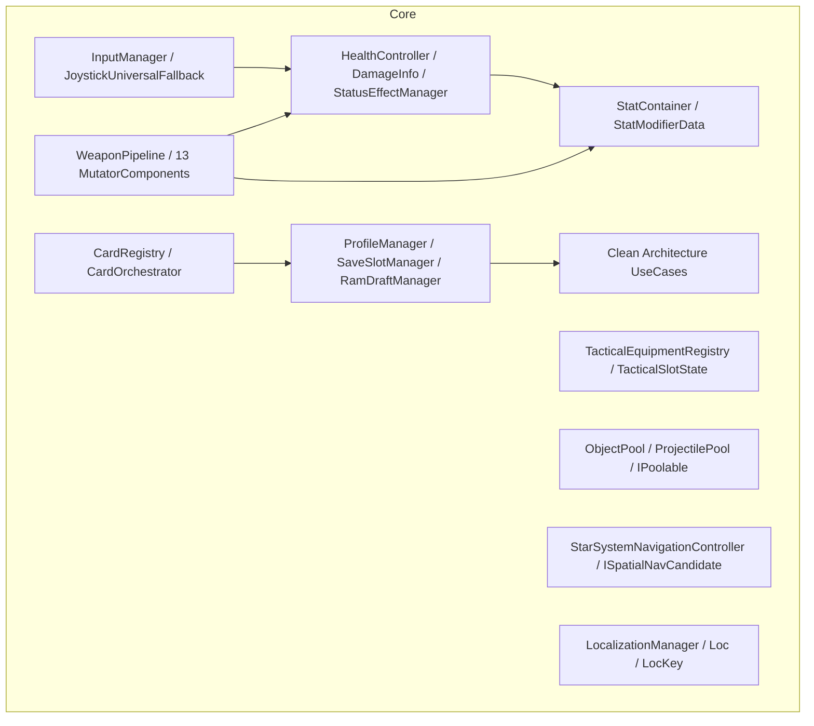
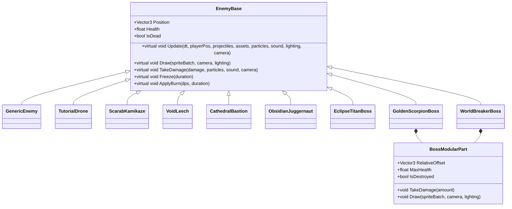
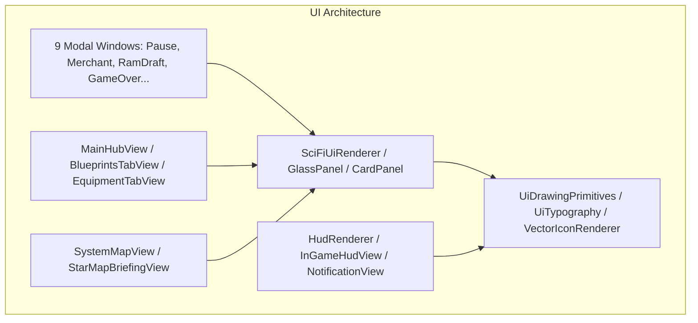
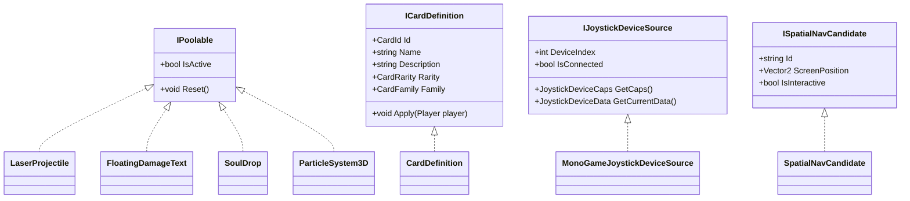
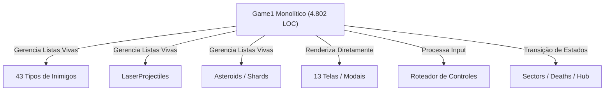
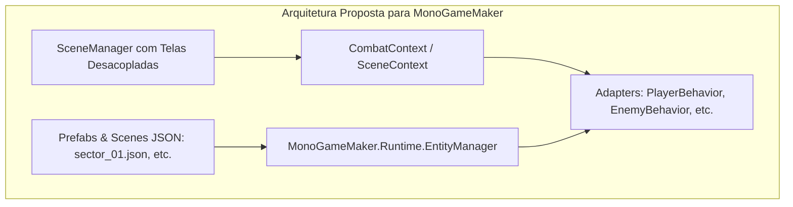

# Auditoria Arquitetural & Mapeamento de Classes - Space_v7 para MonoGameMaker
**Fase 1: Mapeamento de Estrutura, Taxonomia de Classes, Hierarquias, Acoplamentos e Interfaces**  
**Data:** 06/10/2026 | **Ambiente:** .NET 8.0 / MonoGame DesktopGL 3.8.* | **Status:** Concluído

---

## Sumário Executivo

Este documento estabelece o mapeamento técnico exaustivo do código-fonte do projeto **Space_v7** (`/home/bruno/Projects/Space_V7`), visando sua portabilidade, modularização e alinhamento com a arquitetura do **MonoGameMaker** (`/home/bruno/Projects/MonoGameMaker`).

A auditoria cobriu 100% dos arquivos do repositório, inspecionando todos os módulos funcionais (`Core`, `Entities`, `Systems`, `Graphics`, `Audio`, `UI`, `Runtime`, `Services`), os arquivos parciais do monolito `Game1` (`Game1.cs`, `Game1.InputHandling.cs`, `Game1.Rendering.cs`, `Game1.StateFlow.cs`), o ponto de entrada e suite de testes (`Program.cs`, `Tests/`), bem como os contratos de interface, structs e enums.

### Métricas Consolidadas do Código-Fonte

| Módulo / Camada | Arquivos (.cs) | Linhas de Código (LOC) | Classes | Structs | Enums | Interfaces | Tipos Totais |
| :--- | :---: | :---: | :---: | :---: | :---: | :---: | :---: |
| **Game1 (Monolito Central)** | 5 | 5.116 | 3 | 1 | 2 | 0 | 6 |
| **Core** | 75 | 15.127 | 68 | 8 | 17 | 4 | 97 |
| **Entities** | 78 | 34.364 | 82 | 12 | 60 | 0 | 154 |
| **Systems** | 31 | 16.032 | 33 | 1 | 6 | 0 | 40 |
| **Graphics** | 27 | 13.480 | 32 | 10 | 2 | 0 | 44 |
| **Audio** | 7 | 4.233 | 5 | 0 | 4 | 0 | 9 |
| **UI** | 38 | 16.512 | 43 | 0 | 6 | 0 | 49 |
| **Runtime (Shared/Engine)** | 10 | 4.217 | 11 | 2 | 1 | 0 | 14 |
| **Services** | 1 | 173 | 1 | 0 | 0 | 0 | 1 |
| **Subtotal (Código de Produção)** | **272** | **109.254** | **278** | **34** | **98** | **4** | **414** |
| **Tests (Suites Automatizadas)** | 67 | 26.745 | 67 | 0 | 0 | 0 | 67 |
| **TOTAL GERAL** | **339** | **135.999** | **345** | **34** | **98** | **4** | **481** |

---

## 1. Visão Geral da Estrutura de Diretórios e Arquivos do Space_v7

A organização de pastas do Space_v7 segue uma divisão clássica de jogo MonoGame enriquecido, porém com fortes desvios em relação ao paradigma de scripts orientados a componentes preconizado pelo MonoGameMaker.

### Mapa Estrutural do Repositório

```
/home/bruno/Projects/Space_V7/
├── Space_v7.csproj               # Projeto .NET 8.0, MonoGame DesktopGL 3.8, ImGui.NET, NLayer
├── Program.cs                     # Entrypoint + CLI Test Runner integrado com switches de teste
├── Game1.cs                       # Bootstrap MonoGame, campos globais de entidades, loop central
├── Game1.InputHandling.cs         # Despacho massivo de input por tela/modal (1.708 linhas)
├── Game1.Rendering.cs             # Pipeline multi-pass: Background, 3D world, VFX, PBR, Overlays
├── Game1.StateFlow.cs             # Transições de fluxo de jogo: setores, mortes, bosses, drafts
├── Core/                          # Regras de negócio, progressão, cards, mutatores de armas, IO
│   ├── Cards/                     # Cartas de upgrade do armory (ICardDefinition, CardOrchestrator)
│   ├── Combat/                    # DamageInfo (readonly struct), HealthController, StatusEffects
│   ├── Input/                     # InputManager (1.723 linhas), JoystickUniversalFallback
│   ├── Localization/              # LocKey, LocalizationManager, arquivos de idioma
│   ├── Loot/                      # Tabelas de probabilidades de loot (LootTable, LootEntry)
│   ├── Math/                      # Fórmulas de escala de atributos e XP (ProgressionMath)
│   ├── Merchant/                  # Catálogo de compras e diálogos do mercador espacial
│   ├── Navigation/                # Navegação orbital cinematográfica (StarSystemNavigationController)
│   ├── Pooling/                   # IPoolable, ObjectPool<T>, ProjectilePool
│   ├── Progression/               # Perfis, slots de save, mochila de projetos, módulos RAM
│   │   ├── Blueprints/            # BlueprintCatalog, BlueprintDefinition
│   │   └── UseCases/              # Use cases puros (Clean Architecture) para progressão e morte
│   ├── Settings/                  # GameSettings persistente em JSON
│   ├── Ships/                     # ShipDefinition, ShipRegistry (estatísticas base das naves)
│   ├── Stats/                     # StatContainer, StatModifierData, StatType
│   ├── Tactical/                  # Habilidades ativas (EMP, Crio, etc.) e cooldowns
│   └── Weapons/                   # WeaponPipeline, ShotContext
│       └── Mutators/              # 13 componentes de mutação de projéteis e disparos
├── Entities/                      # Todas as entidades do jogo (Player, Bosses, Mobs, Hazards)
│   ├── Enemies/                   # EnemyBase (710 linhas) e 43 tipos de inimigos/bosses
│   │   └── Modular/               # BossModularPart (partes destrutíveis de chefes compostos)
│   ├── Environment/               # PlanetNode, PortalEntity
│   ├── Hazards/                   # Singularity, FireTrail, CryoWall, Shockwaves
│   ├── Progression/               # BlueprintDropItem, EncryptedMemoryCore
│   ├── Souls/                     # LostSoulStashEntity, SoulDrop (IPoolable), SoulTier
│   └── VFX/                       # ShipVfxController (fumaça, faíscas, distorções de motores)
├── Systems/                       # Gerenciadores de subsistemas de gameplay
│   ├── Collision/                 # ProjectileCollisionHandler, ShipCollisionHandler, HazardCollisionHandler
│   ├── Combat/                    # FloatingTextManager
│   ├── Environment/               # SectorHazardSystem, vapores corrosivos
│   ├── Navigation/                # Layout da galáxia, nós estelares, desvio de asteroides
│   ├── Progression/               # PlayerProgressionService, DraftManager, StageDifficultyService
│   ├── Souls/                     # SoulManager
│   ├── Tutorial/                  # TutorialManager (estados do tutorial e banner)
│   ├── CollisionSystem.cs         # Orquestrador de colisões com passagem massiva de parâmetros
│   ├── SectorManager.cs           # Orquestrador de setores (5.927 linhas, dados hardcoded)
│   └── WaveManager.cs             # Máquina de geração de ondas e padrões de formação
├── Graphics/                      # Renderizadores, shaders, malhas e utilitários visuais
│   ├── Assets/                    # ProceduralTextureFactory, Mesh3DFactory, IconAssetRegistry
│   ├── Effects/                   # Shaders HLSL em wrappers C#: Hologram, Shield, Vortex, Juice
│   ├── Particles/                 # ParticleSystem 2D clássico
│   ├── Shaders/                   # BloomEffect.fx
│   ├── Shockwaves/                # ShockwaveManager, ShockwaveInstance
│   ├── Telegraphs/                # AttackTelegraphRenderer (linhas e arcos de aviso de ataque)
│   ├── Trails/                    # RibbonTrailRenderer, TrailRibbon (rastros de projéteis e naves)
│   ├── Weather/                   # WeatherParticleSystem, WeatherType (chuva de cinzas, nevasca)
│   ├── AssetManager.cs            # Fachada central de texturas e malhas (793 linhas)
│   ├── LightingRenderer.cs        # Iluminação dinâmica pontual e ambiente 3D (1.733 linhas)
│   └── Mesh3D.cs, GalaxyMesh.cs   # Malhas 3D procedurais e caches de asteroides e galáxias
├── Audio/                         # Sistema de áudio completo
│   ├── AudioManager.cs            # Fachada de reprodução de efeitos e música
│   ├── SoundSynthesizer.cs        # Sintetizador procedural de áudio por software (2.144 linhas)
│   ├── MusicManager.cs            # Fading e troca de trilhas com suporte a volume mestre/bgm
│   ├── Mp3AudioLoader.cs          # Leitor NLayer puro de MP3 (sem dependência de Content Pipeline)
│   └── DialogueManager.cs         # Gerenciamento de falas narradas e legendas
├── UI/                            # Telas, modais, rendering sci-fi e HUD
│   ├── Codex/                     # HostileIntelCodexView (bestiário de inimigos)
│   ├── Common/                    # Primitivas de desenho vetorial sci-fi, tipografia, ícones
│   ├── Dev/                       # DevSandboxView (painel de depuração rápida)
│   ├── Hub/                       # Telas do Hub: MainHubView, BlueprintsTab, EquipmentTab, etc.
│   ├── InGame/                    # InGameHudView, NotificationView
│   ├── Map/                       # SystemMapView (mapa estelar interativo)
│   ├── Modals/                    # 9 modais: Pause, GameOver, Merchant, RamDraft, Settings, etc.
│   ├── Navigation/                # StarMapBriefingView
│   ├── Rendering/                 # Renderizadores Sci-Fi: SciFiUiRenderer, GlassPanel, CardPanel
│   └── Tutorial/                  # Banners e caixas de diálogo do tutorial
├── Runtime/                       # Componentes de engine compartilhados com MonoGameMaker
│   ├── Camera2D.cs, Camera3D.cs   # Câmeras com screenshake quadrático por trauma e raycasting
│   ├── GameState.cs               # Blackboard global chave-valor persistente em JSON
│   ├── ParticleSystem3D.cs        # Emissor volumétrico Zero-GC de partículas 3D (1.295 linhas)
│   ├── PbrMaterial.cs             # Materiais PBR com Albedo, Normal, Emissive, Roughness, Metallic
│   ├── PostProcessManager.cs      # Pipeline HDR multi-pass com Bloom e ACES Filmic Tone Mapping
│   ├── ResolutionManager.cs       # Escala virtual de resolução e matriz de projeção
│   ├── TextRenderer.cs            # Renderizador de texto procedural/fallback
│   └── TextureProcessor.cs        # Normal maps por Sobel, keying de fundo e extração emissiva
└── Services/
    └── HitstopManager.cs          # Congelamento temporal tátil em impactos (Game Feel)
```

---

## 2. Inventário de Classes por Módulo

### 2.1. O Monolito Central: `Game1` e o EntryPoint

O módulo central é composto por 5 arquivos que totalizam **5.116 linhas de código**:

| Arquivo | LOC | Responsabilidade Central | Dependências Principais |
| :--- | :---: | :--- | :--- |
| [`Program.cs`](file:///home/bruno/Projects/Space_V7/Program.cs) | 314 | Ponto de entrada do executável. Contém um **test runner de linha de comando embutido** com mais de 30 flags para despacho de testes automatizados sem dependências externas de runner. | `Space_v7.Tests.*`, `Game1` |
| [`Game1.cs`](file:///home/bruno/Projects/Space_V7/Game1.cs) | 1.376 | **God Class** e bootstrap do MonoGame. Mantém 65 campos, incluindo todas as instâncias de subsistemas, câmeras, listas de entidades vivas (`_enemies`, `_projectiles`, `_asteroids`, `_powerUps`), dev sandbox e loop principal. | `GraphicsDeviceManager`, `SpriteBatch`, `Player`, `AssetManager`, `LightingRenderer`, `ParticleSystem3D`, `SectorManager`, `WaveManager`, `CollisionSystem` |
| [`Game1.InputHandling.cs`](file:///home/bruno/Projects/Space_V7/Game1.InputHandling.cs) | 1.708 | Tratamento de entradas de teclado, mouse e controle por estado de jogo. Roteia eventos de menu, seleção de perfis, navegação no hub, mira de nave, disparo contínuo e carregado. | `InputManager`, `ProfileManager`, `DraftManager`, `StarSystemNavigationController`, `DevSandboxView` |
| [`Game1.Rendering.cs`](file:///home/bruno/Projects/Space_V7/Game1.Rendering.cs) | 886 | Pipeline de renderização gráfico estruturado em 7 passes sequenciais: Background espacial 3D, PixelArt 3D, High-Res VFX, Cena PBR 3D, Post-Processing/Bloom, Overlays/UI e Métricas de Debug (FPS/FrameTime). | `PostProcessManager`, `BloomRenderer`, `PixelArtRenderer`, `LightingRenderer`, `HudRenderer`, `ResolutionManager` |
| [`Game1.StateFlow.cs`](file:///home/bruno/Projects/Space_V7/Game1.StateFlow.cs) | 834 | Gerencia transições de máquina de estados: início de setores, conclusão de ondas, avanço no mapa estelar, checkpoints de morte com penalidade de almas e ressurreição. | `SectorManager`, `WaveManager`, `SaveSlotManager`, `ProfileManager`, `DraftManager`, `TutorialManager` |

---

### 2.2. Módulo `Core` (75 arquivos, 15.127 LOC, 97 tipos)

O `Core` abriga os subsistemas de regras de negócio, dados, progressão, combate desacoplado e abstração de hardware.



#### Detalhamento dos Sub-módulos do `Core`:

1. **`Core/Combat`**:
   - `DamageInfo` (`readonly struct`): Estrutura de dados imutável com `Amount`, `DamageType`, `ArmorPenetration`, `IsCritical`, `CritMultiplier`.
   - `DamageType` (`enum`): `Physical`, `Energy`, `Cryo`, `Corrosive`, `Plasma`, `TrueDamage`.
   - `HealthController` (`class`): Controla vida e escudo com buffers de regeneração, delays e eventos (`OnHealthDepleted`, `OnShieldBroken`).
   - `StatProfile` (`class`): Tabela estática de atributos base para naves e inimigos.
   - `StatusEffectManager` (`class`): Aplica e atualiza congelamento, paralisia, queimadura, veneno e lentidão sem alocação por frame.
   - `ColorPaletteSystem` (`class`): Mapeamento cromático dinâmico para flashes de dano e auras.

2. **`Core/Stats`**:
   - `StatContainer` (`class`): Recalcula valores de atributos (MoveSpeed, Shield, FireRate, Damage) através de acumuladores aditivos e multiplicativos.
   - `StatModifierData` (`readonly struct`): Modificador com `StatType`, `AddValue`, `MultValue`.
   - `StatType` (`enum`): Enumera os atributos modificáveis do jogo.

3. **`Core/Weapons` & `Core/Weapons/Mutators`**:
   - `WeaponPipeline` (`class`): Orquestra o cálculo de dispersão, cadência, penetração e efeitos de projéteis.
   - `ShotContext` (`struct`): Parâmetros do tiro no instante de disparo.
   - **13 Mutatores de Armas** (padrão de componentes injetáveis):
     - `BlastRadiusMutatorComponent` (dano em área ao impacto)
     - `DashCooldownMutatorComponent` (redução de recarga de dash)
     - `FireRateMutatorComponent` (aceleração de cadência)
     - `FireTrailDashComponent` (deixa rastro de fogo ao esquivar)
     - `GenericStatMutatorComponent` (modificador genérico de atributos)
     - `NovaBurstMutatorComponent` (onda de choque ao estourar o escudo)
     - `PlasmaSingularityMutatorComponent` (vórtice gravitacional)
     - `ProjectileSpeedMutatorComponent` (velocidade do projétil)
     - `ShieldRegenMutatorComponent` (tempo e taxa de recarga do escudo)
     - `StaticDischargeMutatorComponent` (descarga de raios em cadeia)
     - `ThermalShockMutatorComponent` (dano bônus ao acertar alvos queimando com crio)
     - `TimeDilationMutatorComponent` (dilatação do tempo em situações críticas)
     - `VacuumMagnetMutatorComponent` (atração magnética de almas e drops)

4. **`Core/Progression` & `UseCases`**:
   - `PlayerProfile` (`class`): Modelo de dados serializável contendo almas acumuladas, blueprints liberados, naves compradas e histórico de setores.
   - `ProfileManager` (`class`): Singleton que gerencia o perfil ativo e persistência em disco.
   - `SaveSlotManager` (`class`): Gerenciador multi-slot (`save_slot_1.json`, `save_meta.json`).
   - `RamModuleCatalog` & `RamDraftManager`: Sistema de seleção estilo roguelike para slots de RAM da nave com bônus de conjunto (`RamSynergyFamily`).
   - `BlueprintBackpack` & `BlueprintCatalog`: Inventário e árvore tecnológica de projetos desbloqueados.
   - **Use Cases Puros** (`Core/Progression/UseCases/`):
     - `InstallRamModuleUseCase`
     - `ProcessPlayerDeathUseCase`
     - `RecoverLostSoulStashUseCase`
     - `RollHubArmoryDraftUseCase`

5. **`Core/Cards`**:
   - `ICardDefinition` (`interface`): Contrato para cartas draftáveis.
   - `CardDefinition` (`class : ICardDefinition`): Implementação concreta de upgrades permanentes/de run.
   - `CardOrchestrator` & `CardRegistry`: Seleção aleatória balanceada por raridade (`CardRarity`) e família (`CardFamily`).

6. **`Core/Input`**:
   - `InputManager` (`class`, 1.723 linhas): Unifica teclado, mouse e gamepads com suporte a deadzones, buffer de ações e detecção de troca de dispositivo.
   - `JoystickUniversalFallback` (`class`): Wrapper para gamepads genéricos via SDL mapping database.
   - `IJoystickDeviceSource` (`interface`): Abstração de fonte de dados do joystick implementada por `MonoGameJoystickDeviceSource`.
   - `InputGlyphManager`: Mapeia botões físicos para ícones na tela (teclado vs Xbox vs PlayStation).

7. **`Core/Pooling`**:
   - `IPoolable` (`interface`): Define `bool IsActive { get; set; }` e `void Reset()`.
   - `ObjectPool<T>` (`class where T : class, IPoolable, new()`): Pool genérico thread-safe com expansão dinâmica.
   - `ProjectilePool` (`class`): Especialização para pré-alocação maciça de tiros a laser.

8. **`Core/Navigation`**:
   - `StarSystemNavigationController` (`class`, 1.218 linhas): Câmera e transições no mapa espacial entre nós galácticos.
   - `ISpatialNavCandidate` (`interface`): Interface para entidades selecionáveis no mapa estelar.

---

### 2.3. Módulo `Entities` (78 arquivos, 34.364 LOC, 154 tipos)

O módulo `Entities` é o mais volumoso do projeto, contendo a lógica individual de cada elemento dinâmico no campo de batalha.



#### Categorização de Entidades:

1. **O Jogador (`Entities/Player.cs`, 2.732 LOC)**:
   - Classe autônoma e centralizadora.
   - Agrega internamente: `HealthController`, `StatProfile`, `StatContainer`, `StatusEffectManager`, `WeaponPipeline`, `TacticalSlotState` (2 slots), componentes de RAM, e `ShipVfxController`.
   - Possui lógica de propulsão física, rotação inercial, recuo de tiros, tiro carregado (Charge Shot) em 3 tiers, e disparo contínuo.
   - **Débito:** Seu método `Update` recebe 10 parâmetros concretos a cada frame.

2. **Inimigos Comuns e Minions (`Entities/Enemies/`)**:
   - Todos derivam de `EnemyBase` (710 linhas).
   - Inimigos ágeis/básicos: `GenericEnemy`, `TutorialDrone`, `ScarabKamikaze`, `ThermiteScarab`, `CryoMineScarab`, `CauterizerScarab`, `ParadoxKamikaze`, `VoidLeech`, `VoidViper`, `EchoViper`, `PyreViper`, `AcidStinger`, `SolarRaider`, `VoidSiphonScout`, `AegisScout`, `AbyssalSporeScout`, `SporeTorpedoMine`, `WorldBreakerMine`, `BioNoduleCocoon`, `FrostBiter`, `PyreHellhound`, `CorrosiveSpitter`, `EventHorizonSniper`, `SingularityWeaver`, `ChronosLancer`, `TemporalStalker`, `ShadowPhantom`, `BlizzardMirage`, `NullweaverInterceptor`, `NecroMantaSkirmisher`.

3. **Sub-Chefes e Bastions**:
   - Naves pesadas com escudos rotativos e múltiplas fases: `ChitinHulkBastion`, `CathedralBastion`, `StasisBastion`, `CalderaSiegeBastion`, `DreadCruiser`, `OblivionSiegeFrigate`, `CrystalGoliath`, `ObsidianJuggernaut`, `GlacierJuggernaut`, `ObsidianStalker`, `GearworkBombardier`, `VenomousRammer`.

4. **Os 12 Chefes Épicos**:
   - `EclipseTitanBoss`: Asas mecânicas com animação procedural, lasers omnidirecionais e orbes teleguiados.
   - `VoidLeviathanBoss`: Serpente cósmica segmentada com movimentação sinusoidal 3D.
   - `GoldenScorpionBoss`: Escorpião mecânico com cauda articulada modular e geração de clones sombrios.
   - `WorldBreakerBoss`: Fortaleza espacial com blindagens laterais destrutíveis (`BossModularPart`) e feixes cortantes de plasma.
   - `ForgemasterVulcanusBoss`: Foco em erupções de magma e martelos termais de alta pressão.
   - `AbyssalKrakenBoss`: Tentáculos autônomos com ancoragem e armadilhas de vácuo.
   - `PyreArchonBoss` & `ArchonAethelgardBoss`: Transições de postura de combate (ArchonStance) e tempestades solares.
   - `FrostWardenYmirBoss`: Paredes de gelo reflexivas e ondas de choque criogênicas.
   - `QueenToxicaHiveBoss`: Favo biológico gerador de enxames de escaravelhos e poças de ácido.
   - `ChronoOverlordBoss`: Manipulação de tempo, retrocesso temporal e clones quânticos (`QuantumMirrorClone`).
   - `OblivionSingularityBoss`: Distorção gravitacional de renderização com contração de projéteis.

5. **Projéteis, Asteroides e Recursos**:
   - `LaserProjectile` (1.201 LOC, `IPoolable`): Unifica projéteis amigos e hostis com ricochete, piercing, rastro e explosão.
   - `Asteroid3D` & `AsteroidShard3D`: Malha 3D deformada com física de colisão elástica e fratura em múltiplos estilhaços.
   - `PowerUp`: Itens colecionáveis temporários (Overdrive, Shield Booster, Speed, Magnet).
   - `ElectricSoul` & `SoulDrop` (`IPoolable`): Moeda do jogo com níveis (`SoulTier`: Minor, Major, Exalted, Divine).
   - `LostSoulStashEntity`: Marcador de morte estilo "Souls" onde o jogador deve retornar para recuperar almas perdidas.
   - `EncryptedMemoryCore` & `BlueprintDropItem`: Drops de progressão permanente.

6. **Hazards Ambientais (`Entities/Hazards/`)**:
   - `CryoWallHazard`, `FireTrailHazard`, `PlasmaSingularityHazard`, `TutorialShockwaveHazard`.

---

### 2.4. Módulo `Systems` (31 arquivos, 16.032 LOC, 40 tipos)

O módulo `Systems` atua como a infraestrutura de simulação, orquestrando colisões, ondas de inimigos, progressão de dificuldade e navegação estelar.

| Arquivo / Subpasta | LOC | Tipos Principais | Responsabilidade |
| :--- | :---: | :--- | :--- |
| [`CollisionSystem.cs`](file:///home/bruno/Projects/Space_V7/Systems/CollisionSystem.cs) | 386 | `CollisionSystem` | Fachada que delega detecções para 3 tratadores especializados (`ProjectileCollisionHandler`, `ShipCollisionHandler`, `HazardCollisionHandler`). |
| [`SectorManager.cs`](file:///home/bruno/Projects/Space_V7/Systems/SectorManager.cs) | **5.927** | `SectorManager` | **Maior arquivo do projeto.** Define declarativamente via código C# todos os setores do jogo (10 setores), parâmetros astronômicos, composições de onda e arquétipos de bosses. |
| [`WaveManager.cs`](file:///home/bruno/Projects/Space_V7/Systems/WaveManager.cs) | 822 | `WaveManager`, `SpawnEvent` | Executa o loop de spawn de ondas, intervalos entre levas, padrões de formação (`FormationPattern`) e gatilhos de chefes. |
| `Systems/Collision/` | 1.150 | `ProjectileCollisionHandler`, `ShipCollisionHandler`, `HazardCollisionHandler` | Algoritmos de colisão raio-círculo, polígono e bounding-sphere 3D com resolução física. |
| `Systems/Navigation/` | 2.450 | `SystemRegistry`, `GalaxyClusterLayout`, `StarSystemDefinition`, `SystemMapNode`, `AsteroidAvoidanceSteering` | Geração procedural e posições do mapa estelar galáctico com caminhos e nós interconectados. |
| `Systems/Progression/` | 1.250 | `DraftManager`, `PlayerProgressionService`, `StageDifficultyService`, `UpgradeRegistry` | Cálculo dinâmico de taxa de spawn, dano e vida de inimigos por setor; catálogo de upgrades. |
| `Systems/Tutorial/` | 380 | `TutorialManager`, `TutorialStage` | Máquina de estados do tutorial inicial (movimento, tiro, tiro carregado, dash, escudo). |
| `Systems/Souls/` | 210 | `SoulManager` | Gerenciamento de drops de almas e absorção com física de atração magnética em direção ao jogador. |

---

### 2.5. Módulo `Graphics` (27 arquivos, 13.480 LOC, 44 tipos)

Módulo responsável pela pipeline visual híbrida 2D/3D e efeitos de pós-processamento.

| Componente | LOC | Responsabilidade e Tecnologias |
| :--- | :---: | :--- |
| [`AssetManager.cs`](file:///home/bruno/Projects/Space_V7/Graphics/AssetManager.cs) | 793 | Fachada única para texturas procedurais, modelos 3D, ícones e shaders com fallback elegante caso os arquivos `.fx` não estejam compilados. |
| [`LightingRenderer.cs`](file:///home/bruno/Projects/Space_V7/Graphics/LightingRenderer.cs) | 1.733 | Sistema de iluminação dinâmica 3D por GPU com suporte a múltiplas `PointLight` atenuadas por distância e luz ambiente direcional. |
| [`AtmosphericNebulaSystem.cs`](file:///home/bruno/Projects/Space_V7/Graphics/AtmosphericNebulaSystem.cs) | 687 | Gerador de planos de poeira cósmica multicamada com estrelas cintilantes e nuvens de gás procedurais. |
| [`Mesh3D.cs`](file:///home/bruno/Projects/Space_V7/Graphics/Mesh3D.cs) | 449 | Encapsulamento de geometria 3D com buffers de vértice indexados (`VertexBuffer`, `IndexBuffer`) usando `VertexPositionNormalColorTexture`. |
| `GalaxyMeshCache.cs` / `GalaxyMesh.cs` | 1.219 | Visualização de galáxias espirais com milhares de pontos estelares em rotação contínua. |
| `Effects/` (`Hologram`, `Shield`, `Vortex`, `Juice`) | 1.450 | Wrappers C# para shaders HLSL com suporte a fallback procedural via `BasicEffect` do MonoGame. |
| `Trails/` (`RibbonTrailRenderer`, `TrailRibbon`) | 780 | Tiras de rastros de fumaça e plasma com tesselação contínua de vértices baseada no histórico de posições. |
| `Telegraphs/` (`AttackTelegraphRenderer`) | 320 | Linhas e setores de previsão de dano projetados no chão/espaço antes dos ataques dos bosses. |
| `Weather/` (`WeatherParticleSystem`) | 420 | Efeitos climáticos locais (névoa ácida, granizo criogênico, faíscas solares). |

---

### 2.6. Módulo `Audio` (7 arquivos, 4.233 LOC, 9 tipos)

| Arquivo | LOC | Responsabilidade |
| :--- | :---: | :--- |
| [`SoundSynthesizer.cs`](file:///home/bruno/Projects/Space_V7/Audio/SoundSynthesizer.cs) | **2.144** | **Sintetizador procedural de áudio por software.** Gera sintetizadores de ondas (senoide, dente de serra, ruído branco), envelopes ADSR e filtros passa-baixa em tempo real via `DynamicSoundEffectInstance`, sem necessitar de arquivos `.wav` externos para disparos, explosões e propulsores. |
| [`Mp3AudioLoader.cs`](file:///home/bruno/Projects/Space_V7/Audio/Mp3AudioLoader.cs) | 523 | Leitor de arquivos `.mp3` utilizando a biblioteca **NLayer**, decodificando streams PCM na inicialização sem depender do compilador de conteúdo da MonoGame (MGCB). |
| [`MusicManager.cs`](file:///home/bruno/Projects/Space_V7/Audio/MusicManager.cs) | 602 | Gerencia crossfades de volume, ducking suave de trilha sonora em momentos de morte ou pausa, e controle de faixas (`BgmTrack`). |
| [`AudioManager.cs`](file:///home/bruno/Projects/Space_V7/Audio/AudioManager.cs) | 493 | Fachada de orquestração de efeitos sonoros, categorias e prioridades de canais. |
| [`DialogueManager.cs`](file:///home/bruno/Projects/Space_V7/Audio/DialogueManager.cs) | 327 | Carrega e reproduz áudios de diálogo e legendas associadas aos mercadores e NPCs. |

---

### 2.7. Módulo `UI` (38 arquivos, 16.512 LOC, 49 tipos)

O subsistema de interface do Space_v7 é inteiramente construído com desenho procedural e vetorial imediato no `SpriteBatch` (além de algumas janelas de debug que usam `ImGui.NET`).



- **Renderizadores Primitivos:** `SciFiUiRenderer`, `GlassPanelRenderer`, `CardPanelRenderer`, `ModalWindowRenderer`, `SciFiButtonRenderer`, `UiDrawingPrimitives`, `UiTypography`, `UiVectorGraphics`, `BitmapFontRenderer`.
- **Modais e Telas:**
  - `MainMenuModalView`, `ProfileSelectView`, `PauseModalView`, `SettingsModalView`, `GameOverModalView`.
  - `MerchantModalView`, `RamDraftModalView`, `SectorSelectModalView`, `SectorBriefingModalView`.
- **Hub e Customização de Naves:** `MainHubView`, `EquipmentTabView`, `BlueprintsTabView`, `HologramShipView`, `ShipSelectionTabView`, `ShipUpgradesTabView`, `UpgradeDraftView`.
- **HUD de Combate:** `HudRenderer`, `InGameHudView`, `NotificationView` (mostra vida, escudos, recargas de slots táticos, multiplicador de score, alertas de boss e notificações de blueprints).

---

### 2.8. Módulo `Runtime` & `Services` (11 arquivos, 4.390 LOC, 15 tipos)

Os arquivos contidos em `Runtime/` são componentes de engine que operam sob o namespace `MonoGameMaker.Runtime` e já estão parcialmente alinhados com o ecossistema do MonoGameMaker:

1. **`Camera3D`** (591 LOC): Câmera de perspectiva 3D/2.5D com trauma screenshake não-linear ($Trauma^2$), unprojection raycasting para mirar com o mouse no plano do jogo e conversão rápida de coordenadas mundo para tela.
2. **`Camera2D`** (29 LOC): Câmera 2D ortográfica tradicional com clamp em bordas de cenário.
3. **`ParticleSystem3D`** (1.295 LOC): Emissor volumétrico de partículas 3D sem alocação de memória (Zero-GC), utilizando um pool fixo de structs `Particle3D[2048]` e presets para explosões, faíscas e anéis de choque.
4. **`PbrMaterial`** & **`TextureProcessor`**: Manipulação procedural de normais por Sobel, materiais PBR e remoção de fundo com transição Hermite.
5. **`PostProcessManager`** (670 LOC): Pipeline offscreen HDR com targets intermediários, extração de brilho e Bloom com tone mapping ACES Filmic.
6. **`ResolutionManager`** (223 LOC): Manuseio de resolução virtual esticada ou com barras pretas mantendo razão de aspecto.
7. **`GameState`** (111 LOC): Dicionário global de estado com serialização automática para `save_state.json`.
8. **`Services/HitstopManager.cs`** (173 LOC): Gerencia a interrupção momentânea do tempo (congelamento de quadros por frações de segundo) em impactos críticos para maximizar a resposta sensorial.

---

## 3. Hierarquia de Herança e Contratos (POO / Interfaces)

### 3.1. As Quatro Interfaces Explícitas do Projeto

Diferente de sistemas com abstração excessiva, o Space_v7 possui **apenas 4 interfaces declaradas**:



1. **`IPoolable` (`Space_v7.Core.Pooling`)**:
   - Contrato que viabiliza a política de zero-GC durante o combate intenso.
   - Implementado por: `LaserProjectile`, `FloatingDamageText`, `SoulDrop`, `ParticleSystem3D`.
2. **`ICardDefinition` (`Space_v7.Core.Cards`)**:
   - Contrato para upgrades permanentes do jogador via cartas.
   - Implementado por: `CardDefinition`.
3. **`IJoystickDeviceSource` (`Space_v7.Core.Input`)**:
   - Abstração para suporte agnóstico a controles e joysticks alternativos.
   - Implementado por: `MonoGameJoystickDeviceSource`.
4. **`ISpatialNavCandidate` (`Space_v7.Core.Navigation`)**:
   - Contrato para nós interativos na árvore estelar galáctica.
   - Implementado por: `SpatialNavCandidate`.

---

### 3.2. A Árvore de Herança de Entidades

O padrão de herança em entidades é quase estritamente centrado em torno de `EnemyBase`:

```
EnemyBase (710 LOC)
├── GenericEnemy
├── TutorialDrone
├── Scarab Family:
│   ├── ScarabKamikaze
│   ├── ThermiteScarab
│   ├── CryoMineScarab
│   ├── CauterizerScarab
│   └── ParadoxKamikaze
├── Viper / Stalker Family:
│   ├── EchoViper
│   ├── PyreViper
│   ├── VoidViper
│   ├── TemporalStalker
│   └── ObsidianStalker
├── Bastion / Juggernaut Family (Tanques Pesados):
│   ├── CalderaSiegeBastion
│   ├── CathedralBastion
│   ├── ChitinHulkBastion
│   ├── StasisBastion
│   ├── CrystalGoliath
│   ├── ObsidianJuggernaut
│   ├── GlacierJuggernaut
│   └── DreadCruiser
├── Scouts & Snipers:
│   ├── AegisScout
│   ├── VoidSiphonScout
│   ├── AbyssalSporeScout
│   ├── NullweaverInterceptor
│   ├── EventHorizonSniper
│   └── SolarRaider
└── Os 12 Chefes Épicos:
    ├── AbyssalKrakenBoss
    ├── ArchonAethelgardBoss
    ├── ChronoOverlordBoss
    ├── EclipseTitanBoss
    ├── ForgemasterVulcanusBoss
    ├── FrostWardenYmirBoss
    ├── GoldenScorpionBoss
    ├── OblivionSingularityBoss
    ├── PyreArchonBoss
    ├── QueenToxicaHiveBoss
    ├── VoidLeviathanBoss
    └── WorldBreakerBoss
```

### 3.3. Entidades Sem Herança Comum (Ausência de `GameEntity`)

Em contrapartida à hierarquia de inimigos, **nenhuma das seguintes entidades herda de qualquer classe base ou implementa uma interface comum de entidade**:
- `Player`
- `Asteroid3D` e `AsteroidShard3D`
- `MerchantShip`
- `PlanetNode` e `PortalEntity`
- `PowerUp`
- `EncryptedMemoryCore` e `BlueprintDropItem`
- `FireTrailHazard`, `CryoWallHazard`, `PlasmaSingularityHazard`

Cada uma dessas entidades possui assinaturas distintas para seus métodos de atualização (`Update`) e renderização (`Draw`), tornando inviável o gerenciamento polimórfico direto pelo `EntityManager` do MonoGameMaker sem a criação de adaptadores.

---

## 4. Análise de Acoplamento e Débitos Técnicos

A auditoria identificou **5 débitos arquiteturais graves** que impedem a execução direta do Space_v7 sob o ecossistema e ferramentas visuais do MonoGameMaker.

### 4.1. Débito 1: O Monolito `Game1` como God Object

O `Game1` acumula responsabilidades que deveriam estar distribuídas em controladores de cena independentes:
- **Tamanho:** 4.802 linhas somando os 4 arquivos parciais (`Game1.cs`, `Game1.InputHandling.cs`, `Game1.Rendering.cs`, `Game1.StateFlow.cs`).
- **Retenção de Coleções:** Mantém diretamente instâncias de `List<EnemyBase>`, `List<Asteroid3D>`, `List<LaserProjectile>`, `List<PowerUp>`, `List<ElectricSoul>`, etc.
- **Ciclo de Vida Manual:** Executa loops manuais com `for (int i = list.Count - 1; i >= 0; i--)` e `.RemoveAt(i)` espalhados por dezenas de métodos.
- **Roteamento de Telas em Switch Central:** O método `DrawActiveOverlays` chaveia 13 estados de tela diferentes através de instruções `if (_gameState == GameState.XYZ)`.



### 4.2. Débito 2: Parameter Tunneling Crônico

Em decorrência da ausência de um container de injeção ou de um objeto de contexto compartilhado (`ExecutionContext`), métodos vitais exigem de 8 a 20 parâmetros individuais passados manualmente de quadro em quadro.

#### Exemplos Críticos:

1. **`Player.Update` (`Player.cs:1871`)**:
   ```csharp
   public void Update(
       float dt,
       InputManager input,
       List<LaserProjectile> projectiles,
       ParticleSystem3D particles,
       SoundSynthesizer sound,
       LightingRenderer lighting,
       Camera3D camera,
       Action onEmpDetonation,
       Action? onCryoDetonation = null,
       List<Space_v7.Entities.Enemies.EnemyBase>? enemies = null)
   ```
2. **`EnemyBase.Update` (`EnemyBase.cs:200`)**:
   ```csharp
   public virtual void Update(
       float dt,
       Vector3 playerPos,
       List<LaserProjectile> projectiles,
       AssetManager assets,
       ParticleSystem3D particles,
       SoundSynthesizer sound,
       LightingRenderer lighting,
       Camera3D camera)
   ```
3. **`CollisionSystem.Update` (`CollisionSystem.cs:51`)**:
   Recebe **20 parâmetros**, incluindo jogador, listas de inimigos, asteroides, estilhaços, projéteis, powerups, almas, núcleos de memória, partículas, áudio, iluminação, câmera, score, assets, perfil, callbacks de blueprints e estado da run!

### 4.3. Débito 3: Colisão Semântica de Nomenclatura em `GameState`

Existe uma colisão de nomes que gera erros de ambiguidade em compilações que incluam os dois namespaces:
- **`Space_v7.GameState` (`enum`)**: Enumera os 15 estados da máquina de estados do jogo (`Loading`, `TitleScreen`, `MainHub`, `Playing`, `Paused`, `GameOver`, etc.).
- **`MonoGameMaker.Runtime.GameState` (`static class`)**: Blackboard global de persistência e conversão de valores JSON do MonoGameMaker.

```csharp
// Em Game1.cs:
using MonoGameMaker.Runtime; // Traz a classe estática GameState
namespace Space_v7 {
    public enum GameState { ... } // Conflito direto de símbolo!
}
```

### 4.4. Débito 4: O Monolito de Dados `SectorManager` (5.927 LOC)

O arquivo `SectorManager.cs` contém 5.927 linhas. Aproximadamente **5.700 linhas** consistem na inicialização pura e hardcoded em código C# de todos os 10 setores, dezenas de ondas, posições orbitais de planetas e configurações de chefes no método `InitializeSectors()`.
- Isso viola frontalmente o design do MonoGameMaker, que delega layouts e configurações a arquivos declarativos JSON em `Content/Scenes/` e `Prefabs/`.

### 4.5. Débito 5: Inexistência de Scripts em `Scripts/` Herdando de `EntityBehavior`

Embora o arquivo `.cursorrules` especificasse o uso de `MonoGameMaker.Runtime.EntityBehavior`, a pasta `Scripts/` contém apenas scripts auxiliares em Python e PowerShell.
- Nenhuma entidade do Space_v7 herda de `EntityBehavior`.
- Nenhuma entidade é instanciada dinamicamente via `EntityManager`.
- Em razão disso, o **Inspector com Reflection do MonoGameMaker** e o **Dynamic Hot Reload** não conseguem inspecionar ou alterar os parâmetros de jogo em tempo real sem uma camada de adaptação.

---

## 5. Recomendações de Modularização Limpa para MonoGameMaker

Para realizar a portabilidade do Space_v7 para o ecossistema do MonoGameMaker com qualidade de padrão sênior (sem gambiarras e em conformidade estrita com o DDD e a documentação atômica), estabelece-se o seguinte plano diretor de refatoração:



### 5.1. Passo 1: Eliminação do Conflito de Nomes `GameState`
- Renomear o enum de fluxo `Space_v7.GameState` para **`GameFlowState`** ou **`GameMode`**.
- Adotar a classe `MonoGameMaker.Runtime.GameState` como a autoridade única de persistência entre cenas (substituindo acessos estáticos dispersos).

### 5.2. Passo 2: Introdução do `CombatContext` (Context Object Pattern)
- Criar a classe `CombatContext` agrupando os subsistemas comumente injetados:
  ```csharp
  public sealed class CombatContext
  {
      public float DeltaTime { get; set; }
      public Camera3D Camera { get; init; } = null!;
      public ParticleSystem3D Particles { get; init; } = null!;
      public SoundSynthesizer Sound { get; init; } = null!;
      public LightingRenderer Lighting { get; init; } = null!;
      public AssetManager Assets { get; init; } = null!;
      public ProjectilePool Projectiles { get; init; } = null!;
  }
  ```
- Reduzir as assinaturas de `Update` e `TakeDamage` de 10-20 argumentos para **apenas 1 argumento**: `CombatContext ctx`.

### 5.3. Passo 3: Criação de Adaptadores `EntityBehavior` para o MonoGameMaker
- Criar scripts derivando de `EntityBehavior` na pasta `Scripts/`:
  - `PlayerEntityBehavior : EntityBehavior`: Encapsula a instância de `Player`, intercepta eventos `Awake`, `Update`, `DrawUI` e expõe propriedades públicas (`Speed`, `Shield`, `Health`) para visualização e edição instantânea no Inspector do MonoGameMaker.
  - `EnemyEntityBehavior : EntityBehavior`: Encapsula instâncias de `EnemyBase` e roteia as colisões para o `OnCollision` nativo da engine.
  - `AsteroidEntityBehavior : EntityBehavior`: Encapsula o ciclo de vida dos asteroides 3D.

### 5.4. Passo 4: Extração dos Setores Hardcoded para Cenas/Prefabs JSON
- Converter as 5.700 linhas de dados procedurais de `SectorManager.cs` em arquivos JSON estruturados no formato de cena do MonoGameMaker (`Content/Scenes/sector_01.json`, etc.), aderindo às especificações de `docs/PREFAB_SCHEMA.md`.
- Permitir que cada setor seja carregado de forma limpa via:
  ```csharp
  SceneManager.LoadScene("sector_01");
  ```

### 5.5. Passo 5: Desacoplamento dos Modais e Telas de `Game1`
- Transformar os 13 estados de overlays em controladores independentes implementando um contrato padrão de interface de visualização (`IViewController` ou `ISceneView`):
  - `MainMenuSceneView`
  - `MainHubSceneView`
  - `MerchantSceneView`
  - `CombatHudSceneView`
- Eliminar os blocos monolíticos de `Game1.InputHandling.cs` e `Game1.Rendering.cs`, permitindo que cada tela gerencie seu próprio ciclo de entrada e desenho de forma isolada.

---

## 6. Conclusão da Fase 1

O código-fonte do Space_v7 representa uma obra técnica substancial, rica em gameplay, matemática balística e efeitos audiovisuais de alto nível (mais de 109 mil linhas de código de produção e 414 tipos mapeados). 

O diagnóstico revela que a integridade matemática e a jogabilidade são sólidas, mas o projeto sofre do clássico problema de **hiper-acoplamento centralizado em Game1 e parameter tunneling**. Com a estratégia de desacoplamento em Context Objects, a criação de adaptadores para `EntityBehavior` e a migração de setores para o schema declarativo de prefabs/cenas do MonoGameMaker, a portabilidade será concluída com máxima elegância arquitetural e facilidade de manutenção futura.
