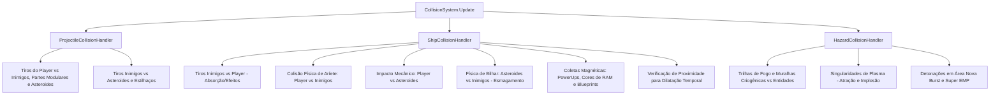
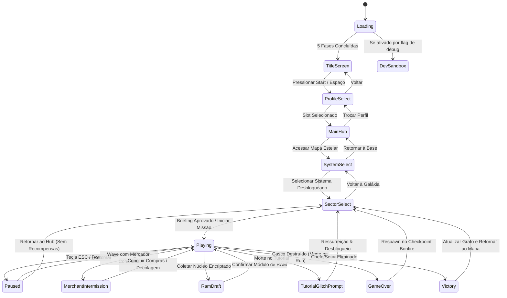

# Auditoria Técnica de Gameplay e Mecânicas: Space_v7 -> MonoGameMaker

> **Status:** Concluído  
> **Escopo:** Fase 1 — Mapeamento de Gameplay, Loops Centrais, Subsistemas e Regras de Negócio  
> **Origem auditada:** `/home/bruno/Projects/Space_V7`  
> **Destino do Relatório:** `/home/bruno/Projects/MonoGameMaker/docs/mapping/02_gameplay_and_mechanics.md`  
> **Idioma:** Português do Brasil (PT-BR)

---

## Sumário Executivo

O projeto **Space_v7** é um jogo de combate espacial 2.5D/3D no estilo shoot 'em up rogue-lite com forte inspiração em *Nova Drift* (customização modular de nave, cadeia topológica de atributos, dispersão balística e capacitores de tiro carregado) e *Dark Souls* / *Dead Cells* (metagame de núcleos voláteis, perda com mecânica de mancha de sangue / *bloodstain*, checkpoints de laboratório / *bonfires*, progressão quadrática com atenuação de *grind*, e persistência em 8 slots atômicos).

Este documento registra a auditoria exaustiva de todas as regras de simulação, loops de execução, entidades vivas, fórmulas matemáticas, árvores de estado e diretrizes arquiteturais necessárias para realizar o port integral e sem gambiarras para o ecossistema **MonoGameMaker** (`GameEntity` + `EntityBehavior`).

---

## 1. O Loop Principal de Gameplay (Frame Cycle & Update Order)

### 1.1 Ciclo de Tempo e Medição de Performance
Em `Game1.cs`, o loop de atualização do jogo não depende de framerate fixo arbitrário (`IsFixedTimeStep = false`, sincronizado via VSync `SynchronizeWithVerticalRetrace = true`). O tempo real decorrido é capturado e protegido contra saltos causados por pausas de depuração ou picos de carga:

```csharp
float dt = (float)gameTime.ElapsedGameTime.TotalSeconds;
if (dt > 0.066f) dt = 0.066f; // Clamping de segurança: limite inferior de ~15 FPS para evitar tunelamento físico
```

A telemetria de frame rate é medida em tempo real usando `System.Diagnostics.Stopwatch`:
- `_updateStopwatch`: Registra o tempo exato de simulação lógica da CPU (`_updateTimeMs`).
- `_renderStopwatch`: Registra o tempo de envio de comandos para a GPU (`_renderTimeMs`).
- `_fpsAccumulator` & `_fpsSampleCount`: Amostragem móvel de FPS real exibida na interface analítica.

### 1.2 Ordem Estrita de Atualização no Frame (`Game1.Update`)
O método `Game1.Update` governa os subsistemas globais e a máquina de estados antes de delegar para o combate ativo. A sequência determinística é:

1. **Sincronização de Resolução e Viewport:**  
   `ResolutionManager.Update(width, height)` calcula a matriz de projeção virtual (1920x1080) e bordas pretas (*letterbox/pillarbox*).
2. **Entrada de Usuário (`InputManager`):**  
   Mapeia teclado, mouse e gamepads com normalização de coordenadas para o espaço virtual, eliminando distorções de clique e mira.
3. **Sistemas de Áudio e Voz:**  
   - `SoundSynthesizer.Update(dt, totalSeconds)`: Ticks de sintetizadores procedurais e paradas de loops.
   - `MusicManager.Update(dt)`: Fade in / fade out cruzado de trilhas MP3 estéreo em memória.
   - `DialogueManager.Update(dt)`: Execução sequencial de falas dubladas (tutorial, história e reações de morte).
4. **Câmera e Efeitos Globais:**  
   - `Camera3D.Update(gameTime)`: Atualiza matrizes `View` e `Projection`, interpolação de foco e atenuação quadrática do tremor por trauma (`Trauma^2`).
   - `AtmosphericNebulaSystem.Update(dt)`: Drift contínuo e turbulência de camadas de nebulosa por ruído simplex.
   - `ShockwaveManager.Update(...)`: Expansão e decaimento temporal de anéis de refração espacial (ondas de choque na lente).
   - `PostProcessManager.Update(dt)`: Decaimento de aberração cromática tática e vinheta de baixa integridade.
   - `HitstopManager.Update(dt)`: Decrementa micro-congelamentos de impacto (*hitstop freeze factor*).
5. **Modais Prioritários e Bloqueios:**  
   - Códice Tático Hostil (`_isHostileCodexOpen`): Bloqueia o jogo e captura a navegação.
   - Atalhos de sistema globais: F11 (Fullscreen sem bordas), F2/F1/F12 (DevSandbox), C/F3 (Códice).
6. **Bifurcação por `GameState`:**  
   Despacha para o estado ativo (`Loading`, `TitleScreen`, `ProfileSelect`, `MainHub`, `SystemSelect`, `SectorSelect`, `Playing`, `Paused`, `MerchantIntermission`, `UpgradeDraft`, `RamDraft`, `GameOver`, `Victory`, `TutorialGlitchPrompt`, `DevSandbox`).

### 1.3 Ciclo Interno de Combate (`Game1.UpdateGameplay`)
Quando `_gameState == GameState.Playing`, o método `UpdateGameplay(float dt, GameTime gameTime)` orquestra as camadas de simulação na seguinte ordem exata:

```
[Background & Estrelas] ➔ [Iluminação & Pontos de Luz] ➔ [Placar/Multiplicador] ➔ 
[Partículas 3D & Cinéticas] ➔ [Player Update] ➔ [Tutorial Update (se setor -1)] ➔ 
[LostSoulStash (Bloodstain)] ➔ [SoulManager (Zero-GC Clustering)] ➔ 
[Cálculo de worldDt (Time Dilation + Tutorial Scale + Hitstop Freeze)] ➔ 
[Asteroides 3D & Estilhaços] ➔ [Inimigos Update & Spawns Pendentes] ➔ 
[Soft Separation Física Inimigo-Inimigo] ➔ [Asteroid Avoidance Steering] ➔ 
[Sector Hazardous Environments (Sol/Vórtice/Ácido)] ➔ [Projéteis (Player: dt, Inimigo: worldDt)] ➔ 
[Pickups: Power-ups, Núcleos RAM, Blueprints] ➔ [Floating Combat Text] ➔ 
[CollisionSystem Resolution (7 Etapas)] ➔ [WaveManager Progression]
```

### 1.4 Delta Time Diferencial e Hitstop
O gameplay separa rigorosamente o tempo do jogador e o tempo do mundo:
- **`dt`**: Delta time real da aplicação, utilizado para o Player, interface e efeitos visuais não afetados pelo tempo.
- **`worldDt`**: Tempo efetivo aplicado a inimigos, projéteis hostis e asteroides:
  $$\text{worldDt} = (IsTimeDilated \,?\, dt \times \text{TimeDilationSlowFactor} : dt) \times \text{TutorialTimeScale} \times \text{HitstopManager.FreezeFactor}$$
- **Hitstop:** Disparado em quebras de escudo (0.09s), acertos críticos pesados e explosões de chefes, congelando a simulação do mundo por milissegundos enquanto gera um flash branco na tela (`impactFlash = 0.80f`), amplificando o impacto cinético sem travar a thread principal.

---

## 2. Entidades Vivas e Comportamentos

### 2.1 O Jogador (`Player.cs`)

#### 2.1.1 Cinemática e Movimentação Inercial
A movimentação da nave emblemática simula voo newtoniano no vácuo com compensação inercial assistida por computadores de bordo:
- **Aceleração e Vetor de Entrada:**  
  Vetor de entrada 2D normalizado via teclado (WASD / Setas) ou analógico esquerdo do Gamepad:
  $$\vec{V} \mathrel{+}= \vec{D}_{\text{norm}} \times (\text{Acceleration} \times \text{BoostAccelMult}) \times dt$$
- **Arrasto Linear (*Drag*):**  
  A desaceleração ocorre por arrasto inercial exponencial:
  $$\vec{V} \mathrel{-}= \vec{V} \times \text{effectiveDrag} \times dt$$
  Quando sob efeito de lentidão criogênica (*Slow*), o arrasto é reduzido para $40\%$ ($\text{Drag} \times 0.40$), resultando em derrapagem inercial prolongada e perda de tração responsiva (estilo *Nova Drift*).
- **Limite de Velocidade Máxima (*Speed Clamp*):**  
  Se $|\vec{V}| > \text{targetMaxSpeed}$, a velocidade é normalizada e fixada no teto. Quando a nave ativa o *Boost/Dash*, a velocidade máxima é multiplicada por $\text{BoostMultiplier}$ ($1.5\text{x}$ a $2.5\text{x}$). Se a passiva *Ataraxia* estiver equipada, concede $+10\%$ de velocidade por carga de EMP mantida no inventário.
- **Inclinação e Rolagem 3D (*Roll & Pitch Banking*):**  
  A malha 3D da nave projeta inclinação dinâmica na tela:
  $$\text{RollAngle} = \text{Lerp}(\text{RollAngle}, \text{Clamp}(V_x / \text{MaxSpeed}, -1, 1) \times 0.48, 10.0 \times dt)$$
  $$\text{PitchAngle} = \text{Lerp}(\text{PitchAngle}, \text{Clamp}(V_y / \text{MaxSpeed}, -1, 1) \times 0.22, 8.0 \times dt)$$

#### 2.1.2 Mecânica de Dash / Propulsor de Sobrecarga
- **Recursos:** Consome a barra de `BoostEnergy` (requer $1.0 = 100\%$).
- **Duração e Cooldown:** Dura $0.25\text{s}$ com recarga de energia regida por `BoostEnergyRechargeDelay`.
- **Efeitos Cinemáticos e Invulnerabilidade:** Concede invulnerabilidade ativa (`IsInvulnerable = true`), gera rastro de fita dupla (`RibbonTrailRenderer` de 48 vértices com oscilação estocástica de largura de $\pm 15\%$) e áudio `SoundType.DashWhoosh`.
- **Mutações de RAM no Dash:**
  - `HasFireTrailDash`: Instancia entidades contínuas `FireTrailHazard` na esteira traseira.
  - `DashThermalWave`: Libera onda de choque esférica de calor (raio $220\text{px}$), queimando e aplicando slow a alvos adjacentes.
  - `CryoImpactWallOnDash`: Ergue muralha de gelo criogênico colidível (`CryoWallHazard`).
  - `PhaseCloak`: Concede camuflagem óptica e garante acerto crítico no próximo disparo (`HasNextShotGuaranteedCrit = true`).
  - `PhantomBlades`: Dispara 8 lâminas de plasma teleguiadas em círculo de 360°.
  - `SeismicMines`: Deposita 3 minas de vácuo detonáveis com raio de explosão de $140\text{px}$.

#### 2.1.3 Atributos, Escudo e Casco (`HealthController` & `StatContainer`)
- **Separação de Casco e Escudo:** O escudo absorve $100\%$ do dano recebido até esgotar sua capacidade. Danos excedentes ultrapassam o escudo e penetram diretamente o casco.
- **Atraso de Recarga do Escudo (*Recharge Delay*):** Todo impacto sofrido reinicia o cronômetro `_shieldRechargeTimer = ShieldRechargeDelay`. Somente após permanecer sem receber dano durante esse intervalo é que a regeneração contínua de escudo é ativada (`ShieldRechargeRate * dt`).
- **Quebra do Escudo (*Shield Break Trigger*):** Quando o escudo atinge 0:
  - Dispara micro-hitstop de 90ms.
  - Dispara onda de choque expansiva de refração espacial (`ShockwaveManager`).
  - Emite áudio de estilhaço `ImpactShield` e `ExplosionSmall`.
  - Dispara o protocolo passivo `NovaBurst` se instalado (onda expansiva de raio $120\text{px}$, 80 de dano e repulsão física em todos os inimigos próximos).

#### 2.1.4 Sistema de Armas e Capacitor de Tiro Carregado
O sistema de disparo (`WeaponPipeline.cs`) implementa dois modos de operação que convivem organicamente:
1. **Tiro Rápido Contínuo:** Quando o jogador segura o gatilho, a arma dispara em cadência fixa ($1.0 / \text{FireRate}$), ciclando hardpoints geométricos (nariz central, asas internas e asas externas).
2. **Super-Tiro Carregado Passivo (*Capacitor Autocharge*):**
   - Quando o jogador **não está disparando**, um temporizador de capacitor acumula energia progressivamente até `MaxChargeTime` ($1.2\text{s}$ a $2.0\text{s}$).
   - **Feedback Visual de Sucção:** Partículas são emitidas em um anel orbital de raio $40\text{px}$ a $65\text{px}$ ao redor da nave, acelerando em espiral centrípeta em direção ao bico (`MuzzlePoint`).
   - A cor do projétil e o brilho do muzzle flash transitam suavemente com base em $\text{ChargeRatio}$:
     - $< 0.35$: Azul elétrico suave.
     - $0.35 \le c < 0.75$: Ciano vívido de alta energia.
     - $\ge 0.75$: Branco estelar hiper-radiante com aura ultravioleta/dourada.
   - **Efeito no Primeiro Disparo:** Ao pressionar o gatilho com o capacitor carregado, o primeiro tiro é liberado como um projétil colossal carregado, multiplicando o dano de $1.15\text{x}$ a $4.0\text{x}$, concedendo perfuração penetrante (*piercing*), recuo mecânico físico na nave (`recoilForce = 120 + 160 * chargeRatio`) e trauma de câmera proporcional.

#### 2.1.5 Equipamentos Táticos (Slots Q e E)
- **Slot 1 (Padrão: Tecla Q):** Super Bomba EMP de Neo-Sol / Nova Burst. Detona uma ogiva que desintegra projéteis hostis na arena inteira, vaporiza asteroides e aplica paralisia e dano massivo em área.
- **Slot 2 (Padrão: Tecla E):** Bomba Criogênica / Kit de Nanorrepairs de Emergência. Congela os inimigos da tela por $3.5\text{s}$ ou reconstitui instantaneamente $150$ pontos de casco.
- Ambos os slots operam com contadores independentes de cargas máximas e recarga passiva por tempo contínuo (`TacticalSlotState`), sujeitos a bônus de *Cooldown Reduction* (CDR).

#### 2.1.6 Cadeia de Mutações de RAM e Conversão Topológica (Padrão Nova Drift)
Os módulos de RAM instalados não são bônus estáticos isolados; eles participam de uma cadeia determinística de conversão topológica de atributos (`RecalculateRamModifiers`):
$$\text{Dano} \xrightarrow{\text{convDmgToCdr}} \text{CDR} \xrightarrow{\text{convCdrToSpeed}} \text{Velocidade} \xrightarrow{\text{convSpeedToCadence}} \text{Cadência} \xrightarrow{\text{convCadenceToDmg}} \text{Dano}$$
Isso permite composições (*builds*) altamente sinérgicas onde acelerar a movimentação da nave aumenta a taxa de tiro, ou elevar o dano acelera a recuperação das bombas táticas.

---

### 2.2 Inimigos e Chefes

#### 2.2.1 Arquitetura Base (`EnemyBase.cs`)
Toda nave inimiga e entidade biológica hostil herda de `EnemyBase`:
- **Parâmetros Fundamentais:** `Position`, `Velocity`, `Health`, `MaxHealth`, `Radius`, `VisualSize`, `Damage`, `ScoreValue`.
- **Escalonamento Infinito de Estágio:**  
  A vida e o dano base são escalonados deterministicamente por `StageDifficultyService`:
  $$\text{MaxHealth} = \text{baseHp} \times (1 + 0.15 \times (\text{StageLevel} - 1))^{1.1}$$
  $$\text{Damage} = \text{baseDmg} \times (1 + 0.10 \times (\text{StageLevel} - 1))$$
- **Estados de Controle de Grupo:**
  - `FreezeTimer`: Sob efeito criogênico, a velocidade cinemática e taxa de ataque caem para $25\%$ (`effectiveDt = dt * 0.25f`).
  - `ApplyBurn(dps, duration)`: Causa dano contínuo ao longo do tempo ignorando defesas de blindagem.
  - `ApplySlow(percent, duration)`: Reduz vetor de translação.
- **Recuperação de Fora da Tela (*Offscreen Steering*):**  
  Inimigos normais que ultrapassam os limites da arena ativam um cronômetro `_offscreenTimer`. Enquanto fora da tela, recebem uma força de esterçamento orientada de volta para o centro $(0, 0, 0)$. Caso permaneçam fora por mais de $3.5\text{s}$, são reciclados silenciosamente.
- **Física de Separação Suave (*Soft Separation Physics*):**  
  Para impedir aglomerações e sobreposição de malhas 3D entre naves inimigas normais, o loop de simulação executa resolução de repulsão elástica entre pares de naves:
  $$\vec{F}_{\text{push}} = \frac{\vec{P}_a - \vec{P}_b}{|\vec{P}_a - \vec{P}_b|} \times ((\text{Radius}_a + \text{Radius}_b + 6) - \text{dist}) \times 6.5 \times \text{worldDt}$$
- **Desvio Universal de Asteroides (`AsteroidAvoidanceSteering`):**  
  Inimigos dotados de IA com `AvoidsObstacles = true` projetam raios de detecção frontais contra asteroides colidíveis e ajustam suas trajetórias laterais para evitar colisões mecânicas involuntárias.

#### 2.2.2 Tabela de Arquétipos de Facções por Sistema Estelar

| Sistema Estelar | Arquétipos Notáveis | Padrão de Movimento | Padrão de Ataque | Mecânicas Exclusivas |
| :--- | :--- | :--- | :--- | :--- |
| **01: Neo-Sol** | *VoidViper*, *SolarRaider*, *DreadCruiser*, *ScarabKamikaze* | Mergulho Senoidal, Flanqueamento Zig-Zag, Investida Suicida | Dardos Bio-ópticos, Lasers Duplos, Canhões Pesados | Scarabs aceleram em mergulho kamikaze com som agudo; Vipers atacam em colunas de flanco. |
| **02: Kyros Abyss** | *CrystalGoliath*, *VoidSiphonScout*, *NullweaverInterceptor* | Órbita Flutuante, Espiral Centrípeta, Voo em Enxame | Dispersão Prismática, Drenagem de Escudo | Absorção de tiros frontais; interceptores em espiral helicoidal. |
| **03: Pyros & Tartarus** | *PyreViper*, *ObsidianStalker*, *CalderaSiegeBastion*, *AbyssalKraken* | Rolamento de Flanco, Pouso Estacionário, Natação Abissal | Rajadas de Magma, Minas Torpedo de Esporos, Tentáculos | Projéteis incendiários persistentes que deixam poças de plasma; camuflagem de fumaça. |
| **04: Aethelgard** | *AegisScout*, *ChronosLancer*, *CathedralBastion*, *GearworkBombardier* | Marcha Autômata, Carga Linear em Lança, Artilharia | Feixes Mecânicos Contínuos, Bombas de Relojoaria | Naves autômatas com escudos direcionais que bloqueiam disparos frontais até serem flanqueadas. |
| **05: Glacies Prime** | *FrostBiter*, *BlizzardMirage*, *GlacierJuggernaut*, *CryoMineScarab* | Ilusão Óptica / Teleporte, Investida Blindada | Rajadas Congelantes (Slow), Minas Criogênicas | Projetam cópias falsas holográficas e aplicam congelamento severo no jogador. |
| **06: Umbra Void** | *VoidLeech*, *EventHorizonSniper*, *SingularityWeaver*, *ShadowPhantom* | Escondido na Escuridão, Sniper de Longo Alcance | Vórtices Gravitacionais, Disparos Perfurantes | Criam mini buracos negros que sugam a nave do jogador e desviam tiros aliados. |
| **07: Toxis Hive** | *AcidStinger*, *CorrosiveSpitter*, *BioNoduleCocoon*, *VenomousRammer* | Enxame Orgânico, Arremesso de Casulos | Cuspe Ácido (DoT de Casco), Aríete de Quitina | Disparam jatos cáusticos que corroem diretamente a integridade do casco, ignorando o escudo. |
| **08: Chronos Warp** | *EchoViper*, *TemporalStalker*, *StasisBastion*, *ParadoxKamikaze* | Salto Quântico Temporal, Retorno no Tempo | Projéteis de Taquiões, Cúpulas de Estase | Revertem dano sofrido voltando no tempo $1.5\text{s}$ se não forem eliminadas com burst imediato. |
| **09: Caldera Hipercrítica** | *PyreHellhound*, *ObsidianJuggernaut*, *ThermiteScarab*, *PyreArchon* | Investida Furiosa em Matilha, Cerco Blindado | Canhões de Lava, Detonação Termobarica | Explosão catastrófica pós-morte gerando ondas de choque em raio amplo. |

#### 2.2.3 Arquitetura de Chefes e Partes Modulares (`BossModularPart.cs`)
Os chefes de fase (*Titãs*) utilizam subcomponentes modulares destruíveis de alta fidelidade:
- **`BossModularPart`:** Cada sub-componente possui hitbox esférica própria, barra de vida individual, posição local articulada à matriz de rotação do chefe (`GetWorldPosition(bossPos, bossRot)`) e lógica de avaria mecânica.
- Ao sofrer dano letal, a parte modular explode de forma independente, dispara áudio de quebra de metal pesado (`TitanDestructionSub`), trauma na câmera ($0.40$) e passa a emitir fumaça preta volumétrica contínua e faíscas até o chefe ser derrotado.

##### Estudo de Caso 1: Demolidor de Mundos (`WorldBreakerBoss.cs`)
- **Estatísticas:** $60.000$ HP, $8.000$ Escudo Cinético, $135$ Dano Base.
- **Postura Fixa de Cerco:** Ancorado no topo central da arena.
- **6 Torretas Articuladas Independentes:** Rastreiam a posição do jogador em tempo real (`TargetAngle = desiredAngle - bossRot`), apresentam recuo mecânico visível no cano (`RecoilDistance`) e clarão de disparo.
- **Fissura de Laser em Tela Cheia (`LaserSliceLine`):** Projeta feixes vermelhos de aviso atravessando $100\%$ da tela por $0.80\text{s}$ antes de detonar em colunas destrutivas de alto dano ($85$ de dano).
- **Salva de 10 Minas Gravitacionais de Antimatéria:** Dispersa bombas que geram poços de gravidade sugando a nave do jogador.

##### Estudo de Caso 2: Titã Eclipse (`EclipseTitanBoss.cs`)
- **Fase 1 (100% a 66% HP):** Dispersão contínua de plasma, drones de escudo orbital girando ao redor da carcaça e salvas triplas de espingarda quádrupla com re-mira ativa no jogador.
- **Fase 2 (66% a 33% HP):** Dispara o Super Feixe Varredor do Núcleo Dourado (varre um arco de $120^\circ$ atravessando a arena inteira) e ativa baterias *Broadside* de flanco.
- **Fase 3 (33% a 0% HP):** Entra em ritual de regeneração centralizado com casulo dourado impenetrável, protegida por 4 escoltas *Solar Raiders*. Se o ritual não for interrompido destruindo as escoltas conectadas por feixes, cura $1\%$ de HP por segundo até $15\text{s}$. Em seguida, entra em fúria (*overdrive*) disparando esferas teleguiadas com detonação de choque em área.

---

### 2.3 Projéteis e Balística (`LaserProjectile.cs` & `ProjectilePool.cs`)
- **Pooling sem Alocação de Memória:** O jogo utiliza um pool estático pré-aquecido de $512$ instâncias (`ProjectilePool.PreWarm(512)`). Ao atingirem alvos ou cruzarem as bordas da tela ($80\text{px}$ fora da visão da câmera), as instâncias são resetadas e devolvidas ao pool, garantindo **zero coletas de Garbage Collector** durante o combate.
- **Tipos de Projéteis:** Laser convencional, Plasma Pesado, Espalhado (*Scatter*), Teleguiado (*Homing*), Feixe Contínuo, Esfera de Singularidade (buraco negro móvel com atração gravitacional), Lâmina Fantasma e Mina Sísmica.
- **Parâmetros Físicos:** Direção, velocidade linear, aceleração vetorial, raio de colisão, contagem de penetração (*piercing*), rebotes em obstáculos (*ricochet*), raio de detonação em área (*AoE explosion radius*) e tempo de vida (*lifetime*).

---

### 2.4 Drops e Coletáveis

#### 2.4.1 Núcleos de Almas (`SoulDrop.cs`, `SoulTier.cs` & `SoulManager.cs`)
- **Padrão de Pooling Saturado e Fusão Espacial:**  
  O `SoulManager` mantém uma piscina fixa de 128 instâncias `SoulDrop`. Se múltiplos inimigos morrem na mesma região, núcleos próximos a uma distância $\le 32\text{px}$ coalescem automaticamente em um único drop de tier superior.
  Se o pool atinge a capacidade máxima de 128 itens em tela, novas almas geradas são fundidas automaticamente no núcleo ativo mais próximo, impedindo estouro de memória ou queda de taxa de quadros.
- **Escalonamento Visual por Tiers:**
  - `Small` (1-10): Escala $1.0\text{x}$, tom azul/branco suave.
  - `Medium` (11-99): Escala $1.3\text{x}$, brilho ciano pulsante.
  - `Large` (100-999): Escala $1.6\text{x}$, pulsação senoidal vívida.
  - `Golden` (1.000-9.999): Escala $2.0\text{x}$, halo dourado e partículas estelares.
  - `Titanic` (10.000+): Escala $2.5\text{x}$, núcleo âmbar radiante com lente anamórfica.
- **Atração Magnética:** Atraídos exponencialmente pela nave do jogador ao entrarem no raio de atração (`MagnetRadius` do `StatContainer`).

#### 2.4.2 Núcleos de Memória Encriptados (`EncryptedMemoryCore.cs`)
- Drop raro de elites e chefes que representa cartuchos de expansão de hardware.
- Ao ser coletado, interrompe temporariamente o combate e abre a interface modal de seleção de mutações de RAM (`GameState.RamDraft`).

#### 2.4.3 Esquemas de Blueprints Físicos (`BlueprintDropItem.cs`)
- Representa projetos de engenharia reversa descartados no campo de batalha.
- Ao ser recolhido, entra na **Mochila da Run** (`runState.CollectedBlueprints`). Não fica desbloqueado imediatamente: o jogador deve alcançar um posto com Laboratório ou concluir a missão para entregar as blueprints e torná-las permanentes no perfil.

#### 2.4.4 Mancha de Sangue Espacial (`LostSoulStashEntity.cs`)
- Entidade persistente deixada no setor exato e na coordenada precisa onde o jogador morreu em uma run anterior.
- Exibe anel giratório com luz pulsante. Ao ser sobrevoada pelo jogador, executa `RecoverLostSoulStashUseCase`, devolvendo $100\%$ do saldo de almas perdidas para a conta permanente do perfil.

---

## 3. Subsistemas de Combate e Colisão

### 3.1 Mitigação de Dano e Fórmula de Blindagem (`HealthController.cs`)
A resolução de dano processa tipos de dano elementais e blindagens físicas de forma puramente determinística:

1. **Cálculo de Dano Crítico:**
   $$\text{CritMult}_{\text{efetivo}} = 1.0 + (\text{CritMult} - 1.0) \times (1.0 - \text{Clamp}(\text{CritResistance}, 0, 0.95))$$
2. **Mitigação por Tipo de Dano:**
   - **Dano Físico:** Reduzido pela armadura do alvo através de curva assintótica:
     $$\text{DanoMitigado} = \text{DanoBruto} \times \frac{100}{100 + \max(0, \text{Armor} \times (1 - \text{ArmorPenetration}))}$$
   - **Dano de Plasma:** Possui penetração básica mínima de $50\%$ de armadura:
     $$\text{PenetraçãoEfetiva} = \max(\text{ArmorPenetration}, 0.50)$$
   - **Fogo, Veneno e Gelo:** Reduzidos pelas respectivas resistências percentuais:
     $$\text{DanoMitigado} = \text{DanoBruto} \times (1.0 - \text{Clamp}(\text{Resistência}, 0, 0.95))$$
3. **Distribuição Escudo vs Casco:**  
   O dano mitigado drena o escudo. Qualquer valor remanescente abate os pontos de vida do casco.

### 3.2 O Orquestrador de Colisão (`CollisionSystem.cs`)
O pipeline de colisão é dividido em três sub-manipuladores especializados:



### 3.3 Física de Asteroides e Mecânica de Bilhar (`Asteroid3D.cs`)
Os asteroides possuem propriedades newtonianas expressivas:
- **Tiers e Massas:**
  - `Huge`: Raio $48\text{px}$, HP $220$, Massa $2500\text{kg}$.
  - `Large`: Raio $32\text{px}$, HP $110$, Massa $800\text{kg}$.
  - `Medium`: Raio $20\text{px}$, HP $50$, Massa $250\text{kg}$.
  - `Small`: Raio $11\text{px}$, HP $20$, Massa $60\text{kg}$.
- **Fratura em Cadeia:** Ao ser destruído, um asteroide se divide em 2 a 3 asteroides do tier imediatamente inferior e ejeta de 4 a 8 fragmentos 3D giratórios (`AsteroidShard3D`) com física rotacional e fading transparente.
- **Esmagamento Cinético de Inimigos (*Billiard Crushing*):**  
  Quando um asteroide de grande porte é arremessado contra naves inimigas (por impacto de tiros ou pelo impulso do aríete do player), a conservação de momento calcula o dano de impacto com base na massa e velocidade relativa do asteroide, esmagando caças leves instantaneamente contra as bordas da tela.

---

## 4. Sistema de Ondas, Setores e Progressão

### 4.1 O Diretor de Ondas (`WaveManager.cs`)
- **Operação Orientada a Dados:** O `WaveManager` consome instâncias `WaveDefinition` declaradas nos setores. Nenhuma formação inimiga é instanciada por código imperativo fixo.
- **Tempo Normalizado de Gatilho (`TriggerTimeNormalized`):**  
  Dentro de cada onda ($60\text{s}$ a $90\text{s}$), formações de esquadrões possuem um tempo de disparo normalizado de $0.0$ (início da onda) a $1.0$ (final da onda).
- **Aceleração Dinâmica por Limpeza (*Wipe Reinforcement*):**  
  Se o jogador eliminar todos os inimigos ativos antes do tempo normalizado da próxima formação, um temporizador de reforço de $4.0\text{s}$ antecipa o envio imediato da próxima esquadrilha, mantendo o ritmo de combate ágil e eliminando tempos mortos.
- **Padrões de Formação (`FormationPattern`):**  
  `VLine`, `FlankPair`, `Scatter`, `EscortedCruiser`, `SwarmColumn`, `BossAssault`, `TacticalPincerStrike`, `HeavyShieldSiege`, `FlankSwarmAmbush`.
- **Intermissão de Mercador:** Ondas com `HasMerchant = true` geram a chegada da nave de carga `MerchantShip` e ativam o estado de loja ao final dos combates daquela onda.

### 4.2 Setores e Biomas (`SectorManager.cs`)
O jogo é estruturado em **63 setores normais** distribuídos pelos 9 sistemas estelares, além do **Setor Tutorial (-1)**.
Cada setor declara:
- `ThreatLevel` (Nível de Ameaça 1 a 10+).
- Modificadores ambientais (`SectorHazardSystem`): Tempestades Solares com radiação de calor, Nebulosas de Ácido que desgastam escudos, Névoas Criogênicas e Vórtices Gravitacionais de Matéria Escura.
- Corpos Celestes 3D de fundo (`CelestialBodies`) com rotação autônoma e translação parabólica vertical sincronizada com a passagem das ondas.
- Dicas de Farm tático (`TargetFarmHint`) e registros de Lore militar (`LoreLog`).

### 4.3 Grafo Estelar e Navegação Interplanetária (`SystemRegistry.cs`)
Cada um dos 9 Sistemas Estelares possui um mapa orbital modelado como um grafo de nós direcionais interconectados:
- **Tipos de Nós (`SystemNodeType`):**
  - `Sector` / `Combat`: Missão de combate padrão com ondas de invasores.
  - `Elite`: Combate contra esquadrão veterano de alta periculosidade com drop garantido de núcleos triplos e cartuchos de RAM.
  - `MerchantOutpost`: Posto avançado orbital para reparos de emergência e compra de recargas.
  - `ResearchLab` / `Laboratory`: **Ponto de Checkpoint Bonfire.** Entrega permanente de esquemas de Blueprints coletados na mochila e acesso à Estação de Engenharia Reversa para gastar núcleos no Perfil.
  - `SecretAnomaly`: Encontro de anomalia espacial com recompensas especiais de núcleos ($+250$) e caminhos alternativos.
  - `Boss`: Confronto contra o Flagship Titã do Sistema.
- **Rotas e Pré-requisitos:** Nós exigem conclusão prévia de nós anteriores (`requiredNodeIds`). Ao derrotar o chefe de um sistema, a rota hiperespacial para o próximo sistema é desbloqueada no Perfil.

---

## 5. Metagame e Progressão

### 5.1 Economia de Núcleos e Equações de Nível (`ProgressionMath.cs`)
A curva de elevação de atributos do piloto adota uma progressão quadrática modificada para equilibrar desafio e redução de tédio no endgame:
- **Custo de Núcleos para o Próximo Nível:**
  - Para níveis $N \le 10$:
    $$\text{Souls}(N) = 15 N^2 + 45 N + 40$$
  - Para níveis $N > 10$ (transição contínua $C^1$ com atenuação de $40\%$ na inflação):
    $$\text{Souls}(N) = 1990 + 345 (N - 10) + 5 (N - 10)^2$$
- **Nível Total do Jogador (`PlayerLevel`):**  
  $$\text{PlayerLevel} = 1 + \sum (\text{pontos investidos em cada atributo})$$
- **Recompensa de Replay de Chefes:**  
  $$\text{Recompensa} = 250 + (\text{ThreatLevel} \times 125)$$

### 5.2 O Loop Bonfire e Mecânica de Morte (`ProcessPlayerDeathUseCase.cs`)
Inspirado na arquitetura Souls-like:
1. **Morte do Jogador:**
   - O saldo de núcleos voláteis não gastos (`TotalSouls`) é transferido para a mancha de sangue (`LostSoulStash`), posicionada nas coordenadas $(X, Y)$ da morte no setor corrente.
   - O saldo de núcleos imediatos do perfil é zerado.
   - Todas as Blueprints provisórias armazenadas na mochila da run (`runState.CollectedBlueprints`) são destruídas.
   - Módulos de RAM efêmeros obtidos na run são descartados.
   - **Preservação Sagrada:** O nível da nave (`PlayerLevel`), os níveis de atributos permanentes comprados no laboratório (`AttributeLevels`), as naves desbloqueadas e as Blueprints já manufaturadas **nunca são perdidos**.
2. **Respawn no Laboratório:**
   - O jogador renasce no último nó de Laboratório visitado (`runState.LastLaboratoryNodeId` ou padrão `sys1_sec1`).
   - Se renascer em um sistema avançado ($\text{SystemId} \ge 3$) com saldo zerado, o jogo injeta $300$ núcleos de suprimento emergencial para evitar bloqueios de progresso irreversíveis.

### 5.3 Módulos de RAM da Run (`RamDraftManager.cs` & `InstallRamModuleUseCase.cs`)
- Durante a incursão, ao derrotar elites ou abrir cartuchos encriptados, o jogador escolhe entre 3 opções de mutação cibernética.
- A capacidade de módulos é limitada pela estatística `RamCapacity` (iniciando em 3 e expandindo via progressão de laboratório).
- Módulos da mesma família substituem versões anteriores com escalonamento de tiers (Tier I $\to$ Tier II $\to$ Tier III).
- Módulos sobressalentes na reserva (`StoredRamModules`) podem ser desmanchados (*scrap*) em troca de núcleos ($50$, $150$ ou $300$ almas dependendo da raridade).

### 5.4 Sistema de Cartas e Orquestração (`CardOrchestrator.cs`)
- Cada carta de melhoria possui uma família (`CardFamily`: *Projectiles*, *HullConverter*, *VoidMagnet*, etc.).
- O `CardOrchestrator` aplica a **Regra de Exclusão Mútua da Família**: Ao equipar uma carta mais avançada da mesma família (ex: *Tri-Beam Scatter* sobre *Twin Multi-Splitter*), a versão anterior é removida automaticamente sem duplicar atributos nem gerar vazamento de estado.

### 5.5 Persistência e Gerenciador de Saves (`SaveSlotManager.cs`)
- Suporte a **8 slots de salvamento independentes** (`save_slot_1.json` até `save_slot_8.json`).
- Arquivo mestre de metadados `save_meta.json` contendo sumários de cada slot (tempo de jogo, nível, data da última sessão, setor máximo alcançado) para carregamento instantâneo do menu sem carregar os perfis completos.
- Gravação atômica em disco para evitar corrupção de savegames em caso de encerramento abrupto.

---

## 6. Máquina de Estados e Fluxo de Navegação do Jogo

### 6.1 Estados Globais do Jogo (`GameState`)



### 6.2 Transições e Áudio Dinâmico
- Durante a troca entre estados de combate e menus, o `MusicManager` executa transição de atenuação (*audio ducking*) de frequências para garantir inteligibilidade das vozes e efeitos sonoros de interface.
- A entrada no estado de pausa interrompe imediatamente todos os sintetizadores de áudio contínuo (`SoundSynthesizer.StopAllLoops()`) para evitar ruídos congelados.

---

## 7. Requisitos de Regras de Negócio para o Port no MonoGameMaker

Para portar o gameplay do **Space_v7** para a arquitetura do **MonoGameMaker** sem gambiarras e em total conformidade com os padrões de DDD e componentização:

### 7.1 Decomposição da Classe Monolítica `Player.cs` em `EntityBehavior`
A classe `Player.cs` (com mais de 2.700 linhas) deve ser fragmentada em componentes desacoplados anexados à `GameEntity` do Player:

1. **`PlayerMotorBehavior`:**
   - Responsável estritamente pela movimentação vetorial, arrasto inercial, aceleração, limites de arena e rotação 3D de banking (`RollAngle`, `PitchAngle`).
2. **`PlayerDashBehavior`:**
   - Gerencia cooldown do propulsor, janela de invulnerabilidade e emissão do rastro de partículas (`RibbonTrailRenderer`).
3. **`PlayerHealthBehavior`:**
   - Encapsula o `HealthController`, temporizadores de recarga de escudo, efeitos de status elementais e gatilhos de quebra de escudo (`NovaBurst`).
4. **`PlayerWeaponSystemBehavior`:**
   - Mapeia o disparo primário e o capacitor passivo do Super-Tiro Carregado, controlando o anel de partículas convergentes no bico.
5. **`PlayerTacticalSlotsBehavior`:**
   - Gerencia as cargas e tempos de recarga das habilidades dos slots Q e E.
6. **`PlayerRamLoadoutBehavior`:**
   - Mantém os componentes mutadores instalados e recomputa a cadeia topológica de atributos.

### 7.2 Decomposição dos Inimigos e Chefes
- Substituir a herança rígida de `EnemyBase` por componentes modulares:
  - `EnemyMotorBehavior`: Movimentação senoidal, flanqueamento, kamikaze e desvio de asteroides.
  - `EnemyCombatBehavior`: Cadência de disparo, tabelas de tiro e detecção de proximidade.
  - `BossPartBehavior`: Anexado a entidades filhas para representar as partes destrutíveis e torretas articuladas dos chefes.

### 7.3 Esquemas de Prefabs Declarativos (`.prefab.json`)
De acordo com `PREFAB_SCHEMA.md` do MonoGameMaker, as seguintes estruturas de prefabs devem ser criadas no projeto de destino:
- `player_vanguard.prefab.json`: Configuração da nave inicial com materiais PBR, motor, armas e partículas.
- `enemy_void_viper.prefab.json`: Prefab com script de movimento senoidal e emissor de plasma rosa.
- `enemy_scarab_kamikaze.prefab.json`: Prefab de ataque suicida com detecção de proximidade e áudio de alerta.
- `boss_worldbreaker.prefab.json`: Prefab colossal contendo entidades filhas para cada uma das 6 torretas montadas.
- `asteroid_large.prefab.json`: Prefab volumétrico com massa, malha 3D e gatilho de fragmentação.
- `drop_soul_cluster.prefab.json`: Prefab de núcleos alocáveis com script de fusão espacial.

### 7.4 Integração com Serviços Centrais do Engine
- **`SaveSystem` do MonoGameMaker:**  
  Adaptar o `SaveSlotManager` para gravar seus arquivos JSON através do pipeline oficial de persistência do MonoGameMaker.
- **`SceneManager`:**  
  Mapear os estados `MainHub`, `SystemSelect`, `SectorSelect` e o ambiente de combate como Cenas autônomas ou sub-cenas carregáveis, eliminando os blocos massivos de código procedural contidos em `Game1.cs`.
- **`ImGuiUI` e Menus:**  
  Migrar os renderizadores imediatos customizados de interface para janelas declarativas ImGui integradas ao editor e ao runtime standalone.

---

## Conclusão da Auditoria

O ecossistema do **Space_v7** é altamente coeso, balanceado matematicamente e rico em dinâmicas de combate. A sua portabilidade para o **MonoGameMaker** não exigirá reinvenção de design, mas sim uma refatoração cirúrgica: converter a estrutura orientada a objetos monolítica em nós de componentes reativos `EntityBehavior` suportados pelo ecossistema de compilação em segundo plano e hot reload do novo motor.
