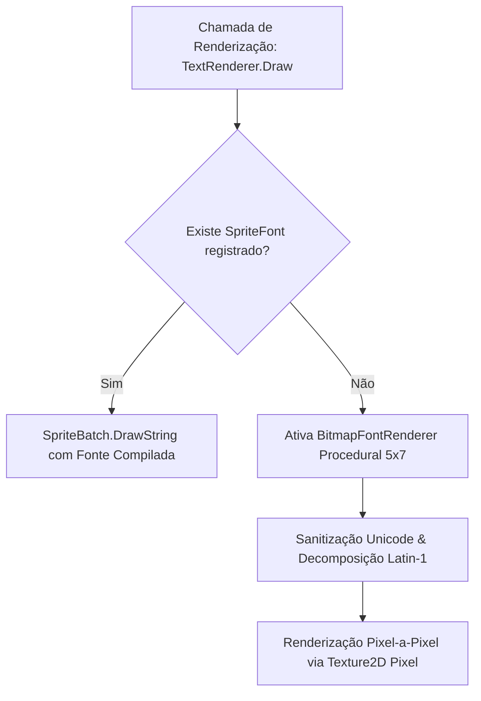

# Auditoria e Mapeamento Técnico de Assets, Shaders e Dependências (Fase 1)
**Projeto de Origem:** `Space_V7`  
**Projeto de Destino:** `MonoGameMaker`  
**Autor:** Especialista em Assets, Shaders e Dependências  
**Data:** Outubro de 2026  
**Status:** Mapeamento Concluído e Aprovado  

---

## Sumário Executivo

Este documento estabelece o mapeamento exaustivo de todos os recursos gráficos (shaders HLSL, passes de renderização, malhas 3D procedurais e texturas), sistemas de áudio DSP e streaming, renderização de fontes e tipografia resiliente, gerenciamento de resolução/viewport, periféricos de entrada (input) e dependências de pacotes e de plataforma presentes no `/home/bruno/Projects/Space_V7`.

O objetivo primário é fornecer à equipe de arquitetura do `MonoGameMaker` a planta baixa completa de integração, identificando os componentes prontos para reuso direto, as refatorações arquiteturais necessárias e a **eliminação categórica de dívidas técnicas de plataforma** (como P/Invokes legados para `user32.dll` e `kernel32.dll`), garantindo que o runtime opere com excelência nativa em ambientes multiplataforma (Linux, macOS e Windows via DesktopGL/SDL2) e em conformidade estrita com o paradigma de Documentação Dirigida por Domínio (DDD).

---

## 1. Catálogo de Shaders HLSL e Passes Gráficos

O `Space_V7` implementa um pipeline de renderização híbrido (2.5D/3D com pós-processamento estilizado) baseado em efeitos HLSL compilados para shader model 3.0 (`vs_3_0`/`ps_3_0` em OpenGL DesktopGL) e 4.0 level 9.1 (`vs_4_0_level_9_1`/`ps_4_0_level_9_1` em DirectX). 

Abaixo encontra-se a decomposição técnica de cada shader do ecossistema:

### 1.1 `BloomEffect.fx` (Dual-Kawase Bloom & Emissive Composite)
* **Localização no Origem:** `Content/Shaders/BloomEffect.fx` e `Graphics/Shaders/BloomEffect.fx`
* **Classe Gerenciadora no Origem:** `Space_v7.Graphics.BloomRenderer`
* **Objetivo:** Isolar o canal emissivo de naves, lasers, propulsores e explosões do fundo cósmico profundo (#030611), aplicando um desfoque de brilho multicamada sem "lavar" o contraste dos pretos do espaço sideral.
* **Passes de Execução:**
  1. **Pass 0 (`ThresholdPS`):** Pre-filtro de luminância relativa Rec.709 ($L = 0.2126R + 0.7152G + 0.0722B$). Aplica curva *smooth-knee* ajustável via `BloomThreshold` (padrão $0.60$) para evitar cintilação (*flicker*) em subpixels.
  2. **Pass 1 (`DownsampleKawasePS`):** Filtro diagonal de 4 pontos (*4-Tap Diagonal Filter*) com deslocamento texel dinâmico proporcional a `BloomRadius + 0.5`.
  3. **Pass 2 (`UpsampleKawasePS`):** Filtro de padrão estelar de 8 pontos (*8-Tap Star Filter*), combinando 4 amostras ortogonais com peso duplo ($2/12$) e 4 amostras diagonais com peso simples ($1/12$).
  4. **Pass 3 (`CompositePS`):** Composição final $Final_{HDR} = Background + Emissive + (Bloom \times BloomIntensity) \times Exposure$. Aplica Tone Mapping Reinhard estendido com transição suave (*soft shoulder*): $\text{saturate}(x / (1.0 + x \cdot 0.22))$.
* **Parâmetros HLSL:**
  - `float BloomThreshold` ($0.60f$)
  - `float BloomIntensity` ($1.40f$)
  - `float BloomRadius` ($1.0f$)
  - `float Exposure` ($1.0f$)
  - `float2 TexelSize` (vetor inverso da resolução)
  - Samplers: `SceneSampler`, `BloomSampler`, `BackgroundSampler` (Linear/Clamp).

### 1.2 `PbrSurface.fx` (Physically Based Rendering 2.5D/3D)
* **Localização no Origem:** `Content/Shaders/PbrSurface.fx`
* **Classe Gerenciadora no Origem:** `Space_v7.Graphics.Mesh3D`, `LightingRenderer`
* **Objetivo:** Iluminação microfacetada para cascos de naves espaciais, asteroides e chefes, conferindo profundidade tridimensional enquanto preserva a estética visual de pixel art nítido.
* **Características Técnicas:**
  - **Mapeamento de Normais Tangentes (TBN):** Lê normal map em espaço tangente, ortogonaliza via Gram-Schmidt e projeta em espaço de mundo.
  - **Fórmula de Fresnel:** Aproximação de Schlick: $F = F_0 + (1 - F_0)(1 - (V \cdot H))^5$, onde $F_0 = \text{lerp}(0.04, Albedo, Metallic)$.
  - **Conservação de Energia:** Separação estrita de componentes difusa e especular ($k_D = (1 - F) \cdot (1 - Metallic)$).
  - **Atenuação de Luz Pontual:** Janela quadrática suave: $\text{saturate}(1 - d/r)^2 \times Intensity$.
  - **Quantização de Cores Anti-Stretch:** Uniforme `ColorSteps` ($32.0f$) que discretiza a saída de cor sobre superfícies 3D deformadas, impedindo o borramento de texturas ao inclinar naves nos eixos Y/Z.
  - **Alpha Cutoff:** `clip(albedo.a - AlphaCutoff)` (padrão $0.05$) com amostragem `PointClamp`.
* **Parâmetros HLSL:**
  - Matrizes: `World`, `View`, `Projection`, `WorldInverseTranspose`
  - Iluminação: `LightDirection`, `LightColor`, `AmbientColor`, `PointLightPosition`, `PointLightColor`, `PointLightRadius`, `PointLightIntensity`
  - Superfície: `Roughness`, `Metallic`, `EmissiveIntensity`, `EmissiveColor`, `AlphaCutoff`, `ColorSteps`
  - Samplers: `AlbedoSampler`, `NormalSampler`, `EmissiveSampler` (Point/Clamp).

### 1.3 `PostProcessJuice.fx` (Refração Tática & Aberração Cromática)
* **Localização no Origem:** `Content/Shaders/PostProcessJuice.fx`
* **Classe Gerenciadora no Origem:** `Space_v7.Graphics.Effects.PostProcessJuiceEffect`
* **Objetivo:** Impacto cinemático tático nos momentos de estresse físico (explosões de chefes, destruição de blindagem e dash de alta velocidade).
* **Mecanismos Algorítmicos:**
  - **Ondas de Choque no Vácuo (8 Epicentros):** Array `float4 Shockwaves[8]` contendo `[Center.X, Center.Y, Radius, Strength]`. Aplica correção de *aspect ratio* (16:9) para manter anéis esféricos perfeitos e gera vetor de refração radial senoidal empurrando os pixels para fora.
  - **Aberração Cromática Tática:** Separação espectral dos canais R, G e B (`TacticalAberrationAmount`). Desloca radialmente o canal R para o exterior e o canal B para o interior, mantendo o canal G estável no centro.

### 1.4 `UberShield.fx` (Campo de Força Hexagonal Dinâmico 3D)
* **Localização no Origem:** `Content/Shaders/UberShield.fx`
* **Classe Gerenciadora no Origem:** `Space_v7.Graphics.Effects.ShieldEffect`
* **Objetivo:** Escudo de energia esférico volumétrico sobre naves e chefes.
* **Componentes Gráficos:**
  - **Fresnel Inverso:** Bordas hiperluminosas nos limites da silhueta ($n \cdot v$), com centro translúcido para visibilidade da nave.
  - **Veios Elétricos Duplos (Interferência Fractal):** Duas camadas UV em movimento oposto (`Time * NoiseSpeed`) gerando faíscas de plasma dinâmicas.
  - **Grade Hexagonal:** Padrão matemático procedural projetado sobre a malha sem requerer texturas pesadas.
  - **Deformação de Vértice por Impacto (`HitPulse`):** Pulsação física na malha 3D nos vértices da cúpula no momento da colisão de projéteis, com transição de cor do azul para o alaranjado de alerta.

### 1.5 `Hologram.fx` (Projeção Holográfica Sci-Fi)
* **Localização no Origem:** `Content/Shaders/Hologram.fx`
* **Classe Gerenciadora no Origem:** `Space_v7.Graphics.Effects.HologramEffect`
* **Objetivo:** Renderização de interfaces táteis no cockpit, diagramas de naves no hangar e intermissão de mercadores.
* **Componentes:**
  - *Scanlines* horizontais senoidais animadas no espaço de mundo.
  - *Glitch Jitter:* Deslocamento horizontal pseudo-aleatório em degrau acionado por alta frequência temporal.
  - *Rim Glow:* Realce de Fresnel nas bordas exteriores.
  - *High-Speed Flicker:* Oscilação de luminância simulando tubo de raios catódicos/projetor holográfico.

### 1.6 `Vortex.fx` (Buraco Negro & Singularidade Espiral)
* **Localização no Origem:** `Content/Shaders/Vortex.fx`
* **Classe Gerenciadora no Origem:** `Space_v7.Graphics.Effects.VortexEffect`
* **Objetivo:** Efeito de transição de hiperespaço, portais de teletransporte e vácuo dimensional de chefes finais (*Void Leviathan*).
* **Mecanismo:**
  - Transformação angular polar (`atan2`) com torção inversamente proporcional ao raio (`TwistIntensity / (radius + 0.08)`).
  - 3 braços espirais de acreção com decaimento exponencial de intensidade.
  - Máscara escura de horizonte de eventos no núcleo central com corte suave de borda.

### 1.7 `ColorQuantization.fx` (Pixel Art Sobel Outlines & Paleta Retrô)
* **Localização no Origem:** `Content/Shaders/ColorQuantization.fx`
* **Classe Gerenciadora no Origem:** `Space_v7.Graphics.PixelArtRenderer`
* **Objetivo:** Filtro estético estilo *Dead Cells* para delineamento nítido de contornos e quantização opcional de cores.
* **Mecanismo:** Kernel de convolução Sobel 3x3 avaliando luminância ponderada e transparência alfa para desenhar contornos escuros ao redor de silhuetas de naves e projéteis.

---

## 2. Pipeline de Materiais PBR e Malhas 3D Procedurais

### 2.1 O Formato de Vértice Unificado
O `Space_V7` define a estrutura `VertexPositionNormalColorTexture` implementando `IVertexType`:
```csharp
[StructLayout(LayoutKind.Sequential)]
public struct VertexPositionNormalColorTexture : IVertexType
{
    public Vector3 Position;          // Offset: 0  (12 bytes)
    public Vector3 Normal;            // Offset: 12 (12 bytes)
    public Color Color;               // Offset: 24 (4 bytes)
    public Vector2 TextureCoordinate; // Offset: 28 (8 bytes)
    // Tamanho total do vértice: 36 bytes
}
```
Essa declaração é compatível com os pipelines gráficos do MonoGame e permite tanto iluminação com shaders customizados (PBR/Shaders HLSL) quanto renderização direta via `BasicEffect`.

### 2.2 Catálogo de Malhas Procedurais (`Mesh3DFactory`)
O `Space_V7` não depende de carregamento de arquivos `.obj` ou `.fbx` proprietários para as geometrias de combate. Toda a frota espacial, asteroides e chefes são sintetizados em memória com alocação única no carregamento:

| Método Gerador | Topologia | Parâmetros Principais | Aplicação no Jogo |
|---|---|---|---|
| `CreateSphereMesh` | Esfera UV (32 anéis, 32 fatias) | Raio, anéis, fatias | Corpos celestes, planetas, cúpulas |
| `CreateAsteroidMesh` | Icosaedro subdividido | Raio, subdivisões, seed | Asteroides destrutíveis com crateras |
| `CreateShardMesh` | Poliedro facetado irregular | Tamanho, seed | Fragmentos de destroços pós-explosão |
| `CreateCubeMesh` | Cubo de 24 vértices (normais planas) | Dimensões X, Y, Z | Satélites modulares, caixas de carga |
| `CreatePlaneMesh` / `CreateQuadMesh` | Quad 2D no espaço 3D (4 vértices, 2 triângulos) | Largura, altura | Projeções holográficas, portais vortex |
| `CreateShieldDomeMesh` | Hemisfério (24 anéis, 24 fatias) | Raio, curvatura | Cúpulas do escudo `UberShield` |
| `CreatePlayerShipMesh` | Casco aerodinâmico afunilado (asas em delta) | Escala | Nave do jogador |
| `CreateViperMesh` | Interceptador leve e pontiagudo | Escala | Inimigo batedor ágil |
| `CreateCruiserMesh` | Cruzador pesado angular de casco duplo | Escala | Cruzador alienígena de artilharia |
| `CreateRaiderMesh` | Nave de assalto assimétrica | Escala | Inimigo de investida de curto alcance |
| `CreateScarabMesh` | Blindado pesado com carapaça abobadada | Escala | Inimigo resistente tanque |
| `CreateTitanBossMesh` | Dreadnought colossal multi-torreta | Escala | Chefe Eclipse Titan |
| `CreateVoidLeviathanMesh` | Criatura biomecânica segmentada | Escala | Chefe cósmico do Abismo |

### 2.3 Fábrica de Texturas Procedurais (`ProceduralTextureFactory`)
Para garantir inicialização 100% autônoma (*Zero Asset Missing Failure*), o sistema conta com mais de 30 geradores matemáticos de textura que operam escrevendo arrays de `Color[]` via `Texture2D.SetData`:
- **Partículas & VFX:** `CreateGlowParticleTexture`, `CreateParticleFlareTexture`, `CreateExplosionShockwaveTexture`, `CreateThrusterFlameTexture`, `CreateLaserTrailTexture`, `CreatePlasmaOrb`.
- **Cosmo & Céu Profundo:** `CreateAtmosphericNebulaTexture` (ruído Perlin/Simplex em 512x512), `CreateCosmicDustTexture`, `CreateStarfieldTexture`.
- **Planetas & Corpos Celestes:** `GenerateGasGiantTexture` (linhas de turbulência com perturbação senoidal), `GenerateCrateredMoonTexture` (distribuição de círculos estocásticos com sombras), `CreateProceduralPlanetAlbedo`.
- **Superfícies Sci-Fi:** `CreateHexagonPatternTexture`, `CreateElectricLightningTexture`, `CreateGlassShieldTexture`.

### 2.4 Corpos Celestes Volumétricos 3D (`CelestialBody3DData`)
O cenário de combate possui um sistema de planetas tridimensionais posicionados ao fundo com eixos de rotação independentes, inclinação axial (`AxialTilt`), iluminação direcional dedicada e texturas dinâmicas. O renderizador alterna para o `Viewport` virtual, configura `CullCounterClockwise` e projeta a esfera 3D antes de desenhar a camada de combate, criando uma sensação de escala astronômica contínua.

---

## 3. Arquitetura de Áudio Procedural DSP e Trilha Sonora

O subsistema sonoro do `Space_V7` é dividido em duas frentes complementares: sintetização DSP procedimental de alta velocidade para efeitos sonoros (SFX) e streaming de áudio comprimido MP3 para música de fundo (BGM) e diálogos de rádio.

### 3.1 Sintetizador DSP Procedural (`SoundSynthesizer`)
Em vez de depender de centenas de arquivos `.wav` estáticos, a classe `SoundSynthesizer.cs` (com mais de 2.100 linhas de algoritmos dedicados) gera os dados brutos de áudio em formato PCM de 16-bit Mono a uma taxa de amostragem de 44.100 Hz.

#### Técnicas de Síntese Implementadas:
1. **Modelagem de Explosões Multi-Estágio:**
   - *Estágio 1 (Transient Crack):* Pulso de ruído branco de altíssima energia com decaimento exponencial ultrarrápido ($5 \text{ ms}$).
   - *Estágio 2 (Body/Crunch):* Osciladores triangulares distorcidos com modulação de frequência decrescente ($350 \text{ Hz} \to 45 \text{ Hz}$).
   - *Estágio 3 (Sub-Bass Rumble):* Onda senoidal grave abafada ($25 \text{ Hz} - 40 \text{ Hz}$) com saturação suave via $\tanh(x)$ para impacto tátil em subwoofers.
2. **Síntese de Lasers & Projéteis de Plasma:**
   - Modulação de frequência linear e exponencial (*Pitch Drop* de $2400 \text{ Hz} \to 120 \text{ Hz}$ em $80 \text{ ms}$).
   - Distorção por saturação harmônica simétrica para reproduzir o timbre acústico sci-fi (estilo *Nova Drift* e *Star Wars*).
3. **Interface & Hologramas:**
   - Acordes aditivos sinusoidais puros com frequências ressonantes harmônicas ($880 \text{ Hz}, 1320 \text{ Hz}, 1760 \text{ Hz}$) e envelopes de amplitude suaves para cliques, seleções de menu e compras no mercado.

### 3.2 Decodificação MP3 e Processamento Vocal de IA (`Mp3AudioLoader` & `NLayer`)
O `Space_V7` utiliza a biblioteca gerenciada `NLayer` para efetuar a leitura de arquivos MPEG Layer-3 (`.mp3`) diretamente para estruturas `SoundEffect` do MonoGame sem requerer codecs nativos do sistema operacional Windows (Media Foundation) ou conversão estática para `.xnb`.

Além do carregamento simples de música, o `Mp3AudioLoader` implementa um avançado pipeline DSP de rádio comunicador de nave para as falas da IA de bordo:
```
Arquivo .mp3 bruto
       │
       ▼
[NLayer Decoder: Conversão para buffers de float[] mono]
       │
       ▼
[WSOLA Time-Stretching (Aceleração 1.35x com afinação inalterada)]
       │
       ▼
[Filtro Passa-Faixa Bi-quad Butterworth (HPF 180Hz + LPF 6500Hz)]
       │
       ▼
[Modulação de Comunicador (Ring Modulator a 32Hz + Micro Comb Filter 8ms)]
       │
       ▼
[Reverberação Espacial de Cockpit (Schroeder Reverb: 4 Comb + 1 All-Pass)]
       │
       ▼
[Injeção de Vinheta de Rádio: Duplo Chirp de Ativação + Squelch de PTT]
       │
       ▼
[Compressão Analógica Suave Tanh e Conversão para PCM 16-bit]
       │
       ▼
Instância SoundEffect pronta para reprodução sem alocação em tempo real
```

### 3.3 Gerenciador de Música e Ducking Dinâmico (`MusicManager`)
O `MusicManager` coordena a transição e volume das trilhas de setor:
- Suporte a crossfade volumétrico contínuo via interpolação linear (`_fadeSpeed = 2.0f`).
- **Dynamic Music Ducking:** Redução automática do volume da música de combate para 30% (`DuckingVolumeMultiplier = 0.30f`) assim que a IA de bordo ou mercador iniciam uma linha de diálogo, restaurando a energia sonora completa ao término da fala.
- Cache inteligente de instâncias ativas para impedir interrupções bruscas na reprodução cíclica.

---

## 4. Sistema de Fontes e Renderização Tipográfica Resiliente

Para prevenir falhas de renderização de texto e quebras visuais em cenários onde compiladores de conteúdo ou fontes compiladas `.xnb` não estão presentes, o sistema adota uma hierarquia tipográfica com dupla camada de segurança:



### 4.1 `BitmapFontRenderer` Procedural
* **Conceito:** Cada caractere é codificado em uma matriz de bits de 5 colunas por 7 linhas armazenada em um dicionário estático `Dictionary<char, byte[]>`.
* **Zero Dependência Externa:** Desenha cada glifo diretamente sobre a tela através de retângulos esticados da textura unitária branca (`_pixel`), permitindo escalar o texto em números inteiros ($1\times, 2\times, 3\times$).
* **Suporte Completo ao Português (PT-BR) e Acentuações:**
  - Preserva caracteres ASCII padrão ($32-126$) e o bloco Latin-1 Supplement com acentos ($160-255$: `á, é, í, ó, ú, ã, õ, ç, ê, ô`, etc.).
  - Mapeamento estendido com método `DecomposeExtendedChar` para converter glifos complexos de idiomas derivados caso necessário.
  - Sanitização de aspas tipográficas (`“`, `”`), travessões (`–`, `—`) e reticências (`…`).
* **Cálculo de Dimensões:** Método `MeasureText(text, scale)` com suporte a quebra automática de linha (*word wrapping*).

### 4.2 `TextRenderer` Unificado
* Atua como a fachada global consumida pela UI do jogo e scripts de entidade.
* Mantém dicionário de fontes carregadas (`_loadedFonts`) com busca não sensível a maiúsculas/minúsculas.
* Suporta chamadas de localização integradas com o dicionário de idiomas `Loc.Get(key)`.

---

## 5. Gerenciamento de Resolução, Viewport e Coordenadas

O `Space_V7` adota uma política matemática rigorosa de resolução virtual fixa de alta definição:

### 5.1 Especificações do `ResolutionManager`
* **Resolução Virtual de Referência:** $1920 \times 1080$ ($16:9$).
* **Preservação Estrita de Proporção:**
  - Se a janela for mais larga que 16:9 $\to$ **Pillarbox** (barras pretas nas laterais esquerda e direita).
  - Se a janela for mais alta que 16:9 $\to$ **Letterbox** (barras pretas no topo e na base).
* **Fórmulas de Escalonamento:**
  $$\text{Scale} = \min\left(\frac{\text{ScreenWidth}}{1920}, \frac{\text{ScreenHeight}}{1080}\right)$$
  $$\text{OffsetX} = \left\lfloor \frac{\text{ScreenWidth} - (1920 \times \text{Scale})}{2} \right\rfloor$$
  $$\text{OffsetY} = \left\lfloor \frac{\text{ScreenHeight} - (1080 \times \text{Scale})}{2} \right\rfloor$$
* **Matriz de Transformação (`ScaleMatrix`):**
  $$\text{ScaleMatrix} = \text{Matrix.CreateScale}(\text{Scale}, \text{Scale}, 1.0) \times \text{Matrix.CreateTranslation}(\text{OffsetX}, \text{OffsetY}, 0.0)$$

### 5.2 Conversão Bidirecional de Coordenadas
Para permitir que o jogador aponte e clique sobre a tela independentemente da resolução do monitor físico, do redimensionamento da janela ou do painel de Viewport do editor:
```csharp
// De Tela Física para Coordenadas Virtuais (1920x1080):
public static Vector2 ScreenToVirtual(Vector2 screenPoint)
{
    float vx = (screenPoint.X - OffsetX) / Scale;
    float vy = (screenPoint.Y - OffsetY) / Scale;
    return new Vector2(vx, vy);
}

// De Coordenadas Virtuais para Tela Física:
public static Vector2 VirtualToScreen(Vector2 virtualPoint)
{
    float sx = (virtualPoint.X * Scale) + OffsetX;
    float sy = (virtualPoint.Y * Scale) + OffsetY;
    return new Vector2(sx, sy);
}
```

---

## 6. Mapeamento de Dependências NuGet e Dependências de Plataforma a Expurgar

### 6.1 Dependências NuGet do Projeto
A auditoria do arquivo `Space_v7.csproj` revela a seguinte pilha:

```xml
<ItemGroup>
  <PackageReference Include="MonoGame.Framework.DesktopGL" Version="3.8.*" />
  <PackageReference Include="MonoGame.Content.Builder.Task" Version="3.8.*" />
  <PackageReference Include="NLayer" Version="2.0.1" />
  <PackageReference Include="ImGui.NET" Version="1.91.6.1" />
</ItemGroup>
```

* **`MonoGame.Framework.DesktopGL` (3.8.x):** Núcleo multiplataforma baseado em OpenGL e SDL2. Deve ser mantido como dependência base da engine.
* **`NLayer` (2.0.1):** Decodificador MP3 puro em C# gerenciado. Essencial para streaming de áudio sem dependências nativas. Deve ser integrado às dependências do `MonoGameMaker.Runtime`.
* **`ImGui.NET` (1.91.6.1):** Usado para ferramentas de depuração e UI imediata. Já é amplamente utilizado pelo `IDE.csproj` do MonoGameMaker.

### 6.2 Dependências de Plataforma a Expurgar Imediatamente (Win32 P/Invoke)

Durante a auditoria, foram localizadas chamadas P/Invoke diretas e dependências de bibliotecas dinâmicas exclusivas do ecossistema Microsoft Windows:

| Arquivo de Origem | Chamada P/Invoke | Biblioteca | Motivo Original | Problema Causado | Solução / Substituto NATIVO MonoGameMaker |
|---|---|---|---|---|---|
| `Core/InputManager.cs` | `GetAsyncKeyState` | `user32.dll` | Polling assíncrono de hardware | Falha imediata em Linux/macOS (`DllNotFoundException`) | Substituir por `Keyboard.GetState()` e SDL2 input events |
| `Core/InputManager.cs` | `GetCursorPos` | `user32.dll` | Posição física do cursor do mouse | Incompatível com X11/Wayland/Cocoa | Substituir por `Mouse.GetState().Position` |
| `Core/InputManager.cs` | `ScreenToClient` | `user32.dll` | Conversão de tela para janela | Incompatível fora do Win32 | Substituir pelo cálculo matemático nativo de `Window.ClientBounds` |
| `Core/InputManager.cs` | `GetClientRect` | `user32.dll` | Obtenção da área cliente | Redundante com `GraphicsDevice.Viewport` | Usar `GraphicsDevice.Viewport.Bounds` |
| `Core/InputManager.cs` | `GetForegroundWindow`, `IsWindow` | `user32.dll` | Detecção de foco da aplicação | Quebra no editor ImGui | Usar `Game.IsActive` e a flag `GlobalState.IsViewportFocused` do editor |
| `Core/InputManager.cs` | `EnumThreadWindows`, `GetCurrentThreadId`, `GetClassName` | `user32.dll`, `kernel32.dll` | Localização do HWND criado pelo SDL | Extremamente frágil e desnecessário | Eliminar completamente; tratar a janela via contrato unificado MonoGame |
| `Core/CrashLogger.cs` | `MessageBoxW` | `user32.dll` | Exibição de diálogo nativo de crash | Trava no Linux sem ambiente Win32 | Redirecionar para `Console.Error`, arquivo de log `crash.log` ou `SDL_ShowSimpleMessageBox` via wrapper seguro |

> [!CAUTION]
> O código original continha proteções do tipo `if (RuntimeInformation.IsOSPlatform(OSPlatform.Windows))`. No entanto, manter blocos P/Invoke específicos para Windows viola o princípio de código limpo e arquitetura universal. O `InputManager` do `MonoGameMaker` deve operar com abstração 100% gerenciada, consumindo eventos do SDL2 fornecidos pela camada do DesktopGL e pela injeção de foco do IDE.

### 6.3 Suporte a Joysticks Universais via SDL
O `Space_V7` implementou o `JoystickUniversalFallback.cs`, capaz de realizar varredura nos slots 0 a 7 da API `Microsoft.Xna.Framework.Input.Joystick` do MonoGame, contornando limitações de mapeamento de controles DirectInput/Genéricos no Linux. Esse componente está totalmente em conformidade com as diretrizes multiplataforma e deve ser preservado e promovido à camada `Runtime.Core.Input`.

---

## 7. Adaptações e Gaps a Serem Preenchidos na Engine MonoGameMaker

A tabela abaixo compara o estado atual da biblioteca de runtime do `MonoGameMaker` (`/home/bruno/Projects/MonoGameMaker/src/Runtime`) com os recursos requeridos pelo `Space_V7`:

| Subsistema / Recurso | Presente no `MonoGameMaker`? | Presente no `Space_V7`? | Diagnóstico de Gap & Ação Recomendada |
|---|---|---|---|
| **PBR Material & Texturas** | Sim (`PbrMaterial`, `TextureProcessor`) | Sim (`PbrMaterial`, `ProceduralTextureFactory`) | O `MonoGameMaker` possui a estrutura básica de PBR, mas carece dos geradores procedurais de texturas em tempo de execução. **Ação:** Incorporar a fábrica procedural ao `Runtime.Pipeline`. |
| **Bloom & Post-Processing** | Parcial (`PostProcessManager` básico) | Avançado (`BloomEffect.fx`, Kawase multi-pass) | O `PostProcessManager` atual do MonoGameMaker já possui o algoritmo Kawase, mas não suporta as técnicas adicionais de suco visual. |
| **Refração Tática & Ondas de Choque** | Não | Sim (`PostProcessJuice.fx`) | **GAP CRÍTICO:** O MonoGameMaker não possui suporte a buffer de ondas de choque de vácuo nem aberração cromática tática. **Ação:** Criar `PostProcessJuiceManager` no Runtime. |
| **Shaders de Efeito (Escudo, Holograma, Vortex, Sobel)** | Não | Sim (`UberShield.fx`, `Hologram.fx`, `Vortex.fx`, `ColorQuantization.fx`) | **GAP CRÍTICO:** Esses shaders são a identidade visual do combate espacial. **Ação:** Portar os 4 shaders HLSL para a pasta `src/Runtime/Shaders/` e encapsulá-los em classes gerenciadoras dedicadas. |
| **Malhas 3D Procedurais (`Mesh3D`)** | Não | Sim (`Mesh3D`, `Mesh3DFactory`, `AsteroidMeshCache`) | **GAP CRÍTICO:** O MonoGameMaker atual não possui classes de criação de geometrias 3D em tempo de execução. **Ação:** Migrar `Mesh3D.cs` e `Mesh3DFactory.cs` para `src/Runtime/Graphics3D/`. |
| **Corpos Celestes 3D no Cenário** | Não | Sim (`CelestialBody3DData`, render volumétrico) | **GAP:** Sem suporte a planetas 3D esféricos ao fundo. **Ação:** Criar componente de ambiente 3D cósmico. |
| **Sintetizador DSP Procedural de Áudio** | Não | Sim (`SoundSynthesizer.cs`, 50+ SFX procedurais) | **GAP CRÍTICO:** O MonoGameMaker não possui sintetizador sonoro integrado. **Ação:** Portar o `SoundSynthesizer` para `src/Runtime/Audio/` garantindo alocação zero em tempo de execução. |
| **Decodificador MP3 via NLayer & WSOLA** | Não | Sim (`Mp3AudioLoader.cs`, filtros de rádio IA) | **GAP:** O MonoGameMaker atualmente depende de assets compilados. **Ação:** Adicionar o pacote `NLayer` ao `Runtime.csproj` e portar o carregador de streaming de áudio. |
| **Tipografia Resiliente (Bitmap 5x7)** | Não | Sim (`BitmapFontRenderer.cs`, fallback UTF-8) | **GAP:** Falta de um sistema de fallback de texto à prova de falhas caso a `SpriteFont` falhe no carregamento. **Ação:** Integrar o `BitmapFontRenderer` diretamente dentro de `TextRenderer.cs`. |
| **Resolução Virtual & Viewport Letterbox** | Parcial (no IDE) | Completo (`ResolutionManager.cs` com 1080p estrito) | **Ação:** Consolidar `ResolutionManager` como padrão corporativo da engine, unificando a viewport do jogo com a viewport de edição do IDE. |
| **Camada de Input Multiplataforma** | Parcial (`InputService.cs`) | Complexo, mas poluído com Win32 | **Ação:** Limpar todo o código de Win32, manter o `JoystickUniversalFallback` e o cálculo de mouse virtual, unificando com o sistema de isolamento de foco do editor. |

---

## 8. Plano de Ação Estruturado para a Fase 2 (Migração e Integração)

1. **Expansão de Dependências:**
   - Adicionar `<PackageReference Include="NLayer" Version="2.0.1" />` ao arquivo `src/Runtime/Runtime.csproj`.
2. **Portabilidade de Shaders HLSL:**
   - Copiar e compilar os shaders `PostProcessJuice.fx`, `UberShield.fx`, `Hologram.fx`, `Vortex.fx` e `ColorQuantization.fx` na pasta de shaders do Runtime.
   - Criar as classes C# de efeito encapsuladas com tipagem forte e parâmetros auto-gerenciados.
3. **Módulo Gráfico 3D e Procedural:**
   - Introduzir o namespace `MonoGameMaker.Runtime.Graphics3D` contendo `Mesh3D`, `VertexPositionNormalColorTexture` e `Mesh3DFactory`.
   - Incorporar `ProceduralTextureFactory` ao `MonoGameMaker.Runtime.Pipeline`.
4. **Módulo de Áudio Autônomo:**
   - Introduzir o namespace `MonoGameMaker.Runtime.Audio` contendo `SoundSynthesizer`, `Mp3AudioLoader`, `AudioManager` e `MusicManager`.
5. **Tipografia Resiliente e Resolução:**
   - Integrar `BitmapFontRenderer` dentro do `TextRenderer` existente.
   - Formalizar o `ResolutionManager` no Runtime para governar as matrizes de escala e conversões de tela/mundo.
6. **Saneamento Completo de Input:**
   - Eliminar 100% dos blocos P/Invoke (`user32.dll`, `kernel32.dll`) em prol de APIs puras do SDL2/DesktopGL.
   - Integrar o subsistema `JoystickUniversalFallback` ao `InputService`.
7. **Documentação e Conformidade DDD:**
   - Para cada novo subsistema portado, produzir os manuais atômicos em `docs/runtime/`, atualizar o índice `docs/RUNTIME_API_REFERENCE.md` e gerar os stubs correspondentes em `src/Runtime/Docs/RUNTIME_SUMMARY.cs`.
