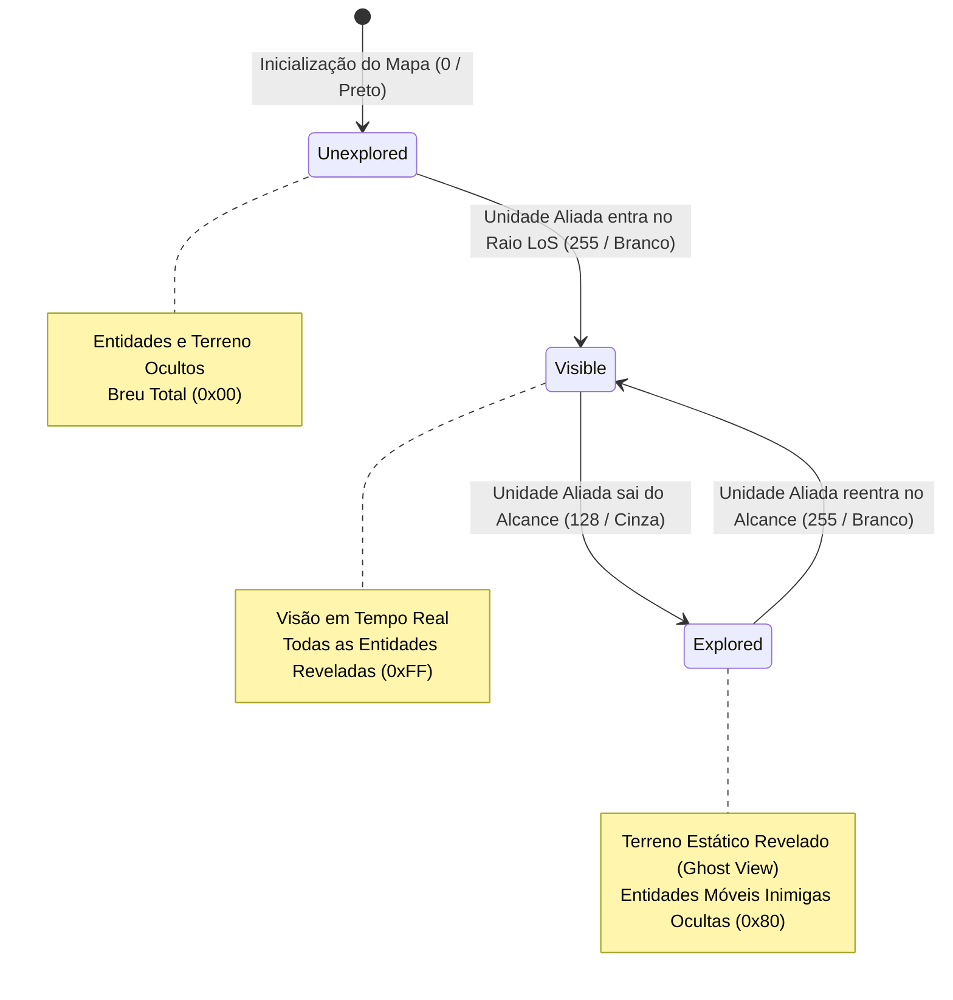
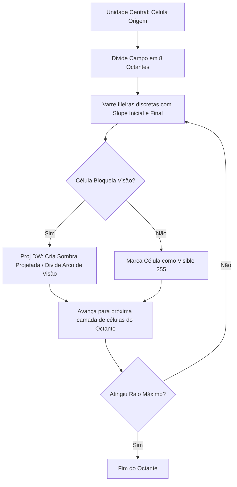
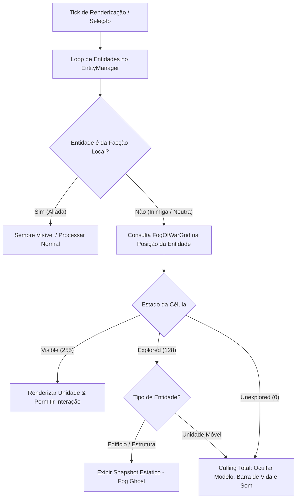
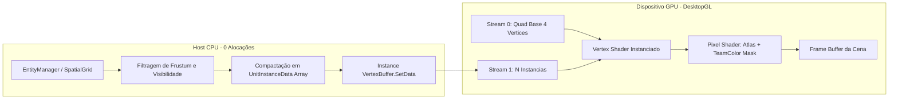
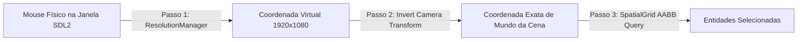
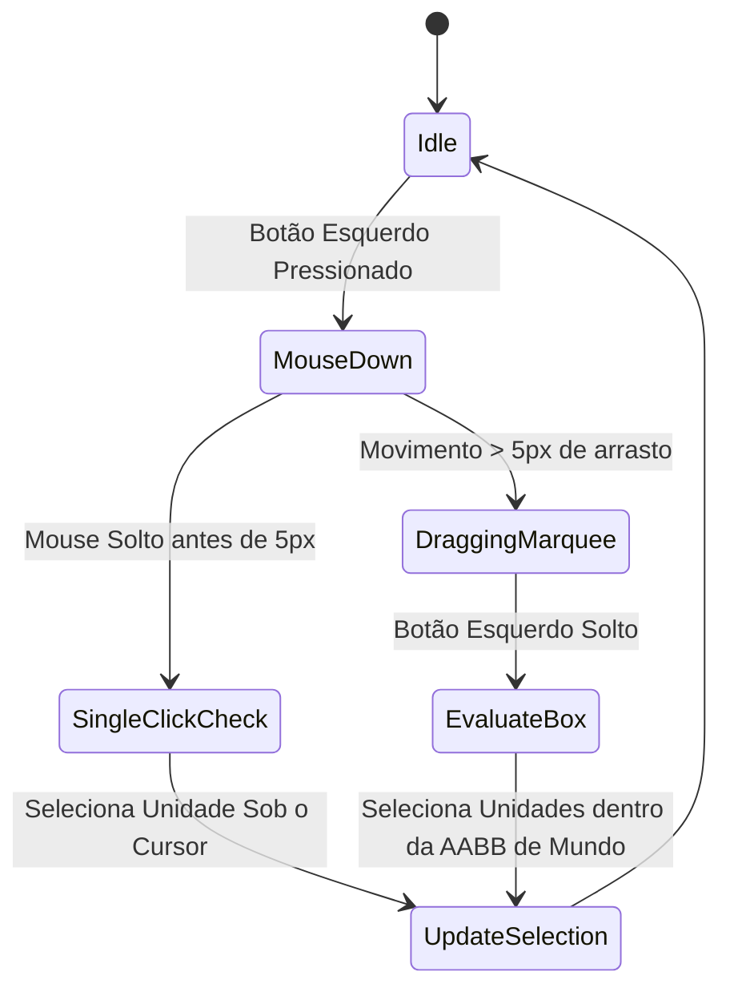
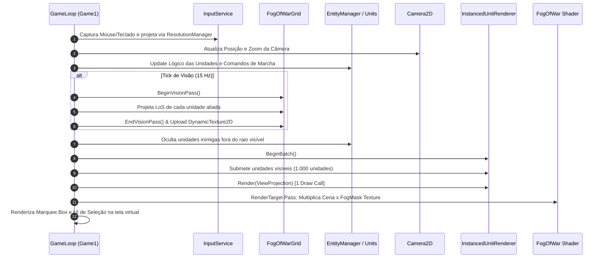

# Arquitetura e Especificação Técnica: Visão, Renderização Instanciada e Seleção de Unidades (Módulo RTS - Fase 1)

> **Documento:** `docs/mapping_rts/02_vision_rendering_and_selection.md`  
> **Módulo:** Real-Time Strategy (RTS) Engine Extension para MonoGameMaker  
> **Status:** Concluído / Especificação de Arquitetura Aprovada  
> **Ambiente Alvo:** .NET 8.0 | MonoGame DesktopGL 3.8.* (OpenGL 3.3 Core / SDL2) | HLSL / MojoShader  
> **Idioma:** Português do Brasil (PT-BR)  

---

## Sumário Executivo

Este documento estabelece o mapeamento técnico minucioso, os contratos de interface C#, as rotinas matemáticas e os shaders HLSL necessários para viabilizar os três pilares centrais de infraestrutura da Fase 1 do **Módulo RTS no MonoGameMaker**:

1. **Névoa de Guerra Dinâmica (Dynamic Fog of War):** Grade discreta de oclusão de visão com três estados (`Unexplored`, `Explored`, `Visible`), algoritmo de projeção de visão circular (Line-of-Sight) com oclusão de terreno, geração de máscara de textura de baixa sobrecarga (`DynamicTexture2D`) e interpolação contínua de bordas em shader HLSL para erradicar o serrilhado de blocos.
2. **Renderização em Lote por GPU Instancing (Instanced Mesh Batching):** Eliminação do gargalo clássico de CPU do `SpriteBatch` ao desenhar entre 500 e 1.000 unidades militares simultâneas em **1 a 3 Draw Calls**, utilizando vertex buffers de instância contendo Transform de Mundo, UV Atlas Offsets e Cor de Facção do Jogador (*Team Color*), com fallback transparente para atlas de sprites em plataformas legadas.
3. **Seleção e Comando Tático de Unidades (Marquee Box Selection & Control):** Sistema de seleção por clique e arrasto (*Marquee Box*), matematicamente integrado com o `ResolutionManager` (compensando Letterbox/Pillarbox e transformações de câmera 2D/3D), com grupos de controle tático (`Ctrl+1..9`), *double-tap camera jump* e máquina de marcha com fila de ordens (`Move`, `Attack-Move`, `Hold`, `Stop`).

### Metas de Performance e Orçamento de Recursos (Budget)

| Métrica | Limite Orçamentário (Budget) | Estratégia de Mitigação |
| :--- | :--- | :--- |
| **Taxa de Quadros (Target Framerate)** | **60 FPS estáveis (16.6ms)** | 1.000 unidades ativas na simulação e na tela |
| **Draw Calls de Unidades** | **≤ 3 Draw Calls** | GPU Hardware Instancing via `DrawInstancedPrimitives` |
| **Alocação de Heap (GC Pressure)** | **0 B / frame (Zero-GC)** | Buffers estáticos, structs `in`, pooling de entidades e comandos |
| **Taxa de Atualização da Visão** | **15 Hz a 20 Hz (desacoplada)** | Visão recalculada em intervalos táticos; interpolação na GPU |
| **Tempo de CPU para Fog Grid** | **< 1.2 ms por tick de visão** | Spatial Partitioning, Bitmasks e Shadowcasting simétrico |
| **Consumo de VRAM da Máscara** | **< 2 MB** | Textura R8/Luminance de 256x256 ou 512x512 para mapas de até 4096m |

---

## 1. Subsistema 1: Névoa de Guerra Dinâmica (Dynamic Fog of War)

### 1.1 Modelo Conceitual e Estados de Célula

A névoa de guerra opera como uma camada lógica de desinformação estratégica. Cada célula da grade espacial do mapa do jogo reside estritamente em um de três estados discretos:



1. **`Unexplored` (Valor 0 / 0x00 - Preto Absoluto):**  
   A coordenada de mundo jamais foi testemunhada por nenhuma entidade ou estrutura da facção do jogador. O terreno, os recursos e os inimigos permanecem 100% ocultos.
2. **`Explored` / Shrouded (Valor 128 / 0x80 - Cinza / Penumbra):**  
   A coordenada já foi explorada anteriormente, mas atualmente não possui nenhuma unidade aliada com linha de visão ativa no local. O terreno estático e as construções reveladas permanecem visíveis (com saturação e brilho atenuados), porém **entidades móveis inimigas ou neutras são estritamente ocultadas**.
3. **`Visible` / Active Line-of-Sight (Valor 255 / 0xFF - Branco / Iluminação Plena):**  
   A coordenada encontra-se ativamente no cone ou raio de visão de pelo menos uma unidade, projétil com visão, radar ou edifício aliado. Todas as unidades no local são transmitidas para a renderização e o radar tático.

### 1.2 Estrutura de Dados e Matriz de Grid em Memória

Para eliminar realocações de memória e maximizar a localidade espacial no cache de nível 1/2 da CPU (L1/L2 Cache), a grade é armazenada como uma matriz plana unidimensional de bytes contíguos (`byte[]`).

#### Especificação Matemática da Grade
- Tamanho do Mapa em Mundo: \(W_{world} \times H_{world}\) unidades (ex: \(2048 \times 2048\) pixels ou metros).
- Tamanho da Célula de Visão: \(CellSize = 16\) pixels.
- Dimensões da Grade: \(GridWidth = \lceil W_{world} / CellSize \rceil\), \(GridHeight = \lceil H_{world} / CellSize \rceil\) (ex: \(128 \times 128\) células).
- Índice Linear: \(\text{index} = y \times GridWidth + x\).

#### Contrato de Estrutura de Dados em C#

```csharp
using System;
using Microsoft.Xna.Framework;
using Microsoft.Xna.Framework.Graphics;

namespace MonoGameMaker.Runtime.RTS.Vision
{
    public enum FogCellState : byte
    {
        Unexplored = 0,
        Explored = 128,
        Visible = 255
    }

    public sealed class FogOfWarGrid : IDisposable
    {
        public int GridWidth { get; }
        public int GridHeight { get; }
        public float CellSize { get; }
        public float WorldWidth => GridWidth * CellSize;
        public float WorldHeight => GridHeight * CellSize;

        // Buffers de estado contíguos na memória (Zero-GC)
        private readonly byte[] _exploredBuffer;      // 0 ou 128 persistente
        private readonly byte[] _visibleBuffer;       // 0 ou 255 do frame de visão ativo
        private readonly byte[] _uploadPixelBuffer;   // Buffer final RGBA ou R8 enviado à GPU

        // Controle de dirty rect para uploads eficientes
        private int _dirtyMinX, _dirtyMinY, _dirtyMaxX, _dirtyMaxY;
        private bool _isDirty;

        public DynamicTexture2D FogTexture { get; private set; }

        public FogOfWarGrid(GraphicsDevice graphicsDevice, int gridWidth, int gridHeight, float cellSize)
        {
            GridWidth = gridWidth;
            GridHeight = gridHeight;
            CellSize = cellSize;

            int totalCells = gridWidth * gridHeight;
            _exploredBuffer = new byte[totalCells];
            _visibleBuffer = new byte[totalCells];
            _uploadPixelBuffer = new byte[totalCells]; // Formato SurfaceFormat.Alpha8 ou Color

            FogTexture = new DynamicTexture2D(graphicsDevice, gridWidth, gridHeight, false, SurfaceFormat.Alpha8);
            ResetFog();
        }

        public void ResetFog()
        {
            Array.Clear(_exploredBuffer, 0, _exploredBuffer.Length);
            Array.Clear(_visibleBuffer, 0, _visibleBuffer.Length);
            Array.Clear(_uploadPixelBuffer, 0, _uploadPixelBuffer.Length);
            MarkFullDirty();
        }

        public FogCellState GetVisibilityAtWorld(Vector2 worldPos)
        {
            int gx = (int)(worldPos.X / CellSize);
            int gy = (int)(worldPos.Y / CellSize);
            if (gx < 0 || gx >= GridWidth || gy < 0 || gy >= GridHeight)
                return FogCellState.Unexplored;

            int idx = gy * GridWidth + gx;
            if (_visibleBuffer[idx] == 255) return FogCellState.Visible;
            if (_exploredBuffer[idx] == 128) return FogCellState.Explored;
            return FogCellState.Unexplored;
        }

        public void BeginVisionPass()
        {
            // Decai o buffer ativo de visão do tick anterior para zero (Zero alocação)
            Array.Clear(_visibleBuffer, 0, _visibleBuffer.Length);
        }

        public void EndVisionPass()
        {
            // Combina os buffers e prepara o uploadTexture
            int total = GridWidth * GridHeight;
            for (int i = 0; i < total; i++)
            {
                byte vis = _visibleBuffer[i];
                if (vis == 255)
                {
                    _exploredBuffer[i] = 128; // Permanece explorado para sempre
                    _uploadPixelBuffer[i] = 255;
                }
                else
                {
                    _uploadPixelBuffer[i] = _exploredBuffer[i]; // Retorna para 128 ou 0
                }
            }

            UploadToGpu();
        }

        private void UploadToGpu()
        {
            // Envia os bytes para a VRAM via SetData da DynamicTexture2D
            FogTexture.SetData(_uploadPixelBuffer);
            _isDirty = false;
        }

        private void MarkFullDirty()
        {
            _dirtyMinX = 0;
            _dirtyMinY = 0;
            _dirtyMaxX = GridWidth;
            _dirtyMaxY = GridHeight;
            _isDirty = true;
        }

        public void Dispose()
        {
            FogTexture?.Dispose();
        }
    }
}
```

### 1.3 Algoritmos de Projeção de Visão Circular (Line-of-Sight)

Para garantir que a CPU não sofra gargalos ao processar a visão de centenas de unidades simultâneas, adotamos uma estratégia híbrida em dois níveis:

#### 1.3.1 Fast Raster Circle Projection (Terreno Aberto / Campo Limpo)
Para unidades em terreno aberto ou sem obstáculos verticais opacos, utiliza-se a projeção circular por teste radial com Bounding Box discreto acelerado:

$$\Delta x^2 + \Delta y^2 \le R^2$$

```csharp
public void RevealCircle(Vector2 worldPos, float radiusWorld)
{
    int centerGx = (int)(worldPos.X / CellSize);
    int centerGy = (int)(worldPos.Y / CellSize);
    int radiusCells = (int)MathF.Ceiling(radiusWorld / CellSize);
    int radiusSquared = radiusCells * radiusCells;

    int minX = Math.Max(0, centerGx - radiusCells);
    int maxX = Math.Min(GridWidth - 1, centerGx + radiusCells);
    int minY = Math.Max(0, centerGy - radiusCells);
    int maxY = Math.Min(GridHeight - 1, centerGy + radiusCells);

    for (int y = minY; y <= maxY; y++)
    {
        int dy = y - centerGy;
        int dy2 = dy * dy;
        int rowOffset = y * GridWidth;

        for (int x = minX; x <= maxX; x++)
        {
            int dx = x - centerGx;
            if (dx * dx + dy2 <= radiusSquared)
            {
                _visibleBuffer[rowOffset + x] = 255;
            }
        }
    }
}
```

#### 1.3.2 2D Symmetric Shadowcasting com Oclusão de Obstáculos
Quando há obstáculos no mapa (rochas, falésias, muralhas ou elevações de terreno), um raio circular simples causaria o erro crítico de enxergar através de paredes. Aplicamos o algoritmo de **Shadowcasting Simétrico em 8 Octantes** (derivado de Roguelikes e adaptado para RTS top-down com grade contígua).



- **Complexidade Teórica:** \(O(K)\), onde \(K\) é o número de células dentro do cone de visão visível (sub-linear em relação à área total do mapa).
- **Vantagem Arquitetural:** Células atrás de obstáculos opacos são ignoradas imediatamente, eliminando cálculos redundantes de trigonometria e raycasts euclidianos pesados.

### 1.4 Renderização da Máscara de Textura e Atualização de GPU

Para não sobrecarregar o barramento PCI-Express:
1. **Taxa de Atualização Desacoplada (Tick Rate de Visão):**  
   O recálculo de visibilidade da névoa roda a **15 Hz ou 20 Hz** (a cada 50ms a 66ms), enquanto o jogo renderiza a 60 FPS contínuos. A transição visual entre estados é interpolada no hardware pela GPU via shader, tornando a desacoplagem imperceptível aos olhos do jogador.
2. **Buffer Dinâmico (`DynamicTexture2D`):**  
   Utiliza `SurfaceFormat.Alpha8` (apenas 1 byte por pixel). Um mapa de \(256 \times 256\) células gera apenas **64 KB de transferência por tick**, consumindo menos de 0.05% da largura de banda do barramento.

### 1.5 Shader HLSL de Suavização e Transição (`FogOfWar.fx`)

Um dos maiores problemas visuais em jogos RTS com névoa quadriculada é o efeito "pixelado/xadrez" nas bordas de visão. Resolvemos isso através de amostragem bilinear na GPU combinada com uma curva de transição Hermite `smoothstep` e pós-processamento de desaturação.

```hlsl
// ==============================================================================
// MonoGameMaker RTS - Dynamic Fog of War Composition Shader
// Interpolação suave de bordas via Hermite Smoothstep e tonalização de penumbra
// ==============================================================================

#if OPENGL
    #define SV_POSITION POSITION
    #define VS_SHADERMODEL vs_3_0
    #define PS_SHADERMODEL ps_3_0
#else
    #define VS_SHADERMODEL vs_4_0_level_9_1
    #define PS_SHADERMODEL ps_4_0_level_9_1
#endif

// Textura do mundo renderizado (albedo da cena do jogo)
Texture2D SceneTexture;
sampler2D SceneSampler = sampler_state
{
    Texture = <SceneTexture>;
    MinFilter = Linear;
    MagFilter = Linear;
    AddressU = Clamp;
    AddressV = Clamp;
};

// Textura da máscara da névoa (gerada dinamicamente pelo FogOfWarGrid)
Texture2D FogMaskTexture;
sampler2D FogMaskSampler = sampler_state
{
    Texture = <FogMaskTexture>;
    MinFilter = Linear; // Filtro bilinear de hardware suaviza as células
    MagFilter = Linear;
    AddressU = Clamp;
    AddressV = Clamp;
};

// Parâmetros de iluminação e controle
float ExploredDarkness = 0.40f;      // Escurecimento na área explorada (40% do brilho)
float ExploredDesaturation = 0.65f;  // Fator de desaturação na área explorada
float4 FogColor = float4(0.02f, 0.03f, 0.06f, 1.0f); // Azul escuro profundo (em vez de preto lavado)

struct VertexShaderInput
{
    float4 Position : POSITION0;
    float4 Color : COLOR0;
    float2 TexCoord : TEXCOORD0;
};

struct VertexShaderOutput
{
    float4 Position : SV_POSITION;
    float4 Color : COLOR0;
    float2 TexCoord : TEXCOORD0;
};

VertexShaderOutput MainVS(VertexShaderInput input)
{
    VertexShaderOutput output;
    output.Position = input.Position;
    output.Color = input.Color;
    output.TexCoord = input.TexCoord;
    return output;
}

float4 MainPS(VertexShaderOutput input) : COLOR0
{
    float4 sceneColor = tex2D(SceneSampler, input.TexCoord);
    float fogValue = tex2D(FogMaskSampler, input.TexCoord).a; // 0.0 (Unexplored), 0.5 (Explored), 1.0 (Visible)

    // Curva Hermite para suavizar as fronteiras entre estados
    // Transição 1: Não explorado (0.0) -> Explorado (0.5)
    float unexploredToExplored = smoothstep(0.05f, 0.45f, fogValue);

    // Transição 2: Explorado (0.5) -> Visível (1.0)
    float exploredToVisible = smoothstep(0.55f, 0.95f, fogValue);

    // 1. Caso Breu Absoluto (Totalmente não explorado)
    if (fogValue <= 0.02f)
    {
        return FogColor;
    }

    // 2. Cálculo da Cor Desaturada para áreas em penumbra (Explored)
    float gray = dot(sceneColor.rgb, float3(0.299f, 0.587f, 0.114f));
    float3 desaturatedColor = lerp(sceneColor.rgb, float3(gray, gray, gray), ExploredDesaturation) * ExploredDarkness;
    float4 shroudedColor = float4(desaturatedColor, sceneColor.a);

    // 3. Mistura entre Breu e Penumbra
    float4 baseColor = lerp(FogColor, shroudedColor, unexploredToExplored);

    // 4. Mistura final entre Penumbra e Luz Plena (Visible)
    float4 finalColor = lerp(baseColor, sceneColor, exploredToVisible);

    return finalColor;
}

technique FogOfWarComposite
{
    pass P0
    {
        VertexShader = compile VS_SHADERMODEL MainVS();
        PixelShader = compile PS_SHADERMODEL MainPS();
    }
}
```

### 1.6 Ocultamento de Entidades no EntityManager & SpatialGrid

A névoa de guerra não se limita ao efeito estético de pós-processamento: ela governa a integridade da simulação de combate. Unidades inimigas ocultadas pela névoa não devem ser renderizadas, não devem receber seleções de clique e não devem emitir sons contextuais para o jogador local.



#### Regras de Visibilidade no Runtime:
1. **Unidades Próprias / Aliadas:**  
   Sempre visíveis no cliente do jogador proprietário.
2. **Unidades Móveis Inimigas:**  
   Consultam `FogOfWarGrid.GetVisibilityAtWorld(entity.Position)`. Se o valor for diferente de `FogCellState.Visible`, a entidade tem sua flag `IsVisible` comutada para `false`. O renderizador instanciado simplesmente ignora a entidade ao montar o vertex buffer de instâncias do frame.
3. **Edifícios e Recursos Inimigos (Fog Ghosts):**  
   Quando um edifício inimigo entra em estado `Explored`, o sistema mantém uma projeção visual congelada no último estado conhecido (*Fog Ghost*). Se o edifício for demolido ou evoluído enquanto estiver oculto, o jogador continuará vendo a construção antiga até que envie uma unidade para atualizar a linha de visão no local.

---

## 2. Subsistema 2: Renderização em Lote por GPU Instancing

### 2.1 O Problema do `SpriteBatch` em Escala RTS

Em jogos com centenas de unidades simultâneas (ex: 500 a 1.000 infantarias e tanques marchando em formação), o padrão clássico `SpriteBatch.Draw()` do MonoGame se torna inviável:
- **Sobrecarga de CPU:** Para cada sprite, a CPU precisa calcular a projeção, montar 4 vértices (`VertexPositionColorTexture`), calcular coordenadas de textura e gravar 6 índices em um buffer temporário.
- **Batches Fragmentados:** Se diferentes unidades utilizam shaders distintos ou se excederem o limite interno do batch buffer (geralmente 2.048 quads), o `SpriteBatch` força múltiplas chamadas `DrawIndexedPrimitives`, sobrecarregando o driver gráfico.

### 2.2 Arquitetura de GPU Hardware Instancing

No **GPU Instancing**, desacoplamos a geometria da instância:
1. **Stream 0 (Geometry Buffer):** Contém exatamente **1 Quad** (4 vértices e 6 índices) estático, carregado uma única vez na VRAM.
2. **Stream 1 (Instance Buffer):** Contém uma lista compacta de estruturas com dados individuais de cada unidade (posição, rotação, escala, retângulo UV no atlas e cor da facção).
3. **Execução:** O driver de vídeo faz a expansão dos vértices diretamente na GPU via `DrawInstancedPrimitives`, desenhando 1.000 unidades em **uma única Draw Call**.



### 2.3 Layout de Memória e Declaração de Vértices (`IVertexType`)

Para garantir compatibilidade absoluta com o MonoGame DesktopGL (OpenGL 3.3 Core via MojoShader), o layout de vértices de instância empacota matrizes e atributos em elementos compatíveis com `VertexDeclaration`.

```csharp
using System.Runtime.InteropServices;
using Microsoft.Xna.Framework;
using Microsoft.Xna.Framework.Graphics;

namespace MonoGameMaker.Runtime.RTS.Rendering
{
    /// <summary>
    /// Vértice estático da geometria base do Quad (Stream 0).
    /// </summary>
    [StructLayout(LayoutKind.Sequential, Pack = 1)]
    public struct UnitQuadVertex : IVertexType
    {
        public Vector3 Position; // Offset local do quad [-0.5, 0.5]
        public Vector2 TexCoord; // Coordenada UV base [0, 1]

        public static readonly VertexDeclaration VertexDeclaration = new VertexDeclaration(
            new VertexElement(0, VertexElementFormat.Vector3, VertexElementUsage.Position, 0),
            new VertexElement(12, VertexElementFormat.Vector2, VertexElementUsage.TextureCoordinate, 0)
        );

        VertexDeclaration IVertexType.VertexDeclaration => VertexDeclaration;

        public UnitQuadVertex(Vector3 position, Vector2 texCoord)
        {
            Position = position;
            TexCoord = texCoord;
        }
    }

    /// <summary>
    /// Estrutura de dados por instância da unidade (Stream 1).
    /// Tamanho total: 16 (Transform) + 16 (UVRect) + 16 (TeamColor) + 4 (Flags) = 52 bytes.
    /// 1.000 unidades ocupam apenas 52 KB na VRAM.
    /// </summary>
    [StructLayout(LayoutKind.Sequential, Pack = 1)]
    public struct UnitInstanceData : IVertexType
    {
        // Linhas da Transform 2D compactada: Posição (X, Y), Rotação (radianos), Escala (Uniforme)
        public Vector4 TransformData; 

        // UV Offset e Dimensões dentro do Texture Atlas: (U_Min, V_Min, U_Width, V_Height)
        public Vector4 AtlasUVRect;

        // Cor da Facção do Jogador (RGBA normalizado em Float)
        public Vector4 TeamColor;

        // Flags e seleção: X = IsSelected (0 ou 1), Y = HealthPercent [0..1], Z/W = Reservados
        public Vector4 VisualFlags;

        public static readonly VertexDeclaration VertexDeclaration = new VertexDeclaration(
            new VertexElement(0, VertexElementFormat.Vector4, VertexElementUsage.TextureCoordinate, 1),
            new VertexElement(16, VertexElementFormat.Vector4, VertexElementUsage.TextureCoordinate, 2),
            new VertexElement(32, VertexElementFormat.Vector4, VertexElementUsage.Color, 1),
            new VertexElement(48, VertexElementFormat.Vector4, VertexElementUsage.TextureCoordinate, 3)
        );

        VertexDeclaration IVertexType.VertexDeclaration => VertexDeclaration;
    }
}
```

### 2.4 Shader HLSL Instanciado (`UnitInstanced.fx`)

O shader processa a matriz de cada instância, calcula a rotação 2D diretamente na GPU, mapeia as coordenadas UV no Texture Atlas da facção e aplica o preenchimento de *Team Color* utilizando o canal alfa da máscara de uniforme.

```hlsl
// ==============================================================================
// MonoGameMaker RTS - Unit GPU Instancing Shader
// Suporta 1000+ unidades com UV Atlas Animation e Player Team Color Replacement
// ==============================================================================

#if OPENGL
    #define SV_POSITION POSITION
    #define VS_SHADERMODEL vs_3_0
    #define PS_SHADERMODEL ps_3_0
#else
    #define VS_SHADERMODEL vs_4_0_level_9_1
    #define PS_SHADERMODEL ps_4_0_level_9_1
#endif

// Matriz View-Projection da Câmera (2D ou 3D)
float4x4 ViewProjection;

// Atlas de Sprites das Unidades
Texture2D UnitAtlasTexture;
sampler2D AtlasSampler = sampler_state
{
    Texture = <UnitAtlasTexture>;
    MinFilter = Linear;
    MagFilter = Linear;
    AddressU = Clamp;
    AddressV = Clamp;
};

// Textura de Máscara de Facção (Canal R define onde pintar a cor do jogador)
Texture2D TeamMaskTexture;
sampler2D TeamMaskSampler = sampler_state
{
    Texture = <TeamMaskTexture>;
    MinFilter = Point;
    MagFilter = Point;
    AddressU = Clamp;
    AddressV = Clamp;
};

// Stream 0: Vértices do Quad
struct VSInputQuad
{
    float3 Position : POSITION0;
    float2 TexCoord : TEXCOORD0;
};

// Stream 1: Dados por Instância
struct VSInputInstance
{
    float4 TransformData : TEXCOORD1; // X, Y = WorldPos, Z = Rotation, W = Scale
    float4 AtlasUVRect   : TEXCOORD2; // X = UMin, Y = VMin, Z = UWidth, W = VHeight
    float4 TeamColor     : COLOR1;     // Cor da facção (R, G, B, A)
    float4 VisualFlags   : TEXCOORD3; // X = IsSelected, Y = HealthRatio
};

struct VSOutput
{
    float4 Position     : SV_POSITION;
    float2 TexCoord     : TEXCOORD0;
    float4 TeamColor    : COLOR0;
    float4 VisualFlags  : TEXCOORD1;
};

VSOutput MainVS(VSInputQuad quad, VSInputInstance inst)
{
    VSOutput output;

    float posX = inst.TransformData.x;
    float posY = inst.TransformData.y;
    float angle = inst.TransformData.z;
    float scale = inst.TransformData.w;

    // Rotação 2D do vértice em torno da origem
    float cosA = cos(angle);
    float sinA = sin(angle);
    float2 localPos = float2(
        quad.Position.x * cosA - quad.Position.y * sinA,
        quad.Position.x * sinA + quad.Position.y * cosA
    ) * scale;

    float3 worldPos = float3(localPos.x + posX, localPos.y + posY, quad.Position.z);
    output.Position = mul(float4(worldPos, 1.0f), ViewProjection);

    // Mapeamento de UV para o sub-quadro do Atlas
    output.TexCoord = inst.AtlasUVRect.xy + (quad.TexCoord * inst.AtlasUVRect.zw);
    output.TeamColor = inst.TeamColor;
    output.VisualFlags = inst.VisualFlags;

    return output;
}

float4 MainPS(VSOutput input) : COLOR0
{
    float4 spriteColor = tex2D(AtlasSampler, input.TexCoord);

    // Alpha test para descarte de pixels transparentes
    if (spriteColor.a < 0.05f)
    {
        discard;
    }

    // Amostra máscara de uniforme
    float teamMask = tex2D(TeamMaskSampler, input.TexCoord).r;

    // Substitui tons pela cor do time do jogador onde a máscara for branca
    float3 finalRgb = lerp(spriteColor.rgb, spriteColor.rgb * input.TeamColor.rgb, teamMask);

    // Se selecionada, aplica um leve realce de brilho nas bordas
    if (input.VisualFlags.x > 0.5f)
    {
        finalRgb += float3(0.12f, 0.18f, 0.25f);
    }

    return float4(finalRgb, spriteColor.a);
}

technique UnitInstancingTechnique
{
    pass P0
    {
        VertexShader = compile VS_SHADERMODEL MainVS();
        PixelShader = compile PS_SHADERMODEL MainPS();
    }
}
```

### 2.5 Gerenciador de Instâncias e Chamada `DrawInstancedPrimitives`

O renderizador do runtime gerencia os dois buffers e executa o disparo em hardware:

```csharp
using System;
using Microsoft.Xna.Framework;
using Microsoft.Xna.Framework.Graphics;

namespace MonoGameMaker.Runtime.RTS.Rendering
{
    public sealed class InstancedUnitRenderer : IDisposable
    {
        private const int MaxInstances = 2048;

        private readonly GraphicsDevice _graphicsDevice;
        private VertexBuffer _quadGeometryBuffer;
        private IndexBuffer _quadIndexBuffer;
        private DynamicVertexBuffer _instanceBuffer;
        private VertexBufferBinding[] _bindings;

        private readonly UnitInstanceData[] _instancesData;
        private int _instanceCount;

        private Effect _instancingEffect;
        private Texture2D _atlasTexture;
        private Texture2D _teamMaskTexture;

        public InstancedUnitRenderer(GraphicsDevice graphicsDevice, Effect instancingEffect, Texture2D atlas, Texture2D teamMask)
        {
            _graphicsDevice = graphicsDevice;
            _instancingEffect = instancingEffect;
            _atlasTexture = atlas;
            _teamMaskTexture = teamMask;

            _instancesData = new UnitInstanceData[MaxInstances];

            InitializeGeometryBuffers();
            InitializeInstanceBuffer();
            InitializeBindings();
        }

        private void InitializeBindings()
        {
            // Vincula os dois VertexBuffers com frequências pré-alocadas (Stream 0 e Stream 1) - Zero-GC
            _bindings = new VertexBufferBinding[2];
            _bindings[0] = new VertexBufferBinding(_quadGeometryBuffer, 0, 0); // Vértices do quad
            _bindings[1] = new VertexBufferBinding(_instanceBuffer, 0, 1);        // 1 elemento por instância
        }

        private void InitializeGeometryBuffers()
        {
            // Cria Quad unitário centralizado na origem [-0.5, 0.5]
            var vertices = new UnitQuadVertex[]
            {
                new UnitQuadVertex(new Vector3(-0.5f, -0.5f, 0f), new Vector2(0f, 0f)),
                new UnitQuadVertex(new Vector3( 0.5f, -0.5f, 0f), new Vector2(1f, 0f)),
                new UnitQuadVertex(new Vector3( 0.5f,  0.5f, 0f), new Vector2(1f, 1f)),
                new UnitQuadVertex(new Vector3(-0.5f,  0.5f, 0f), new Vector2(0f, 1f))
            };

            var indices = new short[] { 0, 1, 2, 0, 2, 3 };

            _quadGeometryBuffer = new VertexBuffer(_graphicsDevice, UnitQuadVertex.VertexDeclaration, 4, BufferUsage.WriteOnly);
            _quadGeometryBuffer.SetData(vertices);

            _quadIndexBuffer = new IndexBuffer(_graphicsDevice, IndexElementSize.SixteenBits, 6, BufferUsage.WriteOnly);
            _quadIndexBuffer.SetData(indices);
        }

        private void InitializeInstanceBuffer()
        {
            _instanceBuffer = new DynamicVertexBuffer(
                _graphicsDevice,
                UnitInstanceData.VertexDeclaration,
                MaxInstances,
                BufferUsage.WriteOnly
            );
        }

        public void BeginBatch()
        {
            _instanceCount = 0;
        }

        public void SubmitUnit(Vector2 worldPos, float rotation, float scale, Vector4 atlasUV, Color teamColor, bool isSelected, float healthRatio)
        {
            if (_instanceCount >= MaxInstances) return;

            ref var inst = ref _instancesData[_instanceCount++];
            inst.TransformData = new Vector4(worldPos.X, worldPos.Y, rotation, scale);
            inst.AtlasUVRect = atlasUV;
            inst.TeamColor = teamColor.ToVector4();
            inst.VisualFlags = new Vector4(isSelected ? 1f : 0f, healthRatio, 0f, 0f);
        }

        public void Render(Matrix viewProjectionMatrix)
        {
            if (_instanceCount == 0) return;

            // Transfere instâncias acumuladas para a VRAM
            _instanceBuffer.SetData(_instancesData, 0, _instanceCount, SetDataOptions.Discard);

            // Reutiliza bindings pré-alocados sem alocação de array no Heap
            _graphicsDevice.SetVertexBuffers(_bindings);
            _graphicsDevice.Indices = _quadIndexBuffer;

            // Configura parâmetros do shader
            _instancingEffect.Parameters["ViewProjection"].SetValue(viewProjectionMatrix);
            _instancingEffect.Parameters["UnitAtlasTexture"].SetValue(_atlasTexture);
            _instancingEffect.Parameters["TeamMaskTexture"].SetValue(_teamMaskTexture);

            foreach (var pass in _instancingEffect.CurrentTechnique.Passes)
            {
                pass.Apply();
                _graphicsDevice.DrawInstancedPrimitives(
                    PrimitiveType.TriangleList,
                    baseVertex: 0,
                    minVertexIndex: 0,
                    numVertices: 4,
                    startIndex: 0,
                    primitiveCount: 2,
                    instanceCount: _instanceCount
                );
            }
        }

        public void Dispose()
        {
            _quadGeometryBuffer?.Dispose();
            _quadIndexBuffer?.Dispose();
            _instanceBuffer?.Dispose();
        }
    }
}
```

### 2.6 Fallback Gracioso para `SpriteBatch` com Texture Atlas

Para ambientes que não suportem `DrawInstancedPrimitives` ou para execução em perfis restritos, a interface `IUnitBatchRenderer` abstrai o backend. O fallback agrupa entidades pela mesma textura de atlas e utiliza `SpriteBatch.Draw` com parâmetros idênticos:

```csharp
public interface IUnitBatchRenderer : IDisposable
{
    void BeginBatch();
    void SubmitUnit(Vector2 worldPos, float rotation, float scale, Vector4 atlasUV, Color teamColor, bool isSelected, float healthRatio);
    void Render(Matrix viewProjectionMatrix);
}
```

---

## 3. Subsistema 3: Seleção e Comando Tático de Unidades

### 3.1 Pipeline de Projeção e Coordenadas (Tela -> Resolução Virtual -> Espaço de Mundo)

Um dos erros mais comuns em módulos RTS desenvolvidos sobre frameworks 2D é a perda de precisão de seleção do mouse devido a barras de Letterbox/Pillarbox ou rotação/zoom de câmera.

O MonoGameMaker resolve isso de forma matematicamente determinística, integrando o `InputService` ao `ResolutionManager` e à `Camera2D`:



#### Fórmulas de Transformação Exata

1. **Remoção de Letterbox/Pillarbox e Escala Virtual (`ResolutionManager.ScreenToVirtual`):**
   $$V_x = \frac{S_x - OffsetX}{Scale}$$
   $$V_y = \frac{S_y - OffsetY}{Scale}$$
   *Onde \(OffsetX\) e \(OffsetY\) representam as barras pretas laterais ou verticais.*

2. **Desprojeção de Câmera 2D para Mundo:**
   Dado a matriz de câmera:
   $$M_{cam} = T(-CamPos) \cdot R(Rot) \cdot S(Zoom) \cdot T(Center)$$
   A conversão de tela virtual para mundo utiliza a matriz inversa:
   $$M_{inv} = M_{cam}^{-1}$$
   $$P_{world} = \text{Vector2.Transform}(P_{virtual}, M_{inv})$$

```csharp
public static Vector2 ScreenToWorldPosition(Point mouseScreenPoint, Matrix cameraTransform)
{
    // 1. Converte tela real para espaço virtual 1920x1080 com compensação de letterbox
    Vector2 virtualPos = ResolutionManager.ScreenToVirtual(mouseScreenPoint.ToVector2(), clampToVirtualBounds: true);

    // 2. Multiplica pela inversa da matriz de visualização da câmera
    Matrix invCamera = Matrix.Invert(cameraTransform);
    return Vector2.Transform(virtualPos, invCamera);
}
```

### 3.2 Seleção por Clique Único e Marquee Box Dragging

O sistema de seleção suporta dois modos operacionais fluidos:
1. **Clique Único (Ponto Único):**  
   Disparado quando a distância de arrasto entre o botão pressionado e o botão solto for inferior a um limiar configurável (\(\le 5\) pixels virtuais). Utiliza teste de raio ou colisão pontual com a máscara da unidade mais próxima.
2. **Marquee Box (Arrasto de Retângulo):**  
   Disparado quando a distância de arrasto ultrapassa 5 pixels. Um retângulo elástico é traçado na tela virtual e convertido em uma AABB no mundo de combate.



#### Regras de Prioridade Tática na Seleção:
- **Prioridade Militar:** Se a caixa de seleção englobar tanto **unidades de combate** (tanques, infantaria) quanto **trabalhadores/colhedores**, o sistema automaticamente seleciona **apenas as unidades de combate**, evitando desviar civis da coleta por acidente.
- **Isolamento de Facção:** O arrasto de caixa só seleciona unidades que pertençam à facção do jogador local (`PlayerFaction`). Unidades inimigas só podem ser selecionadas individualmente via clique direto (para inspeção de pontos de vida).
- **Modificadores de Teclado:**
  - `Shift + Drag/Click`: **Seleção Aditiva** (adiciona novas unidades à seleção já ativa sem desmarcar as anteriores).
  - `Ctrl + Click`: **Seleção por Tipo** (seleciona todas as unidades idênticas do mesmo tipo visíveis no enquadramento atual da câmera).

### 3.3 Aceleração Espacial da Seleção (`SpatialHashGrid.QueryBox`)

Para não percorrer todas as 1.000 entidades ativas em \(O(N)\) durante a seleção por caixa, o sistema consome a infraestrutura unificada do **`SpatialHashGrid`** (especificada detalhadamente em `01_spatial_and_pathfinding.md`), garantindo **Zero-GC** absoluto e consultas em \(O(1)\) por célula coberta pela AABB de seleção:

```csharp
using System;
using Microsoft.Xna.Framework;
using MonoGameMaker.Runtime.RTS.Spatial;

namespace MonoGameMaker.Runtime.RTS.Selection
{
    /// <summary>
    /// Controlador tático de seleção por Marquee Box e clique único.
    /// Integrado com o SpatialHashGrid para filtragem em O(1) de células e Zero-GC.
    /// </summary>
    public sealed class RTSSelectionController
    {
        private readonly SpatialHashGrid _spatialGrid;
        private readonly int[] _selectionIdBuffer; // Buffer pré-alocado reutilizável
        private readonly int _maxSelectable;

        public RTSSelectionController(SpatialHashGrid spatialGrid, int maxSelectable = 512)
        {
            _spatialGrid = spatialGrid;
            _maxSelectable = maxSelectable;
            _selectionIdBuffer = new int[maxSelectable];
        }

        /// <summary>
        /// Executa a seleção em caixa convertendo os limites de mundo diretamente para o SpatialHashGrid.
        /// Zero-GC: grava os IDs selecionados diretamente no Span fornecido sem instanciar listas dinâmicas.
        /// </summary>
        public int QuerySelectionBox(
            Vector2 worldMin, 
            Vector2 worldMax, 
            ReadOnlySpan<Vector2> allPositions, 
            Span<int> selectedEntityIds)
        {
            return _spatialGrid.QueryBox(worldMin, worldMax, allPositions, selectedEntityIds);
        }
    }
}
```

#### Vantagens da Unificação Arquitetural:
1. **Zero Listas Dinâmicas no Heap:** Elimina completamente o uso de coleções no Heap como `Dictionary<long, List<T>>`, erradicando alocações de buckets, realocações internas e coletas de GC Geração 0 durante o arrasto de caixa.
2. **Reutilização da Estrutura Central de Simulação:** O `RTSSelectionController` consulta diretamente os mesmos arrays estáticos contíguos (`cellHead`, `nextEntity`, `entityCell`) alimentados pelo passo de simulação do `RtsSimulationSystem`.
3. **Consistência de Identidade:** Todas as consultas operam por IDs primitivos inteiros (`int entityId`), preservando o alinhamento com a arquitetura Data-Oriented Design (DOD).

### 3.4 Grupos de Controle Tático (Hotkeys Ctrl+1..9)

Os grupos táticos permitem que o jogador organize esquadrões e salte rapidamente para diferentes teatros de operação:

1. **Atribuição (`Ctrl + [1..9]`):**  
   Vincula as unidades atualmente selecionadas ao respectivo slot numérico.
2. **Adição (`Shift + [1..9]`):**  
   Concatena as unidades selecionadas ao grupo existente sem sobrescrevê-lo.
3. **Invocação Simples (`[1..9]`):**  
   Limpa a seleção atual e seleciona instantaneamente as unidades do grupo.
4. **Salto de Câmera (*Double-Tap Jump*):**  
   Se a mesma tecla numérica for pressionada duas vezes em menos de **0.25 segundos**, a câmera desloca seu centro suavemente para o centróide (posição média) das unidades do esquadrão.
5. **Autolimpeza de Ponteiros Nulos (Dead Entity Pruning):**  
   Quando uma unidade é destruída (`entity.IsDestroyed == true`), ela é removida de todos os grupos de controle no tick subsequente, impedindo referências mortas.

```csharp
public sealed class TacticalControlGroups
{
    private readonly List<GameEntity>[] _groups = new List<GameEntity>[10];
    private readonly float[] _lastKeyPressTime = new float[10];
    private const float DoubleTapThreshold = 0.25f;

    public TacticalControlGroups()
    {
        for (int i = 0; i < 10; i++)
            _groups[i] = new List<GameEntity>(64);
    }

    public void AssignGroup(int index, IEnumerable<GameEntity> selectedUnits)
    {
        if (index < 0 || index >= 10) return;
        _groups[index].Clear();
        foreach (var u in selectedUnits)
        {
            if (!u.IsDestroyed) _groups[index].Add(u);
        }
    }

    public void SelectGroup(int index, float currentTime, out bool shouldCenterCamera, out Vector2 groupCenter)
    {
        shouldCenterCamera = false;
        groupCenter = Vector2.Zero;
        if (index < 0 || index >= 10) return;

        // Limpa unidades mortas
        _groups[index].RemoveAll(u => u.IsDestroyed);

        if (_groups[index].Count == 0) return;

        // Verifica Double-Tap
        if (currentTime - _lastKeyPressTime[index] <= DoubleTapThreshold)
        {
            shouldCenterCamera = true;
            Vector2 sum = Vector2.Zero;
            for (int i = 0; i < _groups[index].Count; i++) sum += _groups[index][i].Position;
            groupCenter = sum / _groups[index].Count;
        }

        _lastKeyPressTime[index] = currentTime;
    }
}
```

### 3.5 Fila de Ordens e Comandos de Marcha

As unidades selecionadas respondem a ordens táticas despachadas através do botão direito do mouse ou teclas de atalho:

```csharp
public enum UnitCommandType
{
    Move,          // Desloca-se até o alvo ignorando ameaças no caminho
    AttackMove,    // Marcha até o destino, engajando qualquer inimigo avistado
    HoldPosition,  // Mantém a posição rigidamente; atira nos inimigos em alcance sem mover-se
    Stop,          // Cancela a ordem atual e para imediatamente no local
    AttackTarget   // Foca fogo exclusivamente na entidade designada
}

public readonly struct UnitCommand
{
    public UnitCommandType CommandType { get; }
    public Vector2 TargetPosition { get; }
    public GameEntity? TargetEntity { get; }

    public UnitCommand(UnitCommandType type, Vector2 targetPos, GameEntity? targetEntity = null)
    {
        CommandType = type;
        TargetPosition = targetPos;
        TargetEntity = targetEntity;
    }
}
```

- **Fila de Ordens (`Shift + Click`):** Se a tecla `Shift` estiver pressionada durante o envio de ordens, o novo comando não cancela o atual, mas é empilhado na `Queue<UnitCommand>` da unidade. A unidade executará cada ordem em sequência determinística até esgotar a fila.

---

## 4. Integração Arquitetural no MonoGameMaker

### 4.1 Ciclo de Execução no Frame RTS (Update & Draw Order)

A integração dos três sistemas respeita o ciclo de vida rigoroso do engine:



---

## 5. Sumário dos Contratos e Conclusão da Auditoria

| Componente | Responsabilidade Principal | Mecanismo de Desempenho |
| :--- | :--- | :--- |
| **`FogOfWarGrid`** | Matriz de visibilidade por células (Unexplored, Explored, Visible) | Array contíguo de bytes, desacoplamento a 15-20Hz, upload 64KB |
| **`FogOfWar.fx`** | Suavização de bordas de visão e desaturação da penumbra | Interpolação bilinear, Hermite smoothstep, color grading |
| **`InstancedUnitRenderer`** | Renderização de 500 a 1.000 unidades em pouquíssimas Draw Calls | GPU Hardware Instancing via `DrawInstancedPrimitives` |
| **`UnitInstanced.fx`** | Transformação 2D, animação de atlas UV e Team Color | Vertex Shader Instanciado com máscara de uniforme |
| **`RTSSelectionController`**| Seleção por clique e Marquee Box com prioridade tática | `ResolutionManager` + `SpatialHashGrid` com AABB acelerado |
| **`TacticalControlGroups`**| Agrupamento tático (Ctrl+1..9) e camera centering | Array estático de grupos, detecção de duplo clique em <0.25s |

Com esta especificação técnica, a infraestrutura da **Fase 1** encontra-se completamente mapeada, com algoritmos livres de alocações dinâmicas no loop de desenho, contratos tipados e pronta para implementação direta sem gargalos arquiteturais.
