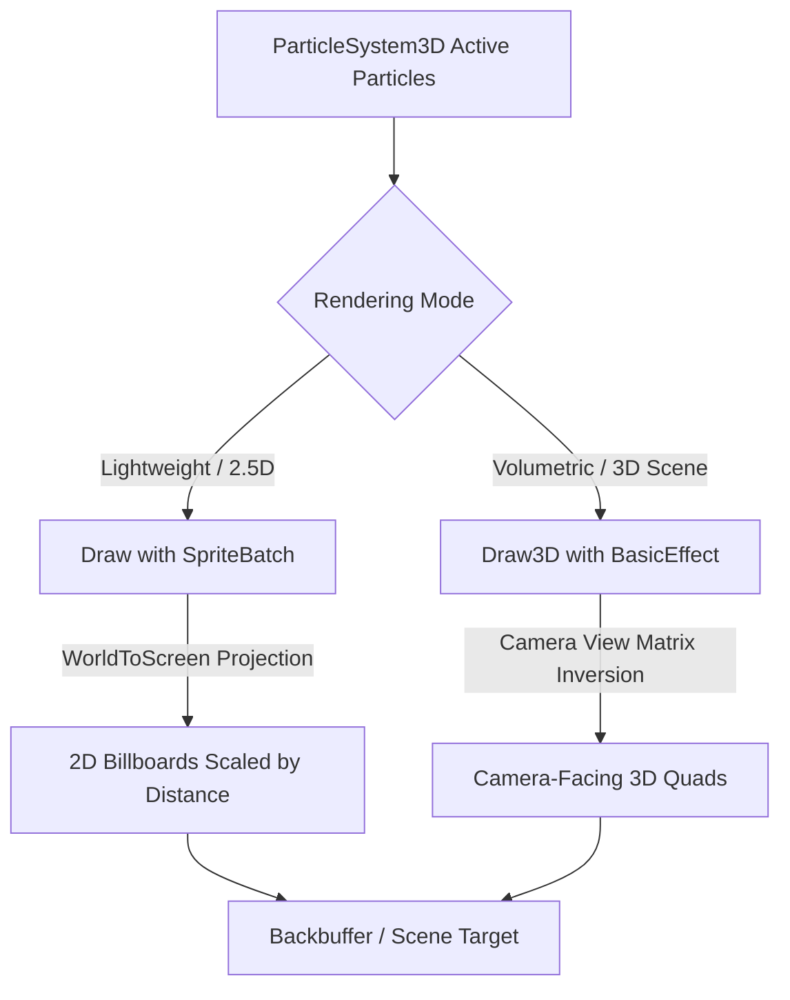

# `ParticleSystem3D` & `Particle3D` (Particles Subsystem)

The `ParticleSystem3D` class provides a high-performance, volumetrically scalable 3D/2.5D particle emitter engine for Mono GameMaker. It features a fixed-size pre-allocated particle pool that achieves **Zero GC Memory Allocation during runtime `Update` and `Draw` loops**, out-of-the-box presets (multi-stage explosions, directional spark showers, expanding shockwaves, and engine thruster plumes), seamless kinematics and rotational velocity, and dual rendering pipelines (2D projected billboards via `SpriteBatch` and GPU-accelerated 3D billboard quads via `DrawUserIndexedPrimitives`).

---

## API Signatures

```csharp
namespace MonoGameMaker.Runtime.Particles
{
    public struct Particle3D
    {
        // Kinematics & Physics
        public Vector3 Position;
        public Vector3 Velocity;
        public Vector3 Acceleration;

        // Visuals & Interpolation
        public Color Color;
        public Color EndColor;
        public float Size;
        public float EndSize;
        public float Rotation;
        public float RotationSpeed;

        // Lifetime
        public float Life;
        public float MaxLife;
        public bool Active;

        // Computed Properties
        public readonly float NormalizedProgress { get; }
        public readonly Color CurrentColor { get; }
        public readonly float CurrentSize { get; }
    }

    public class ParticleSystem3D : IDisposable
    {
        public const int DefaultMaxParticles = 2048;

        // Properties
        public int MaxParticles { get; }
        public int ActiveParticlesCount { get; }
        public Vector3 Gravity { get; set; }
        public float Drag { get; set; }

        // Constructors
        public ParticleSystem3D(int maxParticles = DefaultMaxParticles);

        // Emission Methods & Out-of-the-Box Presets
        public bool Emit(in Particle3D particle);
        public bool EmitCustom(Vector3 position, Vector3 velocity, Vector3 acceleration, Color startColor, Color endColor, float startSize, float endSize, float lifetime, float rotation = 0f, float rotationSpeed = 0f);
        public void EmitExplosion(Vector3 position, int count = 50, Color? startColor = null, Color? endColor = null, float speed = 200f);
        public void EmitSparks(Vector3 position, Vector3 direction, float spreadAngleDegrees = 30f, int count = 25, Color? color = null);
        public void EmitShockwave(Vector3 position, float radius = 50f, Color? color = null, float expansionSpeed = 300f);
        public void EmitThrusterTrail(Vector3 position, Vector3 backwardDir, float speed = 100f, Color? flameColor = null);

        // Kinematic Simulation
        public void Update(GameTime gameTime);

        // Rendering Pipelines
        public void Draw(SpriteBatch spriteBatch, Camera3D camera, Texture2D? particleTexture = null, BlendState? blendState = null);
        public void Draw3D(GraphicsDevice graphicsDevice, Camera3D camera, Texture2D? particleTexture = null, BlendState? blendState = null);

        // Lifecycle
        public void Clear();
        public void Dispose();
    }
}
```

---

## Architectural Highlights

### 1. Zero GC Memory Allocation Guarantee
Particle allocation during intense combat scenes (e.g. dozens of simultaneous explosions or continuous thruster trails) causes garbage collection micro-stutters if objects or vertex arrays are allocated dynamically.
`ParticleSystem3D` uses:
- A fixed struct array `Particle3D[2048]` where inactive slots are recycled in $O(1)$ amortized time.
- Pre-allocated `VertexPositionColorTexture[8192]` and `short[12288]` index buffers initialized once at startup.
- Soft-circle default fallback textures generated and cached directly in GPU memory, avoiding run-time asset loading overhead.

### 2. Dual Rendering Pipelines



1. **`Draw(SpriteBatch, Camera3D, ...)`**: Uses `Camera3D.WorldToScreen()` to project 3D particle coordinates into 2D viewport coordinates. Particles behind the camera lens are automatically clipped. Ideal for 2.5D gameplay layers and UI FX.
2. **`Draw3D(GraphicsDevice, Camera3D, ...)`**: Inverts the camera's `ViewMatrix` to construct exact camera-aligned billboard quads directly in 3D world space. Renders via `DrawUserIndexedPrimitives` with depth reading enabled (`DepthStencilState.DepthRead`) and culling disabled (`RasterizerState.CullNone`).

### 3. Blending Modes: Additive vs. AlphaBlend
- **`BlendState.Additive` (Default)**: Use for glowing energy beams, plasma thrusters, lasers, incendiary explosions, and electrical sparks. Brightness accumulates constructively to produce bloom-ready highlights.
- **`BlendState.AlphaBlend`**: Use for dense dust clouds, atmospheric smoke, and opaque debris chunks.

---

## Practical Example: Combat Vessel Behavior with Dynamic FX

The following complete script demonstrates how to instantiate `ParticleSystem3D`, emit engine thruster plumes on movement, trigger directional spark sprays and multi-stage explosions upon projectile impact, and render particles in the game loop.

```csharp
using System;
using Microsoft.Xna.Framework;
using Microsoft.Xna.Framework.Graphics;
using Microsoft.Xna.Framework.Input;
using MonoGameMaker.Runtime;
using MonoGameMaker.Runtime.Core;
using MonoGameMaker.Runtime.Particles;

namespace MyGame.Scripts
{
    public class SpaceFighterController : EntityBehavior
    {
        private ParticleSystem3D _fxSystem = null!;
        private Camera3D _camera = null!;
        private Vector3 _velocity = Vector3.Zero;
        private float _speed = 350f;

        public override void Awake()
        {
            // Initialize zero-allocation particle system with capacity for 2048 particles
            _fxSystem = new ParticleSystem3D(maxParticles: 2048);
            _fxSystem.Gravity = new Vector3(0f, -20f, 0f); // Slight cosmic gravity drift

            // Setup 3D camera
            _camera = new Camera3D
            {
                Position = new Vector3(0f, 150f, 500f),
                Target = Vector3.Zero,
                FieldOfView = MathHelper.ToRadians(55f)
            };
        }

        public override void Update(GameTime gameTime)
        {
            float dt = (float)gameTime.ElapsedGameTime.TotalSeconds;
            var kb = Keyboard.GetState();

            Vector3 moveDir = Vector3.Zero;
            if (kb.IsKeyDown(Keys.W)) moveDir.Y += 1f;
            if (kb.IsKeyDown(Keys.S)) moveDir.Y -= 1f;
            if (kb.IsKeyDown(Keys.A)) moveDir.X -= 1f;
            if (kb.IsKeyDown(Keys.D)) moveDir.X += 1f;

            if (moveDir.LengthSquared() > 0.001f)
            {
                moveDir.Normalize();
                _velocity = moveDir * _speed;
                Entity.Position += new Vector2(_velocity.X, _velocity.Y) * dt;

                // 1. Emit continuous thruster trail from ship exhaust
                Vector3 enginePosition = new Vector3(Entity.Position.X, Entity.Position.Y - 20f, 0f);
                Vector3 exhaustDirection = -moveDir;
                _fxSystem.EmitThrusterTrail(
                    position: enginePosition,
                    backwardDir: exhaustDirection,
                    speed: 160f,
                    flameColor: new Color(80, 200, 255, 255)
                );
            }

            // 2. Trigger explosion and shockwave on spacebar
            if (kb.IsKeyDown(Keys.Space))
            {
                Vector3 blastPos = new Vector3(Entity.Position.X, Entity.Position.Y, 0f);
                _fxSystem.EmitExplosion(blastPos, count: 60, speed: 250f);
                _fxSystem.EmitShockwave(blastPos, radius: 40f, expansionSpeed: 320f);
            }

            // Update particle physics, lifetimes, and color fades
            _fxSystem.Update(gameTime);
            _camera.Update(gameTime);
        }

        public override void OnCollision(GameEntity other)
        {
            if (other.Tag == "EnemyLaser" || other.Tag == "Asteroid")
            {
                Vector3 hitPoint = new Vector3(Entity.Position.X, Entity.Position.Y, 0f);
                Vector3 impactNormal = Vector3.Normalize(new Vector3(other.Position.X - Entity.Position.X, other.Position.Y - Entity.Position.Y, 0f));

                // 3. Directional spark shower on hull impact
                _fxSystem.EmitSparks(hitPoint, direction: -impactNormal, spreadAngleDegrees: 35f, count: 30);
            }
        }

        public override void Draw(SpriteBatch spriteBatch)
        {
            // Render particles via fast 2D billboard screen projection
            _fxSystem.Draw(spriteBatch, _camera, blendState: BlendState.Additive);
        }

        public override void Dispose()
        {
            _fxSystem.Dispose();
        }
    }
}
```

---

## AI Prompting & Context Guidelines

When directing an AI coding assistant to create or modify visual effects using `ParticleSystem3D`:

*   **Prompt Scenario**: *"When the rocket entity explodes upon hitting a wall, trigger a multi-stage explosion using `_particleSystem.EmitExplosion(hitPos, 60)` followed by a radial shockwave with `_particleSystem.EmitShockwave(hitPos, 40f)`."*
*   **Prompt Scenario**: *"Add glowing thruster exhaust particles behind the player ship by calling `_particleSystem.EmitThrusterTrail(exhaustPos, -shipForward, speed: 120f)` inside the ship's Update loop."*
*   **Prompt Scenario**: *"Render volumetric 3D billboard particles inside a custom 3D mesh rendering pass by calling `_particleSystem.Draw3D(GraphicsDevice, Camera3D)` with `BlendState.Additive`."*
*   **Key Guardrail**: Never allocate new `ParticleSystem3D` instances inside `Update()` or `Draw()`. Always instantiate the pool once during `Awake()` or `Initialize()`, reuse inactive slots via `Emit...()` presets, and call `_particleSystem.Dispose()` in `Dispose()`.
