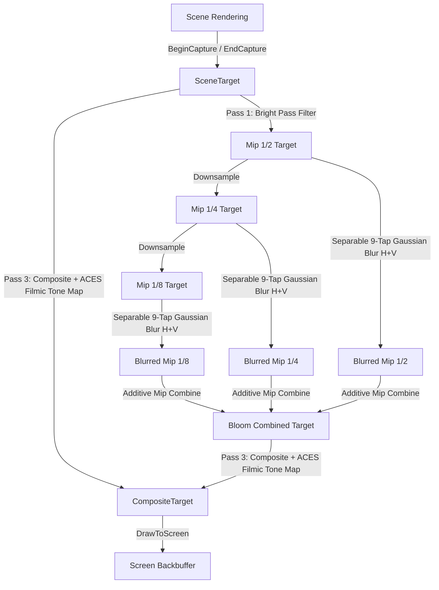

# `PostProcessManager` (Class)

The `PostProcessManager` coordinates fullscreen post-processing effects, offscreen `RenderTarget2D` captures, multi-pass bloom extraction, separable Gaussian blur mip chains (1/2, 1/4, 1/8 downsampling), and ACES Filmic Tone Mapping composite. It includes an automatic zero-crash SpriteBatch software fallback when compiled HLSL effects are unavailable.

---

## API Signatures

```csharp
namespace MonoGameMaker.Runtime.Rendering
{
    public class PostProcessManager : IDisposable
    {
        // Pipeline Controls
        public bool Enabled { get; set; }
        public float BloomThreshold { get; set; }  // Default: 0.75f
        public float BloomIntensity { get; set; }  // Default: 1.2f
        public float BloomRadius { get; set; }     // Default: 1.0f
        public float Exposure { get; set; }        // Default: 1.0f

        // Render Targets
        public RenderTarget2D? SceneTarget { get; }
        public RenderTarget2D? CompositeTarget { get; }
        public int Width { get; }
        public int Height { get; }
        public bool IsInitialized { get; }

        // Lifecycle & Render Loop
        public void Initialize(GraphicsDevice graphicsDevice, int width, int height);
        public void BeginCapture(GraphicsDevice graphicsDevice, Color? clearColor = null);
        public void EndCapture(GraphicsDevice graphicsDevice);
        public void ApplyBloom(SpriteBatch spriteBatch, Effect? bloomEffect = null);
        public void DrawToScreen(SpriteBatch spriteBatch, Rectangle? destinationRectangle = null);

        public void Dispose();
    }
}
```

---

## Multi-Pass Bloom & Tone Mapping Workflow



1. **Capture**: `BeginCapture` redirects drawing calls to an offscreen HDR depth-enabled `SceneTarget`.
2. **Bright Pass Extraction**: Extracts pixels exceeding `BloomThreshold` using a smooth-knee curve to eliminate visual flickering.
3. **Mip Chain & Gaussian Blur**: Progressively downsamples bright pixels into 1/2, 1/4, and 1/8 textures, executing two-pass (horizontal and vertical) separable 9-tap Gaussian convolutions.
4. **ACES Filmic Tone Mapping**: Combines the original scene buffer with the accumulated bloom glow using the industry-standard ACES curve:
   $$\text{ACESFilm}(x) = \text{saturate}\left(\frac{x \cdot (2.51 \cdot x + 0.03)}{x \cdot (2.43 \cdot x + 0.59) + 0.14}\right)$$

---

## Practical C# Game Loop Example

Below is a complete, compilable game loop implementation showing how to integrate `PostProcessManager` into MonoGame's `Game1.cs`:

```csharp
using System;
using Microsoft.Xna.Framework;
using Microsoft.Xna.Framework.Graphics;
using MonoGameMaker.Runtime.Rendering;

namespace MyGame
{
    public class Game1 : Game
    {
        private GraphicsDeviceManager _graphics;
        private SpriteBatch _spriteBatch = null!;
        private PostProcessManager _postProcessManager = null!;
        private Effect? _bloomEffect;
        private Texture2D _sampleGlowTexture = null!;

        public Game1()
        {
            _graphics = new GraphicsDeviceManager(this);
            Content.RootDirectory = "Content";
            IsMouseVisible = true;
        }

        protected override void Initialize()
        {
            _graphics.PreferredBackBufferWidth = 1280;
            _graphics.PreferredBackBufferHeight = 720;
            _graphics.ApplyChanges();

            _postProcessManager = new PostProcessManager();
            _postProcessManager.Initialize(GraphicsDevice, 1280, 720);
            _postProcessManager.BloomThreshold = 0.75f;
            _postProcessManager.BloomIntensity = 1.3f;
            _postProcessManager.Exposure = 1.1f;

            base.Initialize();
        }

        protected override void LoadContent()
        {
            _spriteBatch = new SpriteBatch(GraphicsDevice);
            
            // Try loading compiled shader (or pass null to use software fallback)
            try
            {
                _bloomEffect = Content.Load<Effect>("Shaders/BloomEffect");
            }
            catch
            {
                _bloomEffect = null; // Automatically activates graceful SpriteBatch fallback
            }

            // 1x1 white texture for demonstration
            _sampleGlowTexture = new Texture2D(GraphicsDevice, 1, 1);
            _sampleGlowTexture.SetData(new[] { Color.White });
        }

        protected override void Draw(GameTime gameTime)
        {
            // 1. Begin offscreen scene capture
            _postProcessManager.BeginCapture(GraphicsDevice, Color.CornflowerBlue);

            // 2. Draw scene geometry / sprites inside capture buffer
            _spriteBatch.Begin();
            
            // Draw regular sprite
            _spriteBatch.Draw(_sampleGlowTexture, new Rectangle(100, 100, 150, 150), Color.DarkSlateGray);
            
            // Draw high-intensity glowing neon element (exceeds bloom threshold)
            _spriteBatch.Draw(_sampleGlowTexture, new Rectangle(300, 200, 100, 100), Color.Cyan * 2.0f);
            _spriteBatch.Draw(_sampleGlowTexture, new Rectangle(500, 200, 100, 100), Color.OrangeRed * 2.5f);
            
            _spriteBatch.End();

            // 3. End scene capture
            _postProcessManager.EndCapture(GraphicsDevice);

            // 4. Apply multi-pass Bloom and ACES Tone Mapping
            _postProcessManager.ApplyBloom(_spriteBatch, _bloomEffect);

            // 5. Draw final composite image to screen backbuffer
            GraphicsDevice.Clear(Color.Black);
            _postProcessManager.DrawToScreen(_spriteBatch);

            base.Draw(gameTime);
        }

        protected override void UnloadContent()
        {
            _postProcessManager.Dispose();
            _sampleGlowTexture.Dispose();
            base.UnloadContent();
        }
    }
}
```

---

## AI Prompting & Context Guidelines

*   **When to Use**: Always wrap game viewport rendering within `BeginCapture` and `EndCapture`, followed by `ApplyBloom` and `DrawToScreen` when high-end visual fidelity, neon glow, explosions, laser effects, or filmic tone mapping is required.
*   **Dynamic Customization**: Adjust `BloomIntensity`, `BloomThreshold`, and `Exposure` at runtime for cinematic screen effects (e.g. flashing screen during lightning or nuclear flash).
